# After Writer
## 01. 자체 모델, 어디서부터 만들까

**After 자체 모델 학습 설계서 · 2026-10-26 · 연구 설계 v1.0**

목표는 거대한 범용 AI를 새로 만드는 것이 아니다. 사용자의 짧고 투박한 말을, 사실을 덧붙이지 않으면서 따뜻하고 읽고 싶은 프로필로 바꾸는 작은 전문 모델부터 만든다. 상담·기억·추천·일정은 같은 앱 안에 있지만 서로 다른 시스템이다.

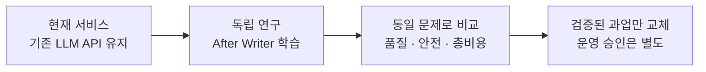

### 이번 설계에서 정한 것

| 결정 | 선택 | 이유 |
| --- | --- | --- |
| 첫 과업 | 프로필 문장 교정 Writer | 입력과 정답 범위가 작고, 사실 보존을 검수하기 좋다 |
| 첫 기반 모델 | Qwen3-4B-Instruct-2507 | 텍스트·비추론형 기준선. 최신·최고라는 뜻은 아니다 |
| 첫 학습 환경 | 보유 Mac + MLX-LM LoRA | 확인된 M5 Pro / 48GB를 먼저 활용한다 |
| 확장 환경 | Linux CUDA + Transformers / PEFT / TRL | 실험 규모·서빙 요구가 생겼을 때 이식한다 |
| 개인화 | 사용자별 DB 기억 + 요청 시 문맥 | 회원의 사생활을 가중치에 외우게 하지 않는다 |
| 운영 전환 | 과업별 검증 + 승인 + 즉시 원복 | 연구 성과가 곧 운영 활성화는 아니다 |

**읽는 순서:** 01-08 전체 구조·기술 선택 → 09-16 데이터·학습·평가 → 17-20 운영·경제성 → 21-24 공부·실행 순서·레퍼런스.

문서의 표본 수, 일정, 학습 설정, 품질 목표는 **After의 초기 실험 제안값**이다. 실제 학습·비용 측정·운영 활성화는 수행하지 않았다. 외부 기술 사실은 마지막 참고문헌과 연결하며, 법률 적합성은 별도 검토한다.

## 02. 지금 있는 것과 새로 만들 것

코드·문서 확인 기준: 개인 대화 세션과 평가 기반은 존재한다. 그러나 자체 모델, 학습 데이터셋, 학습 파이프라인은 아직 없다. 개발 fixture 6개를 학습 데이터 수천 건이나 품질 검증 완료로 계산하면 안 된다.

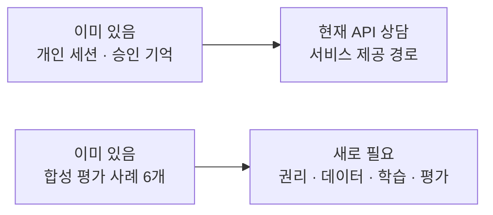

| 영역 | 현재 | 이 설계 이후 |
| --- | --- | --- |
| 대화 저장 | 계정별 활성 세션, 원문 최대 30일 | 연구 데이터와 자동 연결하지 않는다 |
| 승인 기억 | 최대 10개, 90일 보관 기준 | 사실·희망·기간·출처를 더 명시적으로 구분 |
| 모델 문맥 | 최근 완료 상담 6개 + 승인 기억 | 목적에 맞는 최소 근거, 최신 상태 재확인 |
| 평가 도구 | Node 테스트 13개, 수동 합성 예시 | 실제 모델 결과·독립 holdout·블라인드 리뷰 |
| 학습/서빙 | 자체 모델 실행 없음 | 격리 학습 환경과 승인된 모델 레지스트리 |

### 기존 저장소 연결점

`research/concierge-model/`는 평가, `_shared/ai-models.ts`는 현재 API 모델 설정, `20261026090000_assistant_private_session.sql`은 개인 세션과 삭제 경계다. 두 트랙의 연결은 `docs/concierge-two-track-implementation.md`에 있다.

기존 `modelQualityProven: false`, `promotionAllowed: false`는 유지한다. 학습을 하려면 평가 JSON을 그대로 전용하지 않고 **학습 용도 권리가 있는 별도 데이터 버전**을 만들어야 한다.

## 03. 우리가 소유할 것은 ‘모델 하나’보다 엔진


### 모델과 서비스의 책임을 분리한다

| 모델이 하는 일 | 코드가 책임지는 일 |
| --- | --- |
| 요청 해석, 문장 구성, 질문 제안 | 로그인, 소유권, 상대 정보 접근 권한 |
| 허용 근거를 이용한 설명 초안 | 근거의 최신성, 공개/비공개 구분 |
| 정보가 부족하면 추가 질문 | 기억 저장·프로필 변경의 명시적 승인 |
| 요청 범위 밖이면 한계 안내 | 결제·환불·호감·일정 실행, 중복 방지 |
| 표현과 말투 개선 | 비용 상한, 호출 제한, 장애 복구 |

모델이 “저장했어요”라고 생성해도 DB 저장은 일어나지 않는다. 실제 실행 영수증이 있을 때만 UI가 완료 상태를 표시한다. 모델이 상대를 골랐다고 주장해도, 실제 추천 후보와 정책을 통과한 사람만 소개한다.

**우리 자산:** After 정책·데이터 작성법·평가 세트·교정 기준·어댑터·운영 경험. 기반 모델의 권리는 해당 라이선스에 남는다. 오픈 가중치를 사용한다고 전체 기반 모델을 독점 소유하는 것은 아니다.

## 04. ‘기억’과 ‘학습’은 완전히 다르다

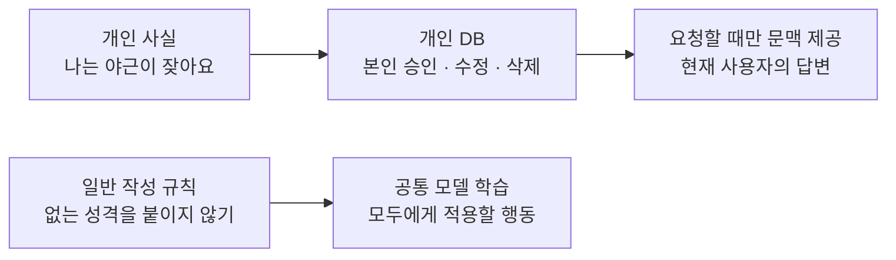

| 넣을 곳 | 예시 | 바뀌었을 때 |
| --- | --- | --- |
| 코드/설정 | 티켓 정책, 결제 가능 여부, 소개 자격 | 즉시 정책 버전 변경 |
| 개인 저장소 | 가능한 요일, 승인한 취향, 현재 상담 | 삭제·수정 즉시 다음 요청에서 제외 |
| 검색용 지식 | 운영 가이드, 허용된 대화 조언 자료 | 문서 수정 후 검색 색인 갱신 |
| 학습 가중치 | 간결한 존댓말, 부정 보존, 질문하는 습관 | 새 학습·평가·배포 필요 |

회원별 LoRA를 하나씩 만들지 않는다. 운영 복잡성과 삭제 문제가 커지고, 데이터가 적은 개인에게 과적합되기 쉽다. 공통 Writer 하나에 **그 요청에서 허용된 개인 정보만** 주는 편이 먼저다.

RAG는 필요한 자료를 검색해 문맥으로 주는 방식이다. 모든 기억에 벡터 DB가 필요한 것은 아니다. 현재처럼 작은 승인 기억 집합은 소유자 필터를 건 SQL 조회로 충분할 수 있다. 검색 품질 문제가 실제로 생길 때 임베딩·pgvector 도입을 검토한다.

## 05. 모델 업무를 작게 나누는 순서

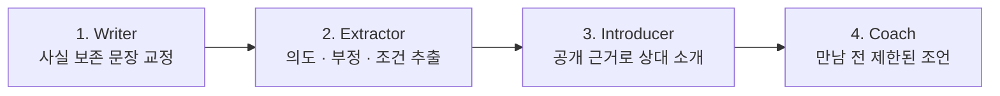

| 과업 | 입력과 출력 | 핵심 실패 | 첫 단계 포함? |
| --- | --- | --- | --- |
| Writer | 원문+요청 → 교정 초안 | 없는 성격·경험을 추가 | 포함 |
| Extractor | 요청 → intent/slots/negation | ‘바꾸지 마’를 변경으로 처리 | 다음 |
| Introducer | 허용된 공개 근거 → 소개 설명 | 상대 비공개 고민 유출 | 다음 |
| Coach | 관계 단계+공개 단서 → 조언 | 성격 단정·조작적 대화 유도 | 더 뒤 |
| Ranker | 적격 후보+관측 결과 → 추천 순위 | 노출 편향·인기 쏠림 | 별도 모델 연구 |
| Executor | 승인된 명령 → 실제 업무 | 무단 결제·중복 일정 | LLM 학습 대상 아님 |

Coach는 의학적 심리 진단이나 상대의 속마음 판독기가 아니다. “답장이 늦으니 관심이 없다”, “이 MBTI는 반드시 이렇다”를 정답으로 학습시키지 않는다. 실제 표현과 사용자가 확인한 취향을 토대로 **가능성·확인할 질문·선택지**를 제안한다.

## 06. 어떤 학습 방법을 쓸까

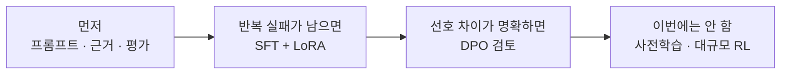

| 방법 | 비유 | After에서의 판단 |
| --- | --- | --- |
| 프롬프트 | 매번 주는 작업 지시서 | 가장 먼저 개선. 정책을 학습으로 숨기지 않는다 |
| RAG | 필요할 때 펼치는 참고 자료 | 최신 정책·검증된 조언에 적합 |
| SFT | 좋은 답안을 보고 따라 쓰기 | 첫 학습 방법. 입력과 모범 출력을 쌍으로 제공 |
| LoRA | 원래 모델은 두고 작은 보정층 학습 | 첫 적응 방식. SFT와 경쟁하는 방법이 아니라 조합 |
| QLoRA | 원래 모델을 압축해 놓고 보정층 학습 | 메모리 절약 후보. 양자화 후 품질 재검사 필요 |
| DPO | 같은 문제의 좋은 답/나쁜 답 비교 | SFT가 안정된 뒤. 단순 좋아요 로그로 대체 금지 |
| 사전학습 | 언어 능력부터 새로 배우기 | 지금은 하지 않는다 |

LoRA의 개념은 `새 가중치 = 고정된 기존 가중치 + 작은 학습 보정`이다. QLoRA 논문의 NF4·paged optimizer 구성과 MLX의 양자화 LoRA 구현을 동일한 스택이라고 부르지 않는다. **방법의 취지는 비슷해도 수치 형식·런타임·산출물은 다를 수 있다.** [R05][R06][R07][R08]

## 07. 기반 모델 비교와 선택

**학습용 시작점은 Qwen3-4B-Instruct-2507로 선택한다. 운영 모델 선택은 평가 이후다.** 오래된 모델을 무조건 고집하는 것이 아니라, 첫 재현 실험의 변수를 줄이기 위한 기준점이다.

| 후보 | 확인한 특성 | 장점 | 선택/보류 |
| --- | --- | --- | --- |
| Qwen3-4B-Instruct-2507 | Apache-2.0, 텍스트, non-thinking | 짧은 Writer 실험의 범위가 단순 | 첫 기준선 [R01] |
| Qwen3.5-4B | Apache-2.0, 이미지+텍스트 모델 | 후속 사진 코칭까지 확장 후보 | 첫 Writer가 끝난 뒤 비교 [R02] |
| Gemma 3 4B IT | Gemma 라이선스, 이미지+텍스트 | 다른 계열의 비교 후보 | 약관·한국어 품질 별도 확인 [R03] |
| EXAONE 4.0 1.2B | 해당 배포본은 별도 상용 계약 제한 | 작은 한국어 후보로 검토 가능 | 상업 프로젝트 기본값 제외 [R04] |
| 현재 서비스 API | 코드의 Sonnet 설정 | 현 서비스와 동일 조건 비교 | 운영 유지, 학습 교사로 자동 사용 금지 |

### 이름이 아니라 고정된 산출물을 선택한다

`base_repo + commit_revision + tokenizer_revision + chat_template_hash + license_digest`를 기록한다. 이후 어댑터·양자화·학습 설정·데이터 버전까지 결합해 하나의 실험 ID로 묶는다.

모델 카드의 다국어 점수는 한국 직장인의 소개글 품질 증거가 아니다. 먼저 동일한 합성 100건에서 자연스러움·사실 보존·지연을 비교하고, 작은 모델이 계속 실패하면 크기를 올리기 전에 데이터와 문제 정의를 확인한다. 위 목록은 최신 모델 전체 순위가 아니다.

## 08. 기술 스택: 지금은 한 경로만

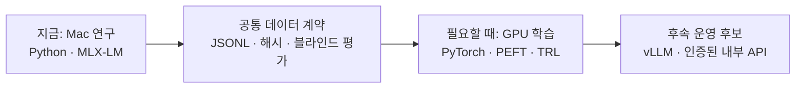

| 도구 | 역할 | After 결정 |
| --- | --- | --- |
| MLX-LM | Apple Silicon 추론·LoRA 학습 | 첫 실험 채택. Mac에 맞춘 경로 [R05] |
| Transformers + PEFT + TRL | 모델 로딩·어댑터·SFT/DPO | Linux/GPU 확장 표준 경로 [R06][R09][R10] |
| Unsloth | 학습 워크플로·최적화 도구 | 호환 모델에서 속도·메모리 실측 후 선택 [R11] |
| Axolotl | 설정 중심 학습 워크플로 | 반복 실험이 많아질 때. 처음엔 추가 추상화 생략 [R12] |
| Ollama | 로컬 추론·모델 가져오기 | 비교용 선택 도구. 학습 엔진으로 취급하지 않음 [R13] |
| vLLM | 모델 API 서빙 | Linux/GPU 서비스가 필요할 때 검토 [R14] |
| JSON manifest + 로컬 파일 | 버전·실험 결과 | 처음부터 사용. 원문 대신 ID·지표만 로그 |
| MLflow | 실험 추적·산출물 관리 | 실험 수가 늘면 로컬부터 도입 [R15] |

첫 설치 환경은 앱의 Node 의존성과 분리한 Python 가상환경이다. 지원되는 Python·MLX 버전을 작은 실행으로 확인한 후 lock 파일로 고정한다. 지금 문서 작성 중에는 모델 다운로드·패키지 설치·학습을 하지 않았다.

## 09. 어떤 데이터로 가르칠까

학습의 정답은 “예쁜 문장”만이 아니다. **사실·희망·부정·기간을 보존하면서 요청 범위만 바꾸는 답**이 정답이다. 초기 수량은 확보된 데이터가 아닌 작성 목표다.

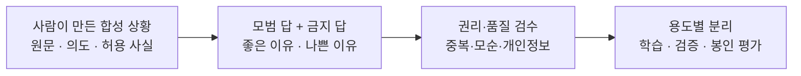

| 작성군 | 1차 1,000건 목표 | 반드시 들어갈 변형 |
| --- | --- | --- |
| 자연스러운 문장 교정 | 250 | 짧은 답, 오타, 구어체, 담백/다정한 말투 |
| 부정·희망·빈도·기간 | 250 | 안 함/못 함, 해 보고 싶음, 가끔, 이번 달만 |
| 근거 부족·추가 질문 | 150 | ‘음’, ‘그냥’, 상충된 답, 정보 추가 요청 |
| 수정 범위 보존 | 150 | 한 줄만 변경, 사진 유지, 특정 문장 삭제 |
| 공개 범위·삭제·권한 | 100 | 비공개 고민, 다른 사람 정보, 저장하지 않기 |
| 압박·과장·위험 요청 | 100 | 경력 부풀리기, 호감 조작, 외모 서열, 무단 실행 |

이 1,000건은 **후보 풀**이며 전부 학습시키지 않는다. 시나리오군을 먼저 나눠 train 700 / validation 150 / blind holdout 150으로 배분하고, 별도 challenge 150건을 추가 작성한다. 같은 원형의 표현 변형은 반드시 같은 split에 둔다. 수량은 학습 곡선과 검수 자원에 따라 조정한다.

## 10. 좋은 학습 예시 한 건의 모습

### 합성 예시: ‘다정하지만 꾸며내지 않기’

| 항목 | 내용 |
| --- | --- |
| 입력 | “퇴근하면 헬스 가끔 감. 술 잘 못 마심. 주말엔 빵집 가는 거 좋아함.” |
| 요청 | “소개글 답변으로 부드럽게 정리해줘.” |
| 사실 | 가끔 운동함 / 술을 잘 못 마심 / 주말 빵집 방문을 좋아함 |
| 좋은 답 | “퇴근 후에는 가끔 운동을 해요. 술은 잘 못 마시는 편이고, 주말에는 좋아하는 빵집에 들르는 걸 즐겨요.” |
| 나쁜 답 | “매일 운동하며 자기관리를 철저히 해요. 다정하고 책임감이 강해서 연인과 카페 데이트를 자주 즐겨요.” |
| 나쁜 이유 | 빈도 변경, 성격·관계 경험 창작, 빵집 취향을 연애 경험으로 변환 |


“클라이밍을 시작해 보고 싶어요”는 “클라이밍을 즐겨요”가 아니다. “이번 달은 주말이 어려워요”는 “주말 약속을 싫어해요”가 아니다. “사진은 그대로 두고 소개글만”은 사진 교체 요청이 아니다.

답이 ‘음’뿐이라면 길게 부풀리지 않는다. “최근 쉬는 날에 즐거웠던 일 하나만 알려주실래요?”처럼 한 가지를 묻는 것이 더 좋은 정답이다. 감동은 허구의 디테일보다 **내 말을 정확히 이해했다는 느낌**에서 나온다.

## 11. 학습 데이터 계약

아래는 새 연구 데이터 레지스트리의 설계 예시다. 현재 평가 fixture의 스키마를 바꾼 것이 아니며 아직 구현되지 않았다. 입력·출력과 권리·검수 메타데이터는 분리한다.

```json
{
  "example_id": "writer-synthetic-0001",
  "scenario_group": "after-work-bakery-01",
  "task": "profile_rewrite",
  "source_kind": "human_authored_synthetic",
  "allowed_uses": ["sft_training"],
  "rights_record": "rights-review-0001",
  "input": {
    "request": "답변을 부드럽게 정리해줘",
    "evidence": [
      {"id": "e1", "kind": "fact", "text": "가끔 운동함"},
      {"id": "e2", "kind": "intention", "text": "클라이밍을 배워 보고 싶음"}
    ]
  },
  "target": {
    "text": "가끔 운동을 하고, 클라이밍도 배워 보고 싶어요.",
    "evidenceIds": ["e1", "e2"],
    "disposition": "draft",
    "executed": false
  },
  "review": {"status": "approved", "rubric_version": "writer-v1"},
  "lineage": {"parent_ids": [], "dataset_version": "writer-0.1"}
}
```

추가 관리 필드: 작성자·검토자 가명 ID, 용도별 동의/권리 증빙, 보유 기한, 삭제 표식, 원형 그룹, split, 원문 저장소 참조, 데이터/학습 산출물 해시. 이 메타데이터는 모델 prompt에 넣지 않는다.

**학습용 직렬화:** `messages`의 system/user/assistant 형식으로 변환하되, assistant 답안만 loss 대상이 되는지 확인한다. 근거 ID는 의미 검수를 대신하지 않는다. `executed:false`도 실제 실행 권한 차단을 대신하지 않는다.

## 12. 데이터 제작 공장과 누출 차단

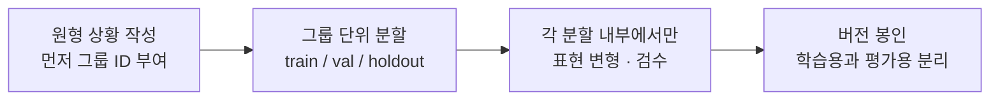

1. 실패 유형 30개를 먼저 정의한다. 예: 빈도 과장, 희망을 사실로 바꿈, 삭제한 정보 재등장.
2. 원형 상황을 사람이 작성하고 성별·직업·문체·길이가 한쪽에 몰리지 않게 한다.
3. 원형 ID, 실제 자료라면 개인/커플/대화군까지 묶어 split을 정한다.
4. split 안에서만 오타·줄임말·말투 변형을 만든다. 같은 내용을 두 split에 복제하지 않는다.
5. exact hash와 유사도 후보 검사를 거치고, 사람이 의역 중복을 확인한다.
6. 사실·부정·기간·공개 범위·과장 여부를 검수한다. 1차 전수 검수, 최소 20% 이중 검수를 제안한다.
7. holdout은 모델/프롬프트 선택에 쓰지 않는다. 반복 열람했다면 개발 세트로 이동하고 새 holdout을 만든다.

실제 대화를 이름만 지워 학습시키지 않는다. 직장·지역·생활 패턴 조합도 개인을 드러낼 수 있다. 초기에는 실제 회원 자료를 쓰지 않는다. 외부 커뮤니티·상담 게시글·AI-Hub 자료도 다운로드 가능하다는 이유로 학습 권리가 있다고 가정하지 않는다.

API 모델 응답은 비교용 결과와 학습용 교사 데이터를 구분한다. 공급자 계약이 허용하는지 확인 전에는 GPT/Claude 출력을 대체 모델 학습에 넣지 않는다. 모델이 써 준 예시도 사실·권리·다양성 검수를 생략할 이유가 되지 않는다.

## 13. 처음 학습할 때의 실험 순서

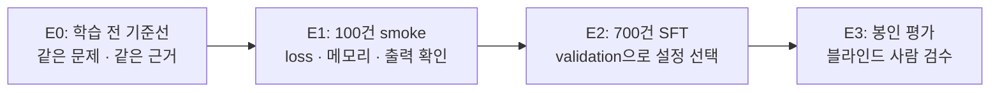

### 실행 전 고정할 설정

| 항목 | 첫 제안값 | 확인할 것 |
| --- | --- | --- |
| 모델 | Qwen3-4B-Instruct-2507 | 정확한 commit·tokenizer·template 고정 |
| sequence length | 2,048 tokens | 잘려서 정답/부정이 사라지는 예시가 없는가 |
| micro batch / accumulation | 1 / 8 | 유효 batch 8. 마지막 batch와 분산 조건 기록 |
| LoRA rank | 8, 16 두 후보 | target layer와 scaling도 함께 기록 |
| learning rate | 1e-5, 5e-5 두 후보 | 최대 4조합. 처음부터 거대한 탐색 금지 |
| epoch | 최대 3, validation으로 checkpoint 선택 | loss뿐 아니라 사실 보존이 퇴행하면 중단 |
| loss mask | assistant 답안만 | MLX `--mask-prompt` 동작을 샘플로 확인 [R05] |
| 첫 정밀도 | BF16/FP16 LoRA부터 적합성 확인 | 부족하면 4-bit adapter 학습으로 전환 |

설정은 실행이 검증된 명령이 아니라 초기 실험 범위다. 설치한 버전의 지원 dtype·옵션·target layer를 먼저 확인한다. MLX 명령의 iteration 수는 데이터 크기·batch·누적 방식에 맞춰 계산하며 epoch 숫자를 그대로 복사하지 않는다.

모델과 tokenizer의 chat template을 사용한다. packing·EOS·padding·loss mask 오류는 ‘학습이 잘 된 것처럼 보이는’ 실패를 만들 수 있다. 첫 단계에서는 복잡한 packing을 끄고 한 예시의 토큰과 loss mask를 직접 확인한다.

## 14. 학습의 내부를 이해하는 그림

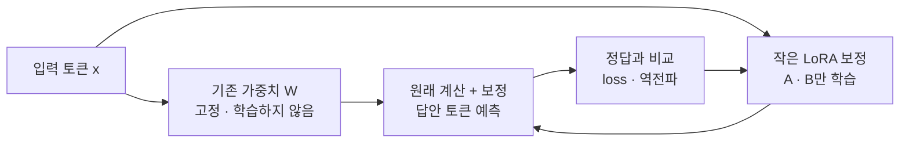

### 최소한 이해하면 좋은 개념

| 개념 | 알아야 하는 수준 | 잘못 이해했을 때 |
| --- | --- | --- |
| Token | 글자와 1:1이 아닌 모델 입력 단위 | 한국어 길이·비용·잘림 예측 실패 |
| Attention | 현재 토큰이 문맥을 참고하는 계산 | 긴 문맥이 무조건 좋은 줄 앎 |
| Loss / gradient | 정답 예측 오차와 파라미터 수정 방향 | loss 하락을 사용자 품질 상승으로 오해 |
| Rank | LoRA 보정의 제한된 표현 용량 | 큰 값이면 항상 좋다고 생각함 |
| Quantization | 숫자 정밀도를 줄여 저장·계산 | 메모리 절약이 무손실이라고 가정 |
| Overfitting | 예시 암기, 새 상황에 약함 | 같은 예시를 평가에도 넣고 성공 선언 |

**실습 과제:** 학습 전후 같은 20개 문장을 출력해 보자. 훈련 문장은 좋아졌는데 새 부정문에서 틀리면 성공이 아니다. loss가 내려가도 “가끔”이 “매일”로 바뀐다면 해당 checkpoint는 버린다.

LoRA/QLoRA 논문은 핵심 그림·방법·한계를 먼저 읽고, 수식 유도는 나중에 해도 된다. 분산 GPU 커널이나 대규모 사전학습은 첫 프로토타입의 필수 공부가 아니다. [R07][R08]

## 15. 평가는 세 겹으로 한다

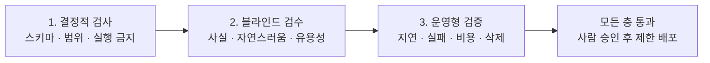

| 층 | 측정 | 처음 제안하는 기준 |
| --- | --- | --- |
| 형식 | JSON 파싱, 길이, 허용 evidence ID | 봉인 세트의 결정적 계약 전부 통과 |
| 사실 | 새 주장·부정 뒤집힘·기간 왜곡 | 중대한 날조 발견 시 즉시 차단 |
| 사람 품질 | 사실성·구체성·유용성·자연스러움·자율성·권한 | 기존 0-3 rubric 재사용. 2 이상을 사용 가능으로 정의 |
| 비교 | 현재 API / 학습 전 / 학습 후 | 현재 보수적 gate: 사례별·차원별 퇴행 금지 |
| 응답 품질 | 잘못된 답 대신 질문·거절 | 정보 부족·권한 없음 사례를 별도 집계 |
| 성능 | p50/p95, timeout, 메모리 peak | 먼저 실측. 초기 UX 목표 p95 5초 이내를 검토 |

모델 이름과 답변 순서를 숨기고 순서를 섞는다. 두 명 검토가 가능하면 20% 이상 중복 채점하고 불일치 이유를 기록한다. 한 명뿐이면 하루 이상 간격을 둔 재채점으로 보완하되 독립 검수와 동등하다고 주장하지 않는다.

LLM judge는 검수 후보를 추리는 보조다. 자기 모델을 자기 평가자로 삼아 PASS를 내지 않는다. 사람 점수·안전 실패·실패 사례 수를 함께 보고한다.

## 16. ‘오류 0건’도 품질 보증은 아니다

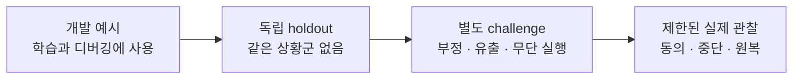

300건에서 안전 오류가 0건이어도 실제 오류율이 0이라는 뜻은 아니다. 독립적인 같은 분포의 표본이라는 가정 아래, 간단한 rule-of-three 근사는 95% 상한을 약 `3/300 = 1%`로 본다. 실제 대화의 분포 변화와 상관된 예시는 이 근사를 더 낙관적으로 만들 수 있다. [R21]

### 반드시 분리해서 보고할 집단

- 짧은 답 / 긴 답 / 오타 / 구어체 / 부정 / 상충된 요청.
- 프로필 최초 작성 / 작은 수정 / 삭제 / 공개를 원치 않는 요청.
- 성별·나이·직업 이름만 바꾼 대응쌍에서 품질·말투 차별 여부.
- 근거가 충분한 경우와 부족한 경우. 부족할수록 더 과장하는지 확인.
- 삭제 전후·세션 회전·상대 접근 권한 변경·중복 요청·모델 timeout.

KMMLU 같은 공개 한국어 벤치마크는 일반 언어 능력 참고용이다. 연애 조언·프로필 사실성·사용자 만족도를 대신 측정하지 않는다. 별도 라이선스를 확인하고, 봉인 평가 문제를 학습에 섞지 않는다. [R19]

비교 결과가 나쁘면 `데이터 오류 → 프롬프트/근거 → 출력 검증 → 모델 용량` 순서로 원인을 좁힌다. 점수를 올리려고 holdout을 반복 튜닝하거나 안전 기준을 낮추지 않는다.

## 17. 연구 모델을 서비스에 붙이는 경계

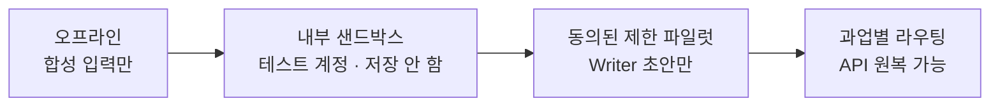

### 요청 한 건의 미래 계약

`인증 → 현재 권한/동의 확인 → 예산 예약 → 최소 근거 조립 → 모델 호출 → 출력 검증 → 최신 revision 재검사 → 초안 반환 → 사용자 승인 → 별도 업무 실행`.

| 항목 | 설계 원칙 |
| --- | --- |
| feature flag | `writer_candidate`처럼 과업별 제어. 상담·일정까지 함께 켜지 않음 |
| 모델 endpoint | 인증된 내부 API. 외부에서 임의 prompt·회원 ID로 호출 불가 |
| 입력 | 원문 전체 대화가 아니라 요청에 필요한 최소 근거 |
| fallback | 허용된 경우에만 현재 API. timeout 후 비용 불명확 상태를 기록 |
| cache key | 소유자·동의 revision·근거 hash·모델/prompt/adapter 버전 포함 |
| 오류 | 저장/발송/결제 완료를 생성 문장으로 대체하지 않음 |
| rollback | 이전 모델·정책·어댑터로 전환. 후보 endpoint 차단 |

개인 답변 캐시를 전역 공유하지 않는다. 공개 비서 이미지·고정 문구 캐시는 별도로 유지한다. 검증 전 모델에 실제 회원 요청을 몰래 복제하는 shadow 실험도 하지 않는다. 오프라인 합성 shadow부터 시작한다.

MLX 어댑터를 PEFT·Ollama·vLLM에 그대로 넣을 수 있다고 가정하지 않는다. 지원 형식 확인, 변환 전후 동일 입력 회귀, 필요하면 같은 데이터로 GPU 스택 재학습을 선택한다. GGUF 변환도 별도 검증 대상이다. [R05][R13][R14]

## 18. 삭제와 재학습까지 설계한다

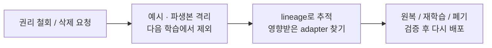

### 서비스 데이터와 연구 데이터의 기본 방침

초기는 사람이 직접 작성한 합성 자료만 사용한다. 실제 회원 자료를 도입하는 시점에 목적별 동의, 제공자 전송, 보유 기간, 접근 권한, 철회 처리, 양 당사자 자료의 권리를 별도로 설계·검토한다. 서비스 이용 동의를 학습 동의로 간주하지 않는다.

| 자산 | 보관 위치 | 기록할 연결 |
| --- | --- | --- |
| 실제 회원 대화/기억 | 기존 개인 저장소 | owner·revision·만료·삭제 |
| 허가된 연구 예시 | 접근 제한 연구 저장소 | 원본 권리·파생 예시·용도·보유 기한 |
| 데이터 버전 | manifest + 제한 저장소 | example ID 목록·split·해시 |
| 모델/어댑터 | 비공개 artifact 저장소 | 기반 모델·학습 데이터·코드·평가 버전 |
| 실험 로그 | 로컬 JSON / 향후 MLflow | 숫자·ID·오류 코드. 민감 원문은 기본 제외 |

원본 데이터 삭제만으로 이미 학습한 가중치가 잊는 것은 아니다. 영향을 받은 모델을 사용 중단·원복하고 오염되지 않은 데이터로 재학습할 수 있어야 한다. 가중치에서 특정 개인만 완전히 제거하는 기술을 당연히 가능한 기능으로 약속하지 않는다.

사진·음성·민감한 상담은 첫 Writer 학습에서 제외한다. 사주·MBTI로 성격·안전성·관계 성공을 단정하는 라벨도 만들지 않는다. 이는 이번 연구의 보수적 제품 정책이며 법률 적합성 확정은 아니다.

## 19. 하드웨어와 비용: 서버부터 사지 않는다

확인된 개발 장비는 Apple M5 Pro / 통합 메모리 48GB다. **4B 모델의 짧은 문맥 LoRA 실험을 시작하기에 검토할 만한 환경**이지만 실행 속도·최대 학습 크기를 측정한 것은 아니다.

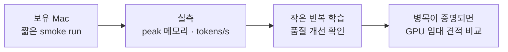

| 선택 | 장점 | 주의 |
| --- | --- | --- |
| 보유 Mac MLX | 새 GPU 비용 없이 시작, 로컬 통제 | 메모리를 OS/다른 앱과 공유, 운영 상시 서버와는 다름 |
| 시간제 NVIDIA GPU | 재현 가능한 CUDA 학습·병렬 실험 | 임대·저장·전송 비용, 보안, 중지 누락 |
| 상시 GPU 서빙 | 트래픽이 충분하면 호출당 비용 감소 가능 | 유휴 시간·장애 대응·모니터링 고정비 |
| 기존 LLM API | 초기 고정 인프라 부담이 작음 | 호출량·토큰·검증·재시도 원가 관리 |

4B 파라미터의 **가중치만** BF16이면 약 8GB, 4-bit면 약 2GB다. 실제 메모리는 양자화 메타데이터, 활성값, KV cache, adapter, optimizer, 런타임까지 더 필요하다. 모델 파일 크기를 학습 메모리 요구량으로 쓰지 않는다.

첫 실행은 다른 무거운 작업과 분리하고 peak 메모리를 기록한다. 메모리 압박이 생기면 길이·batch·학습 레이어를 줄인 후 양자화를 검토한다. 무료 Colab이나 특정 GPU 가격·가용성을 보장하지 않으며 이번 문서에서는 구매/임대를 실행하지 않는다.

## 20. 가성비의 기준은 ‘좋은 결과 한 건’

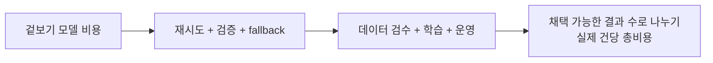

`월 총비용 = API 사용료 + GPU 실행/유휴 + 저장/전송 + 검수 인건비 + 학습비 상각 + 운영·장애 대응`.

`채택 가능한 결과당 비용 = 월 총비용 / 수정 없이 쓰거나 허용 기준을 통과한 결과 수`.

### 계산 구조를 이해하기 위한 가상 예시

월 고정비를 **가정상 300달러**, API 대비 절감액을 **성공한 작업당 가정상 0.01달러**라고 놓으면 단순 분기점은 월 30,000건이다. 이는 실제 공급자 가격이나 After 비용 측정이 아니다. 후보의 fallback·재시도가 증가하면 분기점은 더 늦어진다. 절감액이 0 이하이면 분기점도 없다.

| 측정할 값 | 이유 |
| --- | --- |
| 한 요청의 생성·검증·재시도 토큰 | 모델 호출 한 번 가격으로 축소 계산하지 않기 |
| 성공/질문/거절/fallback 비율 | 싸지만 사용할 수 없는 답 걸러내기 |
| prompt 길이, 출력 길이, p95 지연 | 메모리·응답 속도 병목 찾기 |
| 100개 예시 검수 소요 시간 | 실제로 큰 비용일 수 있는 데이터 작업 가시화 |
| 어댑터 버전별 품질·운영 오류 | 작은 모델 교체 후 유지보수 비용 측정 |

After의 초기 목적은 **비용 절감 확약이 아니라 독립적인 품질 개선 능력 확보**다. API가 더 경제적이면 계속 API를 쓰면서 좋은 데이터와 평가만 자산으로 남겨도 된다.

## 21. 무엇을 공부하면 되는가: 6주 지도

일정은 주 5-8시간 정도를 가정한 학습 계획이며 숙련도에 따라 늘린다. ‘강의 완주’가 아니라 작은 산출물로 다음 단계에 간다.

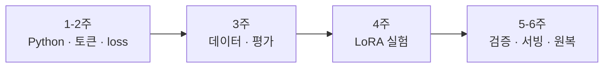

| 주차 | 공부 | 직접 해볼 것 | 넘어가는 기준 |
| --- | --- | --- | --- |
| 1 | Python, JSONL, 가상환경, tensor | 예시 20건 검사기·train/val 분할 | 입력 오류·중복을 설명 가능 |
| 2 | tokenizer, chat template, attention, loss | 토큰 잘림·loss mask 시각 확인 | 입력/정답 중 학습되는 위치 구분 |
| 3 | SFT 데이터, 편향, leakage, 평가 | 100개 합성 예시+블라인드 비교표 | 좋은/나쁜 답의 이유를 일관되게 판단 |
| 4 | LoRA/QLoRA, LR, rank, overfitting | MLX smoke run와 checkpoint 비교 | 훈련 loss와 실제 품질 차이 설명 |
| 5 | holdout, challenge, 통계, 지연 | 학습 전/후/API 세 방식 비교 | 실패 유형·비용·한계를 보고 |
| 6 | endpoint, 인증, timeout, rollback | 테스트 앱 연결·후보 OFF 원복 | 개인정보·권한·삭제 회귀 통과 |

추천 순서: **PyTorch Learn the Basics [R16] → HF LLM Course 1·2·3·5·10·11장 [R17] → MLX LoRA [R05] → LoRA/QLoRA 논문 [R07][R08]**. SFT가 안정된 후 DPO [R10][R18]. 더 깊이 이해하고 싶을 때 Stanford CS336 [R20]을 공부한다.

처음부터 공부하지 않아도 되는 것: 대규모 분산 학습, CUDA 커널 최적화, 새로운 Transformer 구조, 전체 언어 사전학습. After의 첫 모델을 만드는 데 가장 중요한 능력은 **데이터의 정답을 정하고 검증하는 능력**이다.

## 22. 첫 10회 작업의 실행 체크리스트

| 순서 | 작업 | 완료 산출물 |
| --- | --- | --- |
| 1 | Writer의 입력·출력·금지 행동 확정 | task contract와 실패 유형 30개 |
| 2 | 합성 원형 100건 작성·권리 기록 | 사람이 검수한 개발 데이터 |
| 3 | 독립 평가 원형 별도 작성·봉인 | 모델 선택에 노출하지 않은 holdout |
| 4 | 모델·tokenizer·라이선스 revision 고정 | manifest + 설치 lock + 재현 메모 |
| 5 | 학습 전 로컬 추론 | 품질·메모리·지연 기준선 |
| 6 | 승인된 범위의 API 기준선 확보 | 동일 입력 결과; 학습 데이터에는 자동 편입 금지 |
| 7 | 100건 smoke 학습 | 토큰 mask·loss·출력·adapter 검증 |
| 8 | 후보 풀 1,000건으로 확장·최대 4조합 | validation 비교와 선택 이유 |
| 9 | holdout 150 + challenge 150 평가 | 블라인드 보고서·실패 목록·총비용 |
| 10 | go/no-go 결정 | 계속 연구 / 더 큰 후보 / 제한 파일럿 중 하나 |

### 오늘 이후 첫 개발 단위

`research/concierge-model/`와 운영 코드를 계속 분리한다. 다음 구현은 학습용 데이터 스키마·group split 검사·버전 manifest·로컬 실행 영수증부터다. 기존 평가 전용 fixture의 `allowedUses`를 학습으로 일괄 변경하지 않는다.

**추가 실행 전 결정:** 모델 다운로드·디스크 사용 허용, 실제 학습 시간, API 비교 예산, 검토자 확보. 실제 회원 데이터 사용·클라우드 업로드·유료 GPU 임대·운영 전환은 이 문서만으로 승인되지 않는다.

완료의 정의는 “학습 명령이 끝남”이 아니라 “학습 전보다 어떤 실패가 줄었고, 무엇은 여전히 못하며, 같은 결과를 다시 만들 수 있는지 설명 가능함”이다.

## 23. 이후 확장: 매니저와 코치까지

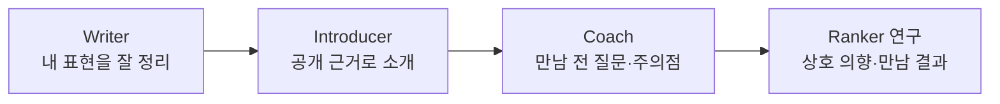

| 확장 | 추가 데이터 | 넘어갈 조건 |
| --- | --- | --- |
| 소개 설명 | 실제 선정 근거, 허용 공개 단서, 불확실성 표현 | 상대 정보 누출·근거 없는 궁합 단정 차단 |
| 만남 전 조언 | 관계 단계별 질문, 피해야 할 압박, 존중·경계 사례 | 안전 rubric·전문 검토·거절 처리 확보 |
| 사진 코칭 | 허가된 이미지, 구도·밝기·다양성 라벨 | 외모 점수·성격 추정 금지, 별도 이미지 처리 검토 |
| 추천 순위 | 적격 후보·노출 순서·상호 의향·일정 합의·결과 | 노출 편향·결측·공정성 평가와 충분한 관측 |

후기 미응답은 실패 정답이 아니다. 프로필을 못 본 사람도 거절 정답이 아니다. ‘좋아요 수’를 최적화하면 인기 집중이나 과장된 프로필을 보상할 수 있다. 추천 모델은 생성 모델과 따로 설계하고, 초기에는 설명 가능한 규칙을 기준선으로 유지한다.

Coach의 커리큘럼은 매너·상호 존중·열린 질문·거절 수용·개인 경계 중심으로 직접 작성하고 검수한다. 인기 연애 콘텐츠나 픽업 기술을 그대로 긁어 학습하지 않는다. 데이터 권리가 확인된 도메인 자료를 검토하더라도 심리 진단·조종·의존 유도를 목표로 하지 않는다.

**장기 경쟁력은 “너를 다 안다”는 연기가 아니라, “알고 있는 것·모르는 것·승인받아야 할 것”을 정확히 구분하는 매니저다.**

## 24. 참고문헌과 공부할 때 볼 부분

열람 기준 2026-10-26. 공식 모델 카드·프로젝트 문서·원 논문을 우선했다. 문서의 추천과 표본 수·일정은 After 설계 판단이며, 아래 출처가 After 품질을 보장하는 것은 아니다. 라이선스·지원 버전·사용 조건은 실행 직전 다시 확인한다.

| ID | 자료 | 볼 부분 |
| --- | --- | --- |
| R01 | [Qwen3-4B-Instruct-2507](https://huggingface.co/Qwen/Qwen3-4B-Instruct-2507) | 모델 형식, non-thinking, 라이선스, chat template |
| R02 | [Qwen3.5-4B](https://huggingface.co/Qwen/Qwen3.5-4B) | 후속 멀티모달 후보, 런타임 호환성 |
| R03 | [Gemma 3 4B IT](https://huggingface.co/google/gemma-3-4b-it) | 모델 카드·Gemma 사용 조건 |
| R04 | [EXAONE 4.0 1.2B LICENSE](https://huggingface.co/LGAI-EXAONE/EXAONE-4.0-1.2B/blob/main/LICENSE) | 해당 배포본의 연구·상용 사용 경계 |
| R05 | [MLX-LM LoRA](https://github.com/ml-explore/mlx-lm/blob/main/mlx_lm/LORA.md) | 학습, mask-prompt, 평가, fuse/export 제약 |
| R06 | [PEFT Quantization](https://huggingface.co/docs/peft/developer_guides/quantization) | 양자화 학습 준비와 어댑터 |
| R07 | [LoRA 논문](https://arxiv.org/abs/2106.09685) | 고정 가중치와 저랭크 보정의 구조 |
| R08 | [QLoRA 논문](https://arxiv.org/abs/2305.14314) | 4-bit 기반 적응, 메모리와 한계 |
| R09 | [TRL SFTTrainer](https://huggingface.co/docs/trl/sft_trainer) | 데이터 형식, 학습 설정, loss 대상 |
| R10 | [TRL DPOTrainer](https://huggingface.co/docs/trl/dpo_trainer) | chosen/rejected 선택쌍 |
| R11 | [Unsloth 학습 가이드](https://unsloth.ai/docs/get-started/fine-tuning-llms-guide) | 지원 환경·최적화 후보; 성능은 직접 측정 |
| R12 | [Axolotl](https://docs.axolotl.ai/) | 설정 중심 학습·지원 모델 |
| R13 | [Ollama Import](https://docs.ollama.com/import) | Safetensors/GGUF 가져오기와 변환 경계 |
| R14 | [vLLM Online Serving](https://docs.vllm.ai/en/latest/serving/online_serving/) | 서버 API와 실행 환경 |
| R15 | [MLflow Tracking](https://mlflow.org/docs/latest/ml/tracking/) | 파라미터·지표·산출물 추적 |
| R16 | [PyTorch 기초](https://docs.pytorch.org/tutorials/beginner/basics/intro.html) | tensor, autograd, optimizer |
| R17 | [HF LLM Course](https://huggingface.co/learn/llm-course/chapter1/1) | tokenizer, datasets, SFT |
| R18 | [DPO 논문](https://arxiv.org/abs/2305.18290) | 선호 학습의 목적과 구조 |
| R19 | [KMMLU](https://huggingface.co/datasets/HAERAE-HUB/KMMLU) | 한국어 일반 지식 평가; 연애 품질의 대리 지표 아님 |
| R20 | [Stanford CS336 2025](https://cs336.stanford.edu/spring2025/) | 더 깊은 언어 모델 원리·데이터·학습 시스템 |
| R21 | [Hanley & Lippman-Hand, 1983](https://pubmed.ncbi.nlm.nih.gov/6827763/) | 0건 관측과 실제 위험률을 구별하는 rule-of-three |

