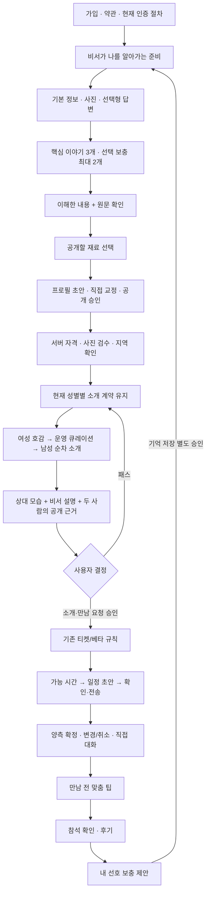
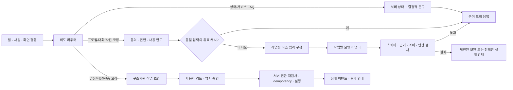

# After · 개인 소개 매니저 설계

2026-10-25 · **설계 및 로컬 시안. 색상·화면 검토 후 확정.**

## 1. 제품의 약속

**“나를 알아가는 비서, 만나보고 싶은 사람을 설명해 주는 매니저.”**

사용자가 AI에게 연애를 대신 맡기는 것이 아니라, 표현·탐색·설명·조율에 드는 수고를 맡긴다. 호감, 공개, 결제, 일정 확정의 선택권은 사용자에게 남긴다. 비서끼리 말을 주고받는 연출보다 **내가 무엇을 승인했고 지금 무엇을 기다리는지** 정확히 설명하는 것이 우선이다.

차별화의 단위는 채팅 횟수가 아니다. **좋은 프로필 → 납득되는 소개 → 부담 없는 실제 만남**을 하나의 연속된 경험으로 완성하는 것이다. 후보가 없는데 AI가 검색 중이라고 말하거나, 희망을 실제 경험으로 부풀리지 않는다.

### 이번 변경과 후속 개발의 구분

| 영역        | 이번 로컬 구현                                                             | 후속 구현·검증                                   |
| ----------- | -------------------------------------------------------------------------- | ------------------------------------------------ |
| 홈          | 현재 상태 중심, 작은 한 줄 스크롤 칩, 중복 홈 이동 제거, 짧은 문구         | 승인할 비서 작업을 모은 하나의 작업함            |
| 색상        | 인디고 행동색·핑크 포인트, 중성 바탕, 기존 캐릭터 유지                     | 사용자 시안 검토 후 DESIGN.md·운영 반영          |
| 프로필 준비 | 짧은 답변에 선택적 추가 힌트, 요약의 원문 보기, 공개 재료와 생성 문장 구분 | 대화 중 특정 문장만 수정하는 구조화된 편집 초안  |
| 상대 소개   | 공개 원문 기반 대화 접점·지역·생활 선택 차이, 양측 근거 펼치기             | LLM으로 정제한 개인별 매니저 소개문 및 의미 검증 |
| 내 프로필   | 원문 Q&A와 나만의 보충 질문 분리                                           | 근거에 기반한 강점 후보·표현 대안·버전 비교      |
| 사진        | 브라우저에서 새 파일 밝기·해상도·가로 비율 확인, 조건부 구성 가이드        | 명시적 동의 후 사진 내용 분석·다양성 제안        |
| 과금        | 기존 티켓·베타 정책 유지                                                   | 구독 가치 검증·가격 결정·PG 및 환불 정책 검토    |
| 자체 모델   | 도입하지 않음                                                              | 평가 세트와 손익 기준 충족 후 후보 실험          |

현재 접점 기능은 규칙 기반이다. 특정 단어가 두 프로필에 있다는 사실을 **같은 취향, 궁합 또는 LLM 심층 분석이라고 포장하지 않는다.** 기존 생성 프로필·대화 팁·비공개 상담의 서버 경로는 유지하며 이번 변경으로 운영 상담·기억·일정 플래그를 켜지 않는다.

## 2. 전체 사용자 여정



후기 미응답·취소·티켓 복구는 기존 서버 정책을 따른다. 모델이 벌점이나 환불을 결정하지 않는다. 실제 카카오 알림, 통신사 인증, 실결제 등 외부 게이트를 이번 시안에서 완료로 간주하지 않는다.

### 화면은 적게, 결정은 분명하게

- **홈:** 이름을 부르는 인사·짧은 안부 → 실제 상태 한 줄 → 지금 필요한 행동 → 한 줄 퀵메뉴 → 비서 입력. 안부는 한국 시간대에 따른 결정적 문구이며 LLM을 호출하거나 사용자의 감정을 추측하지 않는다. 약속이 있으면 상대·날짜·장소가 우선이며 비서 얼굴을 약속 사진처럼 쓰지 않는다.
- **소개:** 사람의 한 줄 소개·사진·기본 정보 → “이분을 소개할게요” → 원문 이야기. 호감·패스는 독립된 명시적 행동이다.
- **나:** 공개 프로필 미리보기와 비공개 코칭을 분리한다. 비공개 코칭은 상대에게 보이는 데이터에 저장하지 않는다.
- **약속 상세:** 승인해야 할 일정과 전송 결과, 변경·취소, 선택적 직접 대화를 유지한다.
- 하단은 홈·소개 두 탭. 나·상점은 기존 상단 진입. 폼은 없애지 않고 비서가 정확한 작업 단계로 연결한다.

“말만 하면 모든 일이 자동으로 끝난다”는 표현은 아직 제공하지 않는 자동실행까지 약속한다. 당장은 **“말로 부탁하고, 중요한 선택만 확인하세요.”**가 적절하다.

## 3. 사람의 원문과 매니저의 해석

### 프로필의 세 층

1. **원문:** 사용자가 실제 선택·입력한 정보. 취소·수정·비공개 전환 가능.
2. **공개 프로필:** 공개 허용한 원문만 다듬고 사용자가 최종 승인한 표현. 사실·빈도·희망·부정의 의미를 보존한다.
3. **개인별 소개 설명:** 두 사람이 서로 열람할 수 있는 공개 정보로 만든 매니저의 설명. 위 두 층과 분리하고 근거를 확인할 수 있게 한다.

예: “러닝을 해보고 싶어요”는 “퇴근 후 러닝으로 자기 관리를 해요”로 바꾸지 않는다. “영화를 잘 안 봐요”와 “영화를 좋아해요”에서 같은 단어를 찾았어도 취향 일치라 하지 않는다. “둘 다 영화 이야기를 남겼지만 경험은 다를 수 있어요”까지만 말한다.

### 후속 개인별 소개 설명 계약

```ts
type MemberIntroductionBrief = {
  portrait: { text: string; sources: PublicEvidence[] }[];
  connections: {
    text: string;
    selfSources: PublicEvidence[];
    otherSources: PublicEvidence[];
  }[];
  questions: { text: string; sources: PublicEvidence[] }[];
  viewerId: string;
  targetId: string;
  sourceFingerprint: string;
  promptVersion: string;
  expiresAt: string;
};
```

- `portrait` 2~3개 관찰, 접점 최대 2개, 함께 확인할 질문 최대 2개. 내용이 없으면 빈 배열을 허용한다.
- 각 관찰은 현재 공개 필드의 정확한 인용과 연결한다. 읽기 좋은 문장과 검증용 근거를 따로 저장한다.
- 차이는 결함이 아니라 확인할 질문으로 표현한다. 상대의 숨은 의도·건강·경제력·성적 행동·심리 상태를 추정하지 않는다.
- MBTI는 사용자가 입력한 자기표현으로만 다룬다. MBTI·사주로 성격·궁합·관계 성공을 판정하지 않는다.
- 내부 운영용 `considerations`나 비공개 선호를 그대로 회원 화면에 내보내지 않는다.
- 차단·탈퇴·소개 종료·공개 철회 시 읽기 권한을 매번 다시 검사한다. 캐시는 권한을 대체하지 않는다.
- 프로필 수정 시 fingerprint가 바뀐다. 오래된 소개문은 숨기거나 새로 확인하도록 하고 잘못된 근거로 재사용하지 않는다.

현재 회원용 규칙 기반 설명은 별도 저장을 하지 않고 허용된 현재 공개 프로필에서 계산한다. 기존 `compose-pair-brief`는 관리자용이므로 이 DTO를 새로 검증하기 전 회원 API로 전용하지 않는다.

## 4. AI 호출과 실행 구조



### 비용을 쓰는 일과 쓰지 않는 일

| 작업                                | 기본 처리                    | 모델 호출 원칙                         |
| ----------------------------------- | ---------------------------- | -------------------------------------- |
| 현재 상태·가격·다음 단계·서비스 FAQ | 서버 사실과 템플릿           | 0회                                    |
| 짧은 답변의 보충 질문               | 입력별 선택적 템플릿         | 타이핑마다 0회                         |
| 새 사진의 기술적 안내               | 기기 내 해상도·밝기 계산     | 0회                                    |
| 프로필 초안                         | 공개 선택된 재료 → 생성·검증 | 명시적 생성 시에만                     |
| 상대 소개문                         | 공개 두 프로필 + 제한된 근거 | 권한 있는 첫 열람 또는 명시 갱신, 캐시 |
| 맞춤 대화 팁                        | 현재 공개 프로필 + 명시 동의 | 동일 근거 재사용                       |
| 자유 상담                           | 최근 대화 + 승인 기억만      | 질문 전송 시, 한도 내                  |
| 일정 후보 계산·전송·취소·환불       | 결정적 정책·트랜잭션         | 모델에 실행 권한 없음                  |
| 사진 내용/다양성 분석               | 선택 동의된 사진만           | 묶음 분석, 중복 해시 재사용, 후속 단계 |

### 현재 코드에서 확인한 기반

- 프로필은 analyze → compose/verify, 필요한 경우 제한된 repair 경로가 있다. sourceRevision·공개 선택·승인 단계가 있다.
- 관리자 소개 설명은 공개 근거와 source hash, 캐시를 사용한다.
- 대화 준비는 공개 열람 권한을 재확인하고 현재 프로필 근거를 사용한다.
- 상담은 최근 제한된 대화와 승인 기억을 전달한다. 모델의 전체 회원 DB 검색은 없다.
- 모델 기본값과 기능별 환경변수 오버라이드가 이미 있다. 이번 작업에서 모델명·운영 한도·동의를 변경하지 않는다.

### 다음 엔지니어링 작업

1. 작업별 공통 계측: 모델명, promptVersion, input/output tokens, cache hit, repair, 지연, 성공/차단 사유. 회원 원문·사진·비밀은 일반 로그에 남기지 않는다.
2. 작업별 한도: 동시 실행 1개, request id 중복 제거, 일·월 사용량 상한, 타임아웃, 제한된 재시도. 실패한 실행을 새 사용자 요청으로 반복 과금하지 않는다.
3. 응답 검증은 스키마만으로 끝내지 않는다. 인용 존재·공개 범위·부정·희망·빈도 보존을 검사한다. 모델 검증기는 보조이며 권한 검사는 코드에서 한다.
4. 운영 플래그는 상담/기억/일정처럼 별개로 둔다. 데이터 삭제·공개 철회 시 생성 중 응답도 무효화하는 기존 fence 계약을 확장한다.
5. 비서의 행동 결과에는 실제 `draft/awaiting_approval/executing/succeeded/failed/cancelled` 상태와 서버 영수증이 있어야 한다. 단순 채팅 답변을 실행 성공으로 표시하지 않는다.

## 5. 사진 컨설팅

**현재 구현:** 새로 고른 파일을 브라우저에서 검사한다. 낮은 해상도, 전체적으로 어둡거나 밝은 이미지, 가로로 긴 비율을 알려준다. 알 수 없는 형식이나 분석 실패는 사진 거절로 처리하지 않는다. 기존 업로드·검수·대표 사진 선택은 유지한다.

“셀카만 고르셨다면…”은 구성 제안이며 사진을 보고 셀카라고 판정한 결과가 아니다. 전신사진을 강제하지 않고 외모 점수·매력 등급·인종·건강·성격 판단을 만들지 않는다.

**후속 선택형 시각 분석:** 얼굴이 너무 작음/가림, 여러 인물로 본인 식별 어려움, 구도가 반복됨 등 사진의 전달력만 평가한다. 전송 전 목적·외부 처리·보관 안내와 동의를 제공한다. 모델명/정책 버전을 기록하고 낮은 확신은 질문으로 돌린다. 모델 분석은 운영자의 안전 검수나 본인인증을 대체하지 않는다. 원본 장기 보관·학습용 재사용은 별도 정책 결정 없이는 하지 않는다.

## 6. 모델 전략: 먼저 평가, 그다음 소유

처음부터 자체 모델을 만드는 대신 **프롬프트·증거 구조·평가 세트·업무 도구**를 After의 핵심 자산으로 만든다. 같은 입력과 정답 기준으로 API/오픈 모델을 교체 비교할 수 있게 한다.

| 단계           | 실행                                            | 진입 조건                                          |
| -------------- | ----------------------------------------------- | -------------------------------------------------- |
| 현재           | 기존 모델 + 규칙·캐시                           | 의미 검증·동의 계약 유지                           |
| 경량 모델 비교 | 공개 합성 프로필로 작업별 A/B                   | 무단 개인정보 전송 없이 평가 세트 확보             |
| 로컬 실험      | Ollama의 structured output으로 동일 스키마 시험 | 개발 Mac 성능·한국어 품질·지연 측정                |
| 파인튜닝       | 문체·형식·교정 방식 학습                        | 적법한 데이터 권리/동의, 삭제 정책, 독립 평가 확보 |
| 자체 호스팅    | GPU·배포·모니터링·장애 대응                     | API보다 총비용 유리하고 안정성·품질 동등           |

Ollama는 모델 실행 도구이지 자동으로 After 전용 모델을 학습시키는 제품이 아니다. 개인별 정보는 기억 저장소와 권한 있는 검색으로 관리하고 모델 가중치에 넣지 않는다. Mac 로컬 실행을 회원용 상시 서버로 바로 쓰지 않는다.

### 평가 세트

짧은 답변, 오탈자, 부정, 희망, 긴 답변, 정보 없음, 공개 철회, 상반된 취향, MBTI 단정 유도, 악의적 지시, 연락처, 타인 비공개 정보 요청을 포함한다. 합성 사례를 먼저 만들고 실제 사례는 적절한 동의·최소화 후 추가한다.

핵심 기준: 미제공 사실 추가 0건, 권한·공개 위반 0건, 실행 오인 0건. 문체·개인성·도움 정도는 블라인드 사람 평가로 비교한다. 비용만 낮고 사실 보존이 나쁜 모델은 채택하지 않는다. 실제 생성 품질이 검증되지 않은 시안 텍스트를 모델 품질 성과로 보고하지 않는다.

## 7. 구독 비즈니스 모델 제안 — 아직 미적용

추천은 **무료 핵심 만남 흐름 + 정액 코칭 구독**이다. 질문마다 눈에 띄는 크레딧을 태우면 비서에게 편히 말한다는 핵심 경험과 충돌한다. 내부적으로 사용량을 계측하되 사용자에게는 포함 범위·잔여 심화 작업·다음 갱신일을 예측 가능하게 보여준다.

| 무료로 유지할 가치                                   | 구독 후보 가치                           | 유료화하지 않을 안전·필수 행동      |
| ---------------------------------------------------- | ---------------------------------------- | ----------------------------------- |
| 상태·서비스 질문, 기본 프로필 준비, 기본 사진 가이드 | 프로필 개선 여러 버전·추가 코칭          | 개인정보 열람/삭제, 신고·차단       |
| 소개 권한 내 기본 정보·근거, 기존 조율 흐름          | 상대별 깊은 소개 해설·만남 전 맞춤 팁    | 결제/티켓 내역, 취소·복구 안내      |
| 기본 일정 확인과 직접 결정                           | 만남 후 회고·승인 기억으로 이어지는 코칭 | 약속 중요 상태, 필수 알림·상담 접근 |

구독자에게 후보 수·만남·연애 성공을 보장하지 않는다. 후보가 부족한 기간에도 요금을 납득할 만큼 개인 코칭의 독립 가치가 있는지 먼저 측정한다. 기존 소개/만남 티켓과 구독을 동시에 받으면 이중과금처럼 보일 수 있다. **구독에 일정 수의 티켓을 포함할지, 코칭만 구독하고 소개는 별도인지**는 실제 수요 실험과 환불·PG 검토 후 확정한다. 이번 작업에서는 가격·티켓 잔액·상품·실결제를 변경하지 않는다.

### 손익을 결정할 숫자

`월 AI 원가 = Σ(작업 횟수 × (입력 토큰 원가 + 출력 토큰 원가 + 검증·보완 원가))`

여기에 사진 처리, 서버, 결제 수수료, 운영 검수·고객지원 시간을 더한다. API 호출 수만으로 수익성을 판단하지 않는다. 자체 호스팅은 GPU 고정비·유휴 시간·운영 인건비·장애 여유 용량까지 포함해 비교한다.

첫 베타에서는 프로필 완료율, 초안 수정 이유, 소개 설명 도움 평가, 호감/요청 수락률, 실제 만남 성사율, 평균 대기 일수, 노쇼/취소, 사용자당 AI 원가, 운영자 개입 분을 함께 본다. 화면 체류시간이나 채팅 횟수 증가는 목적이 아니다.

## 8. 실행 순서와 통과 기준

1. **현재 로컬 시안 검토:** 홈·소개·프로필 준비·사진 가이드. 색상/간격/문구·기존 흐름·다크모드. 사용자 디자인 선택 전 운영 배포하지 않는다.
2. **개인별 매니저 소개 API:** 위 DTO, 권한/캐시/삭제 계약, 합성 품질 평가, 모델 비용 비교. 검증 후 제한 베타로 활성화한다.
3. **대화형 프로필 수정:** 발화 → 변경 후보 diff → 원문/공개 의미 확인 → 승인 저장. 대화를 했다고 즉시 공개 내용을 바꾸지 않는다.
4. **선택형 사진 내용 코칭:** 기술 검사와 별개 기능 플래그/동의, 사실성·편향·실패 사례 검증.
5. **비서 작업함:** 일정 초안·기억 제안·프로필 변경을 한 승인 UX로 연결. 사용자 반응 없는 동안 자동 확정하지 않는다.
6. **구독 실험:** 권리·상품·PG·취소/환불 검토 후 가격 제시. 실제 결제 없는 모의 실험으로 이해도부터 확인한다.

## 9. 참고한 공식 자료와 적용 판단

- [Hinge Prompt Feedback](https://hinge.co/newsroom/prompt-feedback): 짧은 답변을 임의로 과장하기보다 구체적인 자기표현을 돕는 방향 참고. After는 원문 확인과 공개 승인까지 연결한다.
- [Tinder Photo Selector](https://www.help.tinder.com/hc/en-gb/articles/21276850679693-Photo-Selector): 사진 선택을 보조하고 결정은 사용자에게 남기는 방식 참고. 현재 After는 얼굴 판별 기능을 도입하지 않았다.
- [Apple Generative AI HIG](https://developer.apple.com/design/human-interface-guidelines/generative-ai): AI 식별, 수정 가능한 결과, 사용자 통제와 실패 안내를 제품 원칙으로 적용한다.
- [Anthropic: Building effective agents](https://www.anthropic.com/engineering/building-effective-agents): 예측 가능한 작업에는 명시적 워크플로를 쓰고, 필요한 작업에만 모델을 쓰는 설계 참고.
- [Rosebud 장기 기억](https://help.rosebud.app/ai-analysis/long-term-memory), [사용 한도](https://help.rosebud.app/ai-analysis/usage-limits): 지속 맥락과 예측 가능한 사용량 UX 참고. After의 연애 결과나 구독 수요를 검증해 주는 근거는 아니다.
- [Ollama 모델 가져오기](https://docs.ollama.com/import), [가격/실행 옵션](https://ollama.com/pricing): 실행·모델 교체 경로 참고. 자체 학습의 품질 또는 총비용 우위를 뜻하지 않는다.

이 문서는 제품·기술 제안이며 외부 인증·실결제·개인정보 정책의 법적 적합성 확인을 대신하지 않는다.

## 10. 이번 로컬 구현의 검증 기록

| 검사                      | 결과            | 범위/한계                                                                     |
| ------------------------- | --------------- | ----------------------------------------------------------------------------- |
| `npm run check`           | 통과            | 타입·전체 린트·도구·대비·AI·인증·연령·전화·오류·일정 검사·production build    |
| 기존 AI 품질 규칙         | 166건 통과      | 실제 모델 호출이나 생성 품질 블라인드 평가가 아님                             |
| 신규 코칭 규칙            | 통과            | 부정·희망·정확한 원문·공개 선택·사진 기술적 안내                              |
| 독립 코드 리뷰            | 추가 P1/P2 없음 | 발견한 붙여 쓴 부정·보충 답변 원문 누락 2건 수정 후 재확인                    |
| 합성 화면 검사            | 42/42 통과      | 홈·소개·본인 프로필·사진·인터뷰·이해 요약·초안 × 320/390/1440px × 라이트/다크 |
| 접근성·오버플로           | 통과            | 위 42개 상태의 axe serious/critical 0, 문서 가로 넘침 없음                    |
| 퀵메뉴                    | 통과            | 시각 높이 32px·터치 44px, 한 줄 스크롤, 키보드 포커스 노출                    |
| 사진 helper 브라우저 실행 | 통과            | 합성 캔버스 파일의 어두움·밝음·가로 비율·정상 사례                            |

재실행: 기존 로컬 5191 서버를 켠 상태에서 `node scripts/test-concierge-surfaces.mjs`.

최종 실행은 합성 브라우저 세션만 사용했다. 모든 backend 요청은 fixture로 처리했고 등록하지 않은 요청과 브라우저 오류는 0건이었다. 로컬 테스트 커플·이전 계정·운영 DB·운영 플래그·결제·외부 모델을 변경하지 않았다. 중간 검증의 정적 파일 허용 목록 누락은 테스트 하네스 오류였으며 경로를 좁게 보완한 최종 실행에서 해소했다.

검사 결과와 캡처는 `/tmp/after-concierge-surfaces/summary.json`에 있다. 임시 파일이라 장기 보관 자료는 아니며 시안 승인 근거가 필요하면 별도 보관한다. 합성 사진은 플레이스홀더다. 실기기 키보드/터치, WebKit, 새 실제 LLM 생성문 품질, 실제 사진 의미 판독, 서버 전체 매칭 사이클은 이번 변경에서 재검증하지 않았다. 짧은 답변 힌트는 규칙 검사만 통과했고 별도 화면 캡처로 확인하지 않았다.
