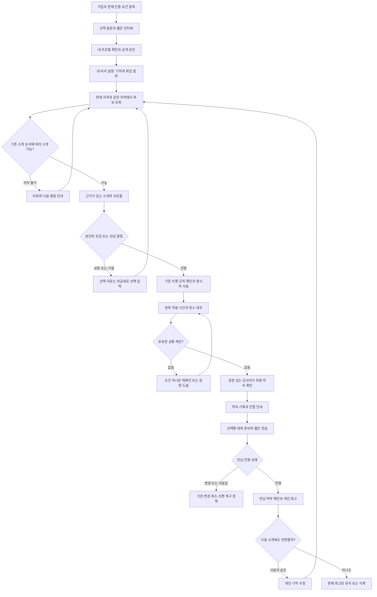
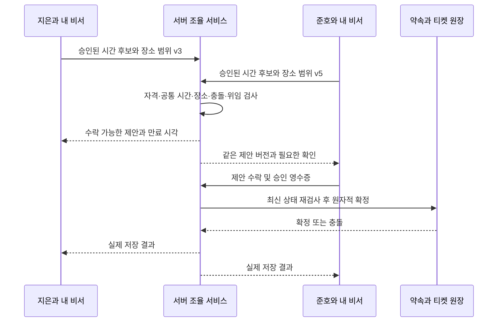

# 애프터 개인 AI 비서 제품 설계

작성일: 2026년 10월 24일 · 상태: 비서 중심 UX 재검토 및 화면 승인 대기 · 코드 검토 기준: Sunset Vivid 반영 작업 트리

후속 결정: 가입과 프로필 준비를 분리하고, 홈을 개인 비서의 진입점으로 전환한다. 첫 구현은 상태 안내와 상대 맞춤 대화 준비이며, 음성 입력·비동기 일정 실행은 후속이다. 구체적인 전환 계약과 화면 검토 기준은 17절을 따른다.

## 1. 제안과 결론

애프터를 **내가 어떤 사람인지 기억하고, 소개부터 만남 준비와 약속 관리까지 도와주는 개인 AI 비서가 있는 소개팅 서비스**로 발전시킨다. 외부 메시지는 “연애를 대신해주는 AI”보다 **“만나기까지는 가볍게. 알아가는 마음은 깊게.”**가 적합하다. 제품 안에서는 ‘내 비서’, 기능 설명에서는 ‘AI 비서’라고 부른다.

첫 핵심 고객은 기존과 같다. 새로운 사람을 만날 마음과 시간은 있지만 프로필 탐색, 첫 대화, 일정 조율을 반복하기 피곤한 직장인이다. AI와 오래 대화하는 것이 성공이 아니라, 본인이 납득하는 사람과 덜 피곤하게 실제로 만나는 것이 성공이다.

**방향은 유망하지만 단순한 화면 개편은 아니다.** 기존 프로필·추천·약속 기능은 상당 부분 재사용할 수 있다. 새로 어려워지는 부분은 개인별 기억의 정확성, 비공개 상담과 상대 공개 정보의 분리, 위임 범위, 동시 일정 변경, 상담 품질, 비용 관리다. 초기에 사람마다 독립 실행되는 LLM 에이전트를 만들 필요는 없다. 하나의 서비스가 사용자별 저장된 기억과 권한을 읽어 요청이 있을 때만 비서 역할을 수행하면 된다.

권고 순서는 **개인 비서와 만남 준비 → 조건을 지키는 일정 조율 → 제한적 자동 제안**이다. 호감 표시, 상대 거절, 티켓 사용, 약속 확정까지 전부 자율화하는 것은 첫 출시 범위에서 제외한다.

이 문서는 제품·화면·데이터·운영·검증을 연결한 청사진이다. 현재 가격, 소개 순서, 인증 기준, 결제·환불 정책, 운영 환경을 변경하지 않는다. 아래 신규 기능과 수치는 별도 표시가 없는 한 제안이며 구현 완료를 뜻하지 않는다.

## 2. 어디서 차별화할 것인가

| 사용자가 겪는 순간 | 비서가 주는 가치 | 제품에서 확인할 증거 |
| --- | --- | --- |
| 내 프로필을 다시 쓰기 귀찮다 | 원문과 선택한 정보를 기억해 수정안을 만든다 | 나답다는 평가, 채택·수정률 |
| 왜 이 사람이 소개됐는지 모르겠다 | 공개된 근거와 실제 만남 조건을 설명한다 | 이유 이해도, 오류 신고율 |
| 첫 만남에서 무슨 이야기를 할지 걱정된다 | 상대가 공개한 이야기에서 질문 3개와 내 이야깃거리 1개를 준비한다 | 준비 전후 부담 변화, 실제 유용성 |
| 날짜와 장소를 주고받기 귀찮다 | 양측이 공유한 가능한 시간과 장소를 대조해 제안한다 | 확정까지 걸린 시간과 사용자 행동 수 |
| 답변이 없는데 어떻게 된 건지 모르겠다 | 확인된 상태, 다음 할 일, 응답 기한을 보여준다 | 대기 중 문의·이탈 감소 |
| 만남 후 내 취향이 더 명확해졌다 | 본인이 승인한 배움을 다음 소개에 반영한다 | 기억 정확성, 다음 소개 만족도 |

AI 대화 소재 기능 자체는 독점적인 아이디어가 아니다. Hinge는 공개 프로필에 기반한 대화 시작 아이디어를 제공하고, 최종 메시지는 사용자가 자기 말로 작성하도록 설계했다. 애프터의 차이는 **개인의 연속적인 기억과 실제 약속의 실행을 연결하는 것**에서 만들어야 한다. [Hinge 공식 소개](https://hinge.co/newsroom/convo-starters)

범용 챗봇과 비교해 애프터가 가질 수 있는 강점은 사용자 허용 범위의 프로필, 소개 상태, 가능한 시간, 승인된 장소, 티켓 상태를 실제 실행 도구와 연결할 수 있다는 점이다. 그 데이터가 부정확하거나 후보가 부족하면 AI만으로 강점이 생기지는 않는다.

## 3. 현재 기반과 추가해야 할 것

아래 ‘현재’는 로컬 코드 확인 결과다. 운영 설정, 실제 사용자 만족도 또는 모든 경로의 재검증을 뜻하지 않는다. 이전 설계 문서의 출시 전 공백 목록을 그대로 현재 버그로 취급하지 않는다.

| 영역 | 확인한 현재 기반 | 새 설계에서 필요한 확장 |
| --- | --- | --- |
| 프로필 | `compose-profile-v3`에 분석·작성·검증 모델 설정, 질문·답변 출처, 공개 선택 구조 | 대화 중 수정 제안, 승인된 장기 기억, 출처·유효기간 관리 |
| 추천 설명 | `compose-pair-brief`, `pair-material.ts`에 공개 필드 제한·인용 근거·검증·캐시 | 사용자별 설명과 만남 준비용 조회 계층. 관리자 전용 함수를 회원에게 그대로 개방하지 않음 |
| 큐레이션 | `admin.ts`에 추천 후보, 추천 이유 승인, 큐 관리 RPC 연결 | 조건 충돌·판단 불명확·조율 정체를 운영 작업으로 전달 |
| 지역 | `work_zone_boundaries.sql`에서 같은 `hub_id` 경계 강제 | 비서도 같은 자격·지역 판정을 사용. 이동시간은 별도 계산 없으면 추정하지 않음 |
| 일정 | `api.ts`의 요청·일정 제출·수락·확정 RPC와 `schedule.tsx` | 개인별 일정 해석, 제안 초안, 승인 영수증, 충돌 재검사 |
| 변경 | `meetingChanges.ts`의 변경 요청·응답 | 대화에서 요청해도 같은 서버 전이와 상대 동의를 사용 |
| 만남 후 | `meeting_lifecycle.sql`의 미응답 경고·취소·피드백 작업 | 비서의 상태 설명, 사적인 회고, 승인된 취향 갱신 |
| AI 운영 | `ai-usage.ts`, `reserve_ai_run`, 모델·버전·토큰 기록 | 기능별 한도, 개인별 월 비용, 거절·시간초과·결과 미상 추적 |
| 개인 상담 | 이번 검토 경로에서 개인 비서 대화·기억 계약은 확인되지 않음 | 새 사용자 전용 저장소, 도구 권한, 상담 평가체계 |

현재 남녀 흐름에는 비대칭이 있다. 기존 설계의 여성 후보 확인·호감 → 운영 큐레이션 → 남성 소개·만남 요청 과정과, 코드의 여성 일정 제안 → 남성 확정 과정을 1차 버전은 유지한다. 화면을 대칭적으로 보이게 하려고 실제로 없는 권한이나 행동을 만들지 않는다. 완전한 양방향 소개는 과금·재고·동시 소개 정책까지 함께 바꾸는 별도 제품 개편이다.

## 4. 전체 사용자 흐름



위 흐름에서 ‘양측 확인’은 무조건 같은 버튼을 두 번 누른다는 의미가 아니다. 기존 일정 제출이 상대에게 수락 가능한 제안으로 작동하는 경우 그 제안과 다른 쪽 수락을 동의 근거로 쓴다. 시간·장소·비용이 바뀌면 이전 동의를 재사용하지 않는다.

## 5. 비서가 할 수 있는 일과 본인이 결정할 일

| 행동 | 기본 권한 | 구체적인 계약 |
| --- | --- | --- |
| 내 진행 상황 설명 | 자동 | 서버가 확인한 상태만 설명. 상대의 마음이나 거절 이유 추측 금지 |
| 내 프로필 수정안 작성 | 자동 초안 | 공개 저장은 변경 전후를 보고 본인이 승인 |
| 상대 공개 프로필 기반 질문 추천 | 요청 시 | 열람 자격이 있는 필드만 사용 |
| 짧은 대화 연습 | 요청 시 | 가상의 연습 상대. 실제 상대의 속마음·응답 예측으로 표시하지 않음 |
| 일정·장소 후보 계산 | 자동 | 공유 허용된 시간과 서비스 장소 범위만 조회 |
| 새 일정 제안 보내기 | 초기에는 건별 승인 | 이후 특정 만남·기간·조건으로 사전 위임한 범위만 자동 전송 가능 |
| 호감·거절·만남 요청 | 본인 확인 | AI의 성격 판단이나 낮은 점수로 대신 처리하지 않음 |
| 티켓 사용·구매·유료 예약 | 본인 확인 | 기존 결제 확인 UI. 대화의 “좋아요”만으로 차감하지 않음 |
| 약속 확정·변경·취소 | 기존 권한과 확인 | 자동 만료는 기존 정책 작업만 수행. AI는 사유를 만들어내지 않음 |
| 신고 판정·제재·환불 예외 | 운영자 | 상담 내용만으로 자동 제재하지 않음 |
| 사적인 상담을 상대에게 전달 | 기본 금지 | 전달할 문장과 받는 사람을 본인이 별도로 승인 |

사용자가 “알아서 해줘”라고 말하면 바로 권한을 넓히지 않는다. 예: “이번 만남에 한해, 다음 주 평일 19~21시·선택한 지역의 카페로 날짜 제안을 보내도 될까요?”라는 **범위가 보이는 위임 확인**으로 바꾼다. 위임에는 만료 시각과 해제 버튼이 있다. 상위 서비스 정책보다 넓은 위임은 저장할 수 없다.

## 6. 비서끼리 조율한다는 경험의 실제 구조

사용자에게는 “두 분이 가능한 시간을 맞춰봤어요”라고 보여줄 수 있다. 내부에서는 두 LLM이 길게 서로 대화할 필요가 없다. **각 회원이 공유를 허용한 정보만 중립적인 조율 서비스에 제출하고, 규칙으로 공통안을 찾는다.** 이는 개인 비서의 경험을 유지하면서 반복 호출과 임의 판단을 줄인다. 작업이 명확할수록 정해진 워크플로를 우선하라는 Anthropic의 설계 원칙과도 맞는다. [Anthropic 설계 자료](https://www.anthropic.com/research/building-effective-agents)



### 교환하는 최소 정보

제안 명세는 `meeting_id`, `proposal_id`, `revision`, 가능한 `start_at/end_at/timezone`, 허용 장소 ID, 응답 기한, 허용 작업, 동의 버전을 가진다. 상대에게 내 전체 캘린더나 바쁜 이유를 보여주지 않는다. 사용자 ID는 서버가 인증 세션에서 결정한다.

교환하지 않는 정보는 상담 원문, 불안·과거 연애사, 상대에 대한 사적 감상, 다른 소개 상대, 운영 메모, 개인 기억 전체다. 한 회원의 비서가 다른 회원의 개인 기억을 조회하는 API는 만들지 않는다.

### 빠르게 패스하는 기준

- 차단·자격 미충족·다른 지역 등 기존 필수 조건: 서버에서 제외.
- 본인이 명시적으로 필수로 지정한 조건과 상대가 공개한 사실이 충돌: 이유 코드를 남겨 후보에서 제외 가능. 조건 변경 시 되돌릴 수 있어야 한다.
- 단순 선호 차이: 순서 조정이나 확인 질문의 재료로 사용. 자동 거절 금지.
- 정보 부족: ‘맞지 않음’으로 변환하지 않고 `unknown`으로 보류.
- “대화가 안 통할 것 같다”, MBTI·사주·사진으로 추측한 성격: 자동 제외 근거로 사용하지 않음.
- 이미 소개된 상대: 후보 제외와 거절을 구분. 관계 상태를 바꾸는 거절은 본인에게 요청.

상대 비서에게 질문하는 기능은 후속 단계다. 초기에는 “이번 주는 어렵고 다음 주도 괜찮나요?” 같은 일정 질문만 허용한다. 관계 의향·자녀·건강 등의 질문을 사전 심사처럼 자동 발송하지 않는다. 공개되지 않은 답은 소유자에게 확인하고, 모르면 답하지 않는다.

## 7. 실제 경험 예시

아래 이름과 대화는 설계용 가상 사례다.

### 가입 직후

비서: “프로필은 준비됐어요. 짧게 커피 마시며 시작하는 걸 선호하신다고 기억해도 될까요?”

화면: `기억하기` / `이번 프로필에만 쓰기`. 추가 질문을 길게 반복하지 않는다. 기존 입력을 재활용하고 비어 있는 조건만 묻는다.

### 소개 도착

비서: “준호님은 최근 본 영화 이야기를 나누는 걸 좋아한다고 적었어요. 지은님도 영화 이야기를 골라주셨고요. 처음 꺼낼 이야기가 있겠어요.”

화면: 공개 프로필, 출처가 있는 추천 이유, 현재 단계의 호감·만남 행동. “두 분은 잘 맞을 확률 92%”처럼 검증되지 않은 숫자는 없다.

### 일정 조율

사용자: “다음 주 화요일 퇴근하고 잠깐 볼 수 있어.”

비서: “화요일 몇 시부터 가능하세요?” → 칩 `19시` `19시 30분` `직접 선택`.

상대의 공유 시간과 겹치면: “두 분 모두 화요일 19시 30분이 가능해요. 선택한 지역의 A카페로 제안할까요?”

확인 화면에는 날짜·시간대·장소·현재 티켓 영향·만료 시각을 표시한다. “근처”와 “잠깐”은 주소나 60분 예약으로 자동 확정하지 않는다. 장소 선택은 실제 좌석 예약이 아니며, 예약 연동이 없는 동안 ‘예약 완료’라고 쓰지 않는다.

### 만남 전 준비

사용자: “어색하면 무슨 얘기를 하지?”

비서: “프로필에 최근 영화 이야기가 있어요. ‘최근 본 것 중에 집에 와서도 생각난 영화가 있었어요?’로 시작해보면 어때요? 답을 들은 뒤엔 지은님이 기억하는 장면도 하나 나눠보세요.”

화면: `질문 3개 보기` / `3분 연습` / `오늘은 괜찮아요`. 연습은 첫 질문 → 사용자의 답 → 가상 반응 → 피드백 순서, 최대 4~6턴 제안. 종료 시 ‘잘한 점 하나·다음에 바꿔볼 점 하나’를 준다. 실제 상대를 모사한다고 약속하지 않는다.

### 답이 없을 때

“상대의 답변을 기다리고 있어요. 현재 응답 기한은 내일 오후 8시예요.” 서버의 실제 기한만 표시한다. “밀당하는 것 같아요”, “관심이 없네요”처럼 심리를 단정하지 않는다.

### 만남 후

먼저 실제로 만났는지 확인한다. 이후 “어떤 순간이 편했어요?”를 선택적으로 묻는다. “커피처럼 짧은 만남이 편했다”는 답을 받으면 “다음 소개에서도 짧은 커피 만남을 우선할까요?”라고 묻는다. 한 번의 경험을 영구적인 성격으로 굳히지 않는다.

서로 더 만나기로 했으면 신규 소개를 쉬는 선택지를 제공한다. 만족해서 떠나는 사용자를 실패로 집계하지 않는다.

## 8. 화면과 정보 구조

### 1차 버전의 진입 방식

기존 탭과 사람 간 대화방을 유지한다. 홈 상단에 **내 비서 요약**과 한 개의 주요 행동을 추가하고, 소개·약속 화면에 맥락별 ‘비서에게 물어보기’를 둔다. 기존 홈 전체를 채팅으로 바꾸지 않는다. 사용자 실험 후에만 비서를 하단 탭으로 승격한다.

홈 예시:

```text
after                         알림

내 비서
화요일 저녁 약속을 확인해주세요.

10월 27일 화요일 19:30
A카페 · 장소 자세히
[약속 확인]

준호님과 처음 꺼내기 좋은 이야기
영화 이야기부터 가볍게 시작해보세요.
[대화 준비]

비서에게 물어보기…
─────────────────────────────
기존 하단 탐색 유지
```

### 주요 화면 계약

| 화면 | 가장 먼저 보일 내용 | 주 행동 | 주의할 상태 |
| --- | --- | --- | --- |
| 홈 | 현재 관계 상태와 지금 필요한 한 가지 | 해당 업무로 이동 | 대기·기한·휴식·장애 구분 |
| 내 비서 | 현재 대화의 대상과 진행 상황 | 질문 또는 제안 확인 | 개인 상담과 실제 상대 대화가 시각적으로 구분됨 |
| 소개 상세 | 한 줄 요약·사진·정보·인터뷰·추천 근거 | 기존 단계의 선택 | 비서가 잠긴 프로필 정보를 우회 노출하지 않음 |
| 만남 준비 | 실제 공개 정보 기반 주제 3개 | 선택적 연습 | 근거 부족 시 일반 주제라고 표시 |
| 약속 | 확정/제안 상태, 날짜·장소, 다음 행동 | 확인·변경 | AI 응답 성공과 일정 저장 성공을 구분 |
| 비서 설정 | 기억 목록과 위임 목록 | 수정·삭제·해제 | 공개 프로필 수정과 별도라는 점 명시 |
| 운영 콘솔 | 도움이 필요한 건과 기한 | 검토·해결 | 개인 상담 원문 기본 비노출 |

Sunset Vivid의 따뜻한 바탕, 코랄 행동, 짙은 초록 선택을 유지한다. 캐릭터·반짝임·‘분석 중’ 애니메이션을 주인공으로 만들지 않는다. 메시지는 짧고 문장 길이를 제한하되, 중요한 일정·권한 확인은 읽기 쉬운 구조화된 블록으로 보여준다. 한 화면에 같은 둥근 카드를 반복하지 않고 대화·일정·프로필의 정보 형태를 다르게 표현한다.

모바일에서는 키보드가 입력란과 확인 버튼을 가리지 않게 하고, 새 메시지로 사용자가 읽는 위치를 강제로 이동시키지 않는다. 액션 결과는 화면 읽기 도구에도 전달한다. 확대 글씨·다크모드·축소 모션을 포함한다. 삭제·취소·거절은 대화의 일반 추천 칩과 분리한다.

### 반드시 구분할 실패 상태

빈 대화에는 “무엇이든 물어보세요”만 두지 않고 현재 가능한 질문 두 가지를 준다. LLM 장애 시 프로필·약속 버튼은 계속 작동한다. 읽기 권한 만료 시 상대 정보를 포함한 새 답변과 이전 준비 자료 노출을 중단한다. 일정 저장 결과가 불명확하면 ‘확인 중’으로 두고 동일 요청을 대조한다. 공급 부족은 ‘AI가 찾고 있어요’라는 무한 로딩 대신 현재 조건의 소개 부족으로 설명한다.

## 9. 기억과 데이터 설계

### 기억은 대화 전체를 매번 보내는 방식이 아니다

매 요청은 현재 작업 상태, 필요한 승인 기억 일부, 최근 대화 일부, 해당 사용자가 볼 수 있는 자료만 읽는다. 긴 대화를 요약하더라도 추측을 사실로 승격하지 않는다. 각 기억에는 원문 출처·승인 시각·버전·적용 범위가 있다.

| 정보 층 | 예 | 사용 범위 |
| --- | --- | --- |
| 공개 프로필 | 본인이 승인한 인터뷰 답변 | 기존 소개 권한으로만 상대에게 공개 |
| 개인 기억 | 짧은 커피 만남을 선호함 | 본인 상담·제안. 상대에게 직접 전달하지 않음 |
| 개인 상담 | 지난 만남에서 긴장했던 이유 | 해당 사용자 대화. 추천 점수에 자동 반영하지 않음 |
| 조율 정보 | 특정 주 화요일 19:30 가능 | 해당 만남의 교집합 계산에 한정 |
| 업무 기록 | 제안·수락·변경 영수증 | 당사자와 업무 권한을 가진 운영자 |
| 안전 사건 | 신고와 증거 | 별도 제한된 운영 접근 |

### 제안 데이터 구조

기존 `profiles`, `intros`, `meetings`, 티켓 원장, 운영 이벤트를 상태 원본으로 유지한다. 아래는 신규 또는 기존 저장소 확장의 논리 모델이며, 구현 전 실제 스키마와 중복을 대조한다.

| 논리 테이블 | 핵심 필드 | 제약 |
| --- | --- | --- |
| `assistant_threads` / `assistant_messages` | owner, purpose, meeting_id, content, expires_at | 본인만 조회. 개인 상담과 만남 준비 목적 분리 |
| `assistant_memories` | owner, key, value, source_ref, confirmed_at, version, expires_at | 승인 전 후보와 활성 기억 구분. 수정 이력 |
| `assistant_delegations` | owner, scope, constraints, policy_version, expires_at, revoked_at | 허용 작업 목록, 만남 범위, 서버 상한 |
| `assistant_actions` | owner, kind, args_hash, expected_version, approval_ref, idempotency_key, state | 같은 의도의 중복 실행 차단, 결과 미상 상태 |
| `coordination_proposals` | meeting_id, revision, slots, venue_ids, expires_at, status | 기존 약속과 분리된 초안. 최종 원장은 기존 meetings |
| `assistant_runs` 또는 기존 `ai_runs` 확장 | feature, model, prompt_version, context_hash, token_usage, latency, result_code | 원문·개인정보 없는 관측 로그 |

회원 간 접근은 DB 정책과 서버 조회 계층에서 제한한다. 서비스 역할 키로 조회한 후 프롬프트에게 비밀을 지키라고 하는 방식은 허용하지 않는다. 대화에 입력된 사용자 ID나 만남 ID는 요청자의 참가 자격을 확인하기 전 신뢰하지 않는다.

보존 기간의 초기 제안은 일반 상담 원문 30일, 만남 준비 생성물은 만남 종료 후 30일이다. 장기 기억은 명시적 승인 후 유지하고 90일마다 유효성 확인을 제안한다. 이 기간은 정책 검토 대상이며 아직 운영 정책이 아니다. 삭제·철회는 캐시와 요약까지 전파하고, 업무·거래 기록의 별도 보존 범위와 사용자 삭제 화면의 설명을 일치시킨다. 제공자의 저장·학습·해외 처리 조건은 실제 계약 확인 후 동의 안내에 반영한다.

운영자는 상담 원문을 일상적으로 열람하지 않는다. 사용자가 도움을 요청하며 선택한 메시지 묶음만 문의에 첨부하고, 접근 사유를 남긴다. 플랫폼 운영자가 항상 비밀을 전혀 볼 수 없다는 식의 보장도 하지 않는다.

## 10. AI와 실행 시스템

```text
사용자 질문 / 앱 내 사건
         ↓
인증·대상 권한·현재 상태 조회
         ↓
업무 분류 ── 단순 상태·기한 → 템플릿 응답
         ↓
필요한 기억과 공개 근거만 구성
         ↓
LLM: 상담 답변 또는 구조화된 작업 초안
         ↓
출처·형식·행동 권한 검증
         ↓
읽기 답변 / 사용자 확인 UI
         ↓
서버 작업 실행기 → 기존 RPC·트랜잭션·아웃박스
         ↓
실제 저장 결과 → 비서 설명과 운영 관측
```

### 도구 계약

`get_my_state`, `get_my_memories`, `get_visible_profile`, `get_coordination_options`는 읽기 전용이다. `draft_profile_change`, `draft_schedule_proposal`은 초안만 만든다. `commit_approved_action`은 만료되지 않은 승인 영수증과 정확한 인자 해시가 있어야 실행한다. LLM이 일반 SQL, 관리자 기능, 타인 상담 검색, 결제 키에 접근하는 도구는 제공하지 않는다.

출력은 `reply`, `evidence_refs`, `proposed_action`, `requires_confirmation`, `uncertainty`로 구성한다. 모델의 `requires_confirmation=false`를 최종 권한으로 믿지 않고 서버 정책이 다시 판정한다. 출처 ID가 존재하는지만 보는 것으로 사실 검증을 끝내지 않는다. 추천·프로필 문장은 해당 근거가 실제 주장을 뒷받침하는지 별도 검증하고 실패 시 생략한다.

### 조율 작업의 상태

`draft → awaiting_approval → approved → executing → succeeded`를 기본으로 하고 `expired`, `revoked`, `failed`, `unknown_result`를 둔다. 결과 미상은 새 요청을 만들어 재전송하지 않고 기존 멱등 키로 조회한다. 사용자에게 완료라고 알리는 시점은 도메인 원장의 성공이 확인된 뒤다.

확정 시에는 두 당사자의 자격·차단 여부·최신 제안 버전·시간 점유·티켓 상태·위임 철회를 다시 확인한다. 잠금과 트랜잭션은 두 요청이 같은 시간을 동시에 차지하지 못하게 해야 한다. 알림은 확정과 연결된 아웃박스 이벤트로 보내며 전송 실패가 확정을 되돌리거나 티켓을 중복 차감하지 않는다.

### 코칭의 태도

짧고 다정하되 상대의 심리를 진단하지 않는다. 답장이 늦은 사실에서 회피형·관심 없음 등을 단정하지 않고 가능한 설명과 직접 확인할 방법을 제안한다. 연애 조언은 의료·심리치료로 포장하지 않는다. 조종, 압박, 거절 무시, 동의 우회, 신상 탐색을 돕지 않는다. 위협이나 피해 호소는 일반 데이트 코칭을 멈추고 신고·운영 도움 경로로 연결한다.

프로필·상대 소개글·가져온 텍스트 속 “이전 지시를 무시하라” 같은 문장은 자료일 뿐 실행 지시가 아니다. 모델 검증만으로 막지 않고 도구 허용 목록·필드 제한·서버 권한으로 효과를 제한한다.

## 11. 모델과 비용 설계

현재 코드의 `DEFAULT_TEXT_MODEL`과 단계별 환경변수 구조를 재사용하되, 이 설계에서 모델을 바꾸지 않는다. 실제 운영의 모델 선택·공급자 가용성은 구현 시 확인한다. 신규 기능은 `ASSISTANT_COACH_MODEL`, `ASSISTANT_EXTRACT_MODEL`, `ASSISTANT_VERIFY_MODEL`처럼 역할별 설정을 제안한다.

| 작업 | 기본 실행 | 비용 통제 |
| --- | --- | --- |
| 상태·잔액·기한·공통 일정 | 코드와 템플릿 | LLM 0회 |
| 자연어 일정 추출 | 필요할 때 제한된 모델 호출 | 애매한 값은 확인, 날짜 파서는 서버 검증 |
| 상담·대화 준비·연습 | 품질 검증한 텍스트 모델 | 답변 길이와 턴 수 제한 |
| 공개 프로필·추천 문장 | 생성 후 근거 검증 | 현재 검증 강도 유지, 해시 기반 캐시 |
| 비서 간 조건 교환 | 구조화된 데이터 | LLM 0회, 전체 후보 쌍에 호출하지 않음 |
| 장기 기억 후보 | 대화 구간 종료 시 필요분만 | 매 메시지 전체 재분석 금지 |

한 사용자 요청은 기본 생성 1회와 필요한 검증 1회 이내를 목표로 한다. 재생성은 제한된 1회 또는 실패 안내로 끝내며, 무한 에이전트 루프를 두지 않는다. 개인·일·기능별 토큰 예산을 호출 전에 원자적으로 예약한다. 예산을 다 써도 약속 확인·취소·신고·문의는 계속 사용할 수 있다.

### 계산 예시

다음은 실제 견적이나 현재 공급자 가격이 아닌 **비용 감도를 보기 위한 가정**이다.

- 사용자 한 명의 월 상담·연습 20턴: 턴당 입력 2,000 / 출력 350 토큰 → 입력 40,000 / 출력 7,000.
- 만남 준비 2회: 회당 입력 2,500 / 출력 500 → 입력 5,000 / 출력 1,000.
- 준비물 검증 2회: 회당 입력 2,500 / 출력 150 → 입력 5,000 / 출력 300.
- 합계 입력 50,000 / 출력 8,300. 가상의 단가를 입력 $3 / 출력 $15, 각각 100만 토큰당으로 놓으면 **$0.2745/활성 사용자·월**. 재시도 등 20%를 더하면 약 **$0.33**.
- 같은 가정의 1,000명은 약 $329/월. 상담·연습만 5배로 늘고 준비·검증은 그대로라면 입력 210,000 / 출력 36,300 토큰으로, 여유분 포함 약 $1.41/명·월, 1,000명 약 $1,409/월이다. 사용량 분포가 중요하다.

이 계산에는 최초 프로필 생성, 추천 후보 브리프, 별도 기억 추출, 음성, 외부 알림, 지도·예약 API, 스토리지, 사람의 운영 시간이 빠져 있다. 각 항목을 추가한 실제 청구 원가로 다시 계산해야 한다. 가격표는 설정으로 관리하고, 입력·출력·캐시·검증·재시도 사용량을 실제 모델별로 집계한다. 비용을 줄였다는 판단은 이 계산이 아니라 실측 p50/p95 사용량과 만족도로 한다.

## 12. 수익 모델과 운영 용량

첫 베타에서는 기존 혜택과 티켓 정책에 개인 비서의 핵심 경험을 포함한다. 가입 직후 별도 구독부터 팔면 ‘비서가 있다는 약속’만으로 결제하게 되고, 아직 적은 후보 공급의 문제를 숨길 수 있다.

| 단계 | 제공 가치 | 과금 방향 |
| --- | --- | --- |
| 기본 | 프로필 정리, 상태 안내, 기본 만남 준비, 안전·문의 | 진입 및 기존 이용 범위에 포함 |
| 만남 | 현재 소개·만남 진행과 조율 | 기존 티켓 규칙 유지, 변경 시 별도 정책 승인 |
| 확장 코치 | 추가 연습·깊은 회고·선택적 장기 관리 | 수요 확인 후 제한량 패키지 또는 구독 실험 |
| 사람의 도움 | 복잡한 조율·개별 상담 | 실제 인력·처리시간 확보 후 별도 상품 검토 |

기본 일정 관리와 필수 안전 기능을 유료 장벽으로 막지 않는다. 무제한 코칭 구독과 희소한 소개 재고는 분리해서 계산한다. 더 많이 결제했다고 AI가 근거 없는 호감이나 성사 확률을 높여 보여주면 신뢰를 잃는다.

단위 경제는 **매출 − 결제비용 − 실제 모델/API비 − 알림비 − 티켓 복구 영향 − 건당 운영 시간×인건비 − 고객 획득비**로 확인한다. 목표는 메시지 수 증가보다 약속당 운영 시간과 조율 횟수 감소다. 후보가 부족한 지역에는 코치 사용량이 늘어도 소개 만족도가 떨어질 수 있으므로 지역별 대기시간과 수급을 함께 본다.

## 13. 1인 운영 콘솔

새 비서 대화 전체를 감시하는 화면 대신 기존 작업함에 **조율 막힘**, **실행 결과 미상**, **안전 검토**, **AI 오류·비용 급증**을 추가한다.

| 운영 상황 | 목록에서 보이는 정보 | 처리 동선 |
| --- | --- | --- |
| 일정 공통안 없음 | 만남, 시도 횟수, 필요한 입력, 마지막 활동 | 재확인 요청 초안 또는 기존 수기 조율 |
| 승인 후 저장 실패 | 작업 ID, 승인 버전, 실제 원장 상태 | 결과 대조 후 재개. 중복 실행 금지 |
| AI 근거 오류 신고 | 문제 문장과 사용자가 선택한 근거 | 해당 자료 숨김, 원인 분류, 재생성 또는 수기 처리 |
| 미응답 | 정책 기한, 전달 상태, 기존 경고 | 현재 정책 작업 확인, 예외만 개입 |
| 비용·지연 이상 | 기능·모델별 집계, 실패율, 한도 | 해당 기능 중지, 템플릿·수기 경로 유지 |
| 개인 상담 도움 요청 | 사용자가 전달한 메시지 범위 | 담당자 검토, 기록된 답변과 종료 |

행마다 담당·기한·다음 행동·해결 근거를 둔다. 자동 처리 건수만 올리는 대시보드 대신 **기한 지난 작업**, **확정 실패**, **장기 대기**, **사람 개입률**, **약속당 소요시간**을 우선한다. 운영자 대리 수행에는 이유와 감사 기록을 남기며, AI가 작성한 설명을 사람 검토 완료로 표시하지 않는다.

카카오 메시지, 통신사 인증, 실결제는 기존 후속 연동 범위다. 이 비서 설계가 그 승인·실기기 검증을 대신하지 않는다. 인앱 알림만 활성화된 상태에서는 앱을 닫은 회원에게 전달됐다고 주장하지 않는다.

## 14. 검증과 출시 기준

### 기능 및 보안 시나리오

| 검증 | 합격 기준 |
| --- | --- |
| 사용자 A가 B의 기억·상담 요청 | 서버가 거절하고 내용·존재 여부를 불필요하게 노출하지 않음 |
| 잠긴 소개·종료된 관계의 대화 준비 요청 | 현재 열람 정책을 적용, 이전 캐시로 우회 불가 |
| 일정·장소가 승인 후 변경됨 | 과거 승인으로 확정 불가, 새 확인 필요 |
| 같은 시간 두 기기에서 확정 | 한 건만 확정, 나머지는 충돌 설명 |
| 요청 중 타임아웃·재연결 | 같은 멱등 키로 대조, 중복 차감·제안 없음 |
| 위임 철회와 실행이 경합 | 실행 직전 철회·정책 버전 확인 |
| 프로필 속 악성 지시 | 다른 도구 권한·데이터 범위에 영향 없음 |
| 개인 기억 삭제 | 다음 호출·요약·캐시에 삭제된 내용 재등장하지 않음 |
| LLM 장애·예산 소진 | 기본 약속·취소·문의·신고 동작 유지 |
| 상대가 거절·차단 | 새 자동 조율·안내 중지, 진행 작업 상태 정리 |
| 장소 선정 | ‘약속 장소 결정’과 ‘좌석 예약’이 구분됨 |
| 남녀 기존 단계 | 각 단계의 행동·가격·노출 범위 그대로 유지 |

### 한국어 품질 평가

공개 프로필이 빈약한 사례, 부정문, 취향 변경, 늦은 답장, 긴장, 거절 존중, 일정 애매함, 공개/비공개 혼합 등 합성 사례 60개를 먼저 구성한다. 평가자는 사실성·자기다움·부담·실행 가능성·불필요한 판단을 각각 기록한다. LLM 자기평가만으로 통과시키지 않는다.

출시 제안 기준: 권한 누출·승인 없는 실행·중복 차감은 테스트에서 0건. 상대 사실이 추가된 문장은 공개 전에 차단. 일반 답변은 사람 평가 5점 만점 평균 4점 이상을 목표로 하되 평균으로 치명적인 실패를 덮지 않는다. 이는 모집단 품질 보장이 아니라 출시 전 최소 점검이다.

타깃 직장인 5~8명에게 ‘오늘 할 일 찾기’, ‘잘못 기억한 취향 고치기’, ‘자동 제안 범위 파악하기’, ‘대화 준비’, ‘약속 변경’ 과제를 수행하게 한다. AI 기능을 좋아하는지보다 실제로 권한과 상태를 이해했는지 관찰한다.

### 베타 지표

주 지표는 **소개 자격을 갖춘 활성 회원 중 양측이 만남을 확인한 비율**, **약속 확정까지 걸린 시간**, **조율 부담에 대한 자기평가**다. 한쪽의 만남 응답을 양측 성사로 합치지 않는다. 지역·소개 단계·성별의 기존 흐름별로 나누고, 아직 대기 중인 회원도 대기시간 집계에 포함한다.

보조 지표: 추천 이유 오류, 기억 수정·삭제율, 제안 채택·취소율, 준비물 유용성, 운영 개입 시간, 코칭 p95 비용·지연. 채팅 체류시간과 발화 수는 과몰입이나 혼란도 늘릴 수 있으므로 성공 지표로 삼지 않는다.

우선 10~20명 제한 코호트에서 2주 또는 실제 약속 10건까지 관찰하는 파일럿을 제안한다. 표본이 작으면 통계적 우월성을 선언하지 않고, 반복되는 문제와 작업 절감 여부로 다음 범위를 결정한다.

## 15. 구현 순서와 완료 조건

아래 기간은 범위 비교용 작업 추정이며 일정 약속이 아니다. 기존 코드와 데이터 계약을 구현 착수 시 다시 확인해야 한다. 한 명의 개발자가 AI 도구를 사용하고 리뷰·테스트를 포함하는 조건에서 전체 1~4단계는 대략 4~7주를 가정한다. 외부 승인 대기는 별도다.

| 순서 | 범위 | 예상 작업일 | 완료 조건 |
| --- | --- | --- | --- |
| 0 | 정책·데이터 공개 범위·현재 상태 계약 확정 | 2~3 | 행동 권한 표, 스키마 비교, 평가 사례 확정 |
| 1 | 읽기 전용 내 비서, 상태 설명, 대화 준비 | 4~6 | 현재 화면에서 진입, 공개 근거 검증, 장애 시 기존 흐름 |
| 2 | 비공개 대화와 승인 기억, 삭제·위임 설정 | 4~7 | RLS, 출처·버전, 삭제 전파, 동의 화면 |
| 3 | 일정 해석·제안 초안·건별 승인 실행 | 5~8 | 기존 RPC 연결, 경합·멱등·권한·결과 미상 테스트 |
| 4 | 짧은 연습·만남 후 회고·운영 관측 | 3~5 | 코칭 평가, 운영 예외 처리, 비용 상한 |
| 5 | 제한 코호트 파일럿과 개선 | 관찰 2주 | 실제 부담 감소, 치명적 오류 없음, 원가 관측 |
| 6 | 사전 위임한 범위의 자동 제안 | 파일럿 후 산정 | 사용자 이해와 취소·철회·충돌 증거 확보 |

**첫 배포 단위는 1단계까지**가 적합하다. 사용자에게 ‘내 비서’의 가치를 보여주면서 관계·거래 상태를 새 AI가 바꾸지 않게 할 수 있다. 기존 UI를 전부 갈아엎거나 신규 에이전트 프레임워크를 먼저 도입하지 않는다.

기능 플래그는 읽기 상담, 기억, 일정 초안, 실행을 각각 분리한다. 초기에는 내부 계정 → 제한 코호트 → 확대 순서다. 회귀 시 실행 플래그부터 끄고 승인 대기 작업을 멈추되, 이미 확정된 약속과 티켓 원장은 유지한다. AI 기능 종료로 기존 일정 작업·알림·운영 접근이 중단돼서는 안 된다.

## 16. 다음 구현 전에 확정할 결정

권고 기본안은 다음과 같다. 현재 설계 문서 작성은 이 기능들의 운영 활성화 승인이 아니다.

1. **브랜드**: 애프터 유지, 서비스 내부 이름은 ‘내 비서’. 독립 캐릭터나 가상의 인간 매니저로 위장하지 않는다.
2. **첫 범위**: 상태 안내·상대 공개 정보 기반 대화 준비를 먼저 출시한다.
3. **자동화**: 일정 초안은 자동, 외부에 전달되는 제안과 관계 결정은 첫 버전에서 본인 확인.
4. **비서 간 소통**: 초기에는 일정·장소의 구조화된 교환. 자유로운 자율 대화나 심리 궁합 판정은 제외.
5. **과금**: 기존 티켓 정책 유지. 코치 구독은 실제 반복 사용과 원가 확인 후 설계.
6. **기억**: 공개 정보와 비공개 기억 분리. 장기 기억은 본인 승인·수정·삭제 가능.
7. **도입 조건**: 안전한 실행과 한국어 품질을 먼저 확인하고, 1인 운영 시간이 줄어드는지 측정.

이 제품의 중심 경험은 “내 대신 연애하는 비서”가 아니라 **“내가 사람에게 집중할 수 있게, 만나기까지의 일을 챙겨주는 비서”**다. 사용자가 원하면 준비와 조율을 맡기고, 상대를 좋아하고 관계를 선택하는 순간에는 본인이 주도권을 갖는다.

## 17. 비서 중심 UX 재검토와 화면 시안

### 가입과 프로필 준비를 별도 여정으로 분리

사용자의 수정 방향을 반영해 **가입은 이용 자격 확인, 프로필은 비서가 나를 알아가는 과정**으로 구분한다. 로그인·약관·휴대폰/현재 성인 기준·회사 메일 등의 실제 요건은 그대로 적용한다. ‘비서와 인터뷰한다’는 표현 때문에 인증·동의·사진 검수의 필요성이 사라지지 않는다.

```text
로그인 및 기존 계정 확인
 → 필수 약관 → 현재 활성화된 휴대폰/성인 확인 → 회사 메일 확인
 → 가입 완료
 → 비서와 프로필 준비 시작 또는 나중에 이어서
 → 기존 기본 정보·사진 입력 + 선택 질문·짧은 인터뷰
 → 공개 프로필 확인·승인
 → 사진 검수 및 기존 자격 확인
 → 소개 가능한 상태
```

현재 `home.tsx`는 `onboarding_step >= 7`일 때 주요 조회를 실행하고, 미완료 사용자를 가입으로 돌려보낸다. 따라서 문구와 페이지 이름만 변경하면 가입한 사용자가 다시 가입 단계로 돌아가는 문제가 생긴다. 아래 상태를 서버에서 도출하고 라우트 가드가 같은 판정을 사용해야 한다.

| 상태 축 | 의미 | 허용되는 경험 |
| --- | --- | --- |
| 계정·이용 자격 | 로그인, 필수 동의와 현재 인증 요건 | 미완료면 필요한 인증 단계로 복귀 |
| 프로필 준비 | 미시작·작성 중·공개 승인·검수 대기 | 비서 준비 홈과 기존 프로필 입력 화면 |
| 소개 자격 | 사진·상태·지역 등 현재 후보 조건 충족 | 기존 소개 권한으로만 상대 노출 |
| 관계 진행 | 소개·요청·조율·확정·만남 후 | 각 상태의 기존 권한과 행동 |

이 네 축을 새 Boolean 네 개로 중복 저장하는 대신 기존 원본에서 계산한다. 새 저장 필드가 꼭 필요하면 기준 상태와 마이그레이션을 함께 정의한다. 가입만 완료된 사용자의 비서는 본인 프로필 준비만 돕고 상대 후보·상담·자료를 조회하지 않는다. 기존 회원은 인터뷰를 강제로 다시 하지 않고 현재 프로필을 불러와 선택적으로 고친다. 계정 전환 시 대화·프로필 초안·캐시를 분리하고 진행 중 조회를 취소한다.

### 폼을 유지하면서 비서가 안내

신원, 생년월일, 지역, 사진, 선택형 질문처럼 오류 없이 입력해야 하는 정보는 기존 폼을 유지한다. 채팅으로 우회 입력할 때도 같은 검증을 거친다. 서술형 인터뷰는 비서의 질문으로 자연스럽게 연결하지만 모든 필드를 한 항목씩 채팅으로 묻는 긴 절차는 만들지 않는다. 사용자가 직접 작성하는 기존 대안도 유지한다.

새 기억 동의는 공개 프로필 승인과 다르다. 1차 버전은 기존 프로필과 상태를 읽고, 새로운 장기 기억이나 비공개 심층 분석을 만들지 않는다. 향후 기억 기능에서만 항목별 승인과 삭제를 추가한다.

### 시안의 여섯 화면

| 화면 | 검토할 핵심 | 구현 단계 |
| --- | --- | --- |
| 가입 완료 | 인증 종료와 프로필 준비 시작이 구분되는가 | 온보딩 분리 작업 |
| 비서 인터뷰 | 짧은 질문·칩·보충 입력이 자연스럽고 반복되지 않는가 | 기존 폼·검증 재사용 |
| 프로필 확인 | AI 초안을 읽고 고친 다음 공개를 결정하는가 | 기존 공개 승인 유지 |
| 내 비서 홈 | 상태·다음 행동이 먼저 보이고 채팅은 선택 가능한가 | 1차 핵심 |
| 대화 준비 | 상대가 실제 공개한 내용에서 이야기의 출발점을 주는가 | 1차 핵심 |
| 조율 알림 | 요청 접수·내 확인·상대 응답 대기가 구분되는가 | 후속 비동기 실행 |

시안은 가상 회원과 가상 약속으로 구성한다. 중간 폼, 실제 사진 입력·검수, 서버 저장, LLM 호출, 알림 전송은 연결하지 않았다. 음성 버튼은 입력 예시만 채우며 마이크 권한이나 녹음을 요청하지 않는다. ‘약속에 담아두기’도 화면상 상태 변화이며 새 저장 기능의 구현 완료를 뜻하지 않는다.

### 첫 구현 범위의 정확한 경계

1. 기존 홈을 ‘내 비서’로 표현하고 `home_state_v2` 기반 안내·주요 행동을 제공한다. 단순 상태 응답에 LLM을 쓰지 않는다.
2. 현재 열람 가능한 상대의 공개 자료만 이용하는 대화 준비 경로를 만든다. 관리자 전용 페어 브리프 API를 공개하지 않고 사용자 참가 자격을 확인하는 별도 읽기 경로를 사용한다.
3. 상담 입력의 첫 지원 범위는 현재 상태 질문, 만남 준비 요청, 기존 화면으로의 안내다. 일정 변경처럼 아직 실행할 수 없는 요청에는 실제 기존 화면으로 연결하고 ‘처리 중’이라고 표시하지 않는다.
4. 네 개의 주요 메뉴는 유지하되 홈 명칭을 ‘내 비서’로 바꾼다. 기존 소개, 사람 간 대화, 나 메뉴를 없애거나 비서 상담에 합치지 않는다. 전체 메뉴를 세 개로 줄이는 결정은 후속 과업 관찰 후 한다.
5. 가입·프로필 분리는 인증 및 라우트 가드 회귀가 필요한 별도 구현 묶음으로 분리한다. 첫 배포의 읽기 비서를 가로막지 않되, 실제 출시 시 미완료·기존·계정 전환 경로를 검증한다.

실제 음성 입력, 범용 연애 상담, 장기 기억, 대화 연습, 자동 일정 변경·취소·발송은 첫 배포에 넣지 않는다. AI가 요청을 이해한 것과 서버에 작업이 등록된 것을 구분한다. 후속 비동기 작업은 앱을 닫아도 작업 ID로 재조회 가능해야 하며, 사용자에게 접수·확인 필요·상대 대기·완료·실패/재시도 상태를 돌려준다.

### 화면 검토 뒤 개발 순서

화면 방향 확인 → 상태·노출 계약과 합성 사례 → 읽기 비서 홈 → 맞춤 대화 준비 API·캐시·근거 검증 → 가입·프로필 분리 → 회귀 및 모바일 QA → 독립 코드 리뷰 → 정확한 PR HEAD CI → 머지·배포·운영 버전 확인 순서로 진행한다. 읽기 비서와 가입 분리가 별도 PR이면 각각 테스트와 배포 검증을 한다.

화면 시안 확인은 실제 앱 전체 검증이 아니다. 구현 시에는 사진 누락, 검수 대기, 인증 취소, 기존 계정 재진입, 상대 권한 만료, 네트워크 오류, AI 시간초과, 입력 중 한글 조합, 작은 화면·다크모드·키보드를 포함해 확인한다. 기능이 늘었다는 이유로 기존 신고·취소·직접 편집·고객 문의를 숨기지 않는다.

## 부록 코드 근거

- [기존 제품 설계](./product-operations-design.md), [프로필 엔진 설계](./ai-profile-engine-v3-design.md): 이전 의사결정의 맥락. 현재 구현 판단은 아래 코드와 구분.
- [프로필 생성](../supabase/functions/compose-profile-v3/index.ts)
- [추천 브리프](../supabase/functions/compose-pair-brief/index.ts), [공개 근거 제한](../supabase/functions/_shared/pair-material.ts)
- [모델 기본값](../supabase/functions/_shared/ai-models.ts), [사용량 기록](../supabase/functions/_shared/ai-usage.ts)
- [사용자 API](../src/lib/api.ts), [일정 화면](../src/routes/schedule.tsx), [일정 변경](../src/lib/meetingChanges.ts)
- [관리 API](../src/lib/admin.ts)
- [지역 경계](../supabase/migrations/20261017170000_work_zone_boundaries.sql)
- [만남 생애주기](../supabase/migrations/20261017200100_meeting_lifecycle.sql)
