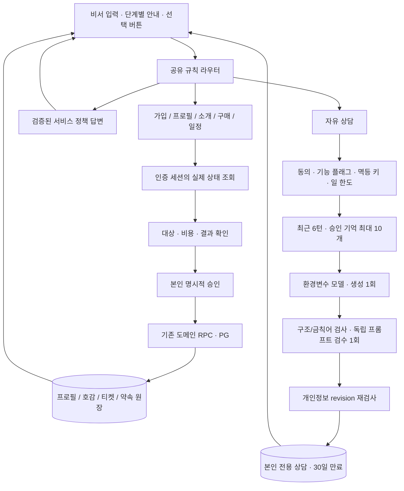
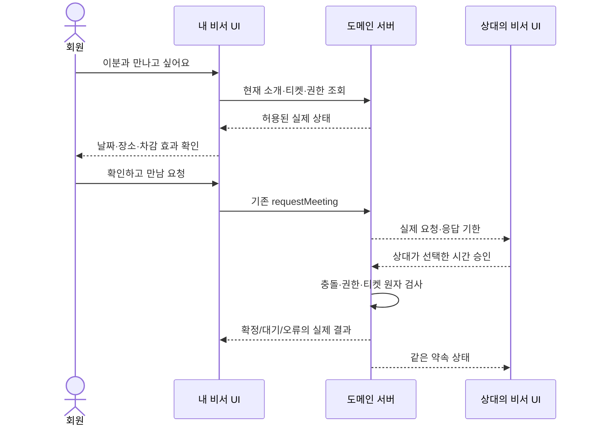

# 비서 워크플로 엔진 · 엔지니어링 설계

2026-10-25 · 기존 개인 비서 설계의 실행 계약. 검증 결과는 별도 QA 보고서로 기록한다.

## 결정

애프터의 비서는 **규칙 기반 제품 워크플로 + 제한된 생성 AI**다. 회원별 LLM을 상시 실행하거나 비서 둘이 대화하며 약속을 결정하지 않는다. 가입·프로필 준비·여성 호감·남성 열람/티켓·약속을 같은 안내 방식으로 연결하되, 기존 인증·서버 권한·과금·지역·운영 심사 규칙을 바꾸지 않는다. 사진·선택지·PG 창은 구조화된 화면으로 유지한다.

## 현재 상태에서 발견한 문제

1. `준비`를 먼저 매칭해 “프로필 준비”가 대화 팁으로 빠진다.
2. 모든 `결제` 질문을 고객센터로 보내 실제 구매 동선과 단절된다.
3. 소개·호감·회원가입이 비서 도움 범위에 명시되지 않았다.
4. 홈과 상담의 요청 해석이 분리되어 서비스 질문도 모델로 갈 수 있다.
5. 일반 자유 상담은 생성+검수 2회다. 이 비용은 단순 정책·이동 질문에는 필요 없다.
6. 출처 없는 LLM 답변이 결제·상태를 설명하거나 실행 완료를 주장하면 안 된다.

## 요청과 실행의 분리

공유 라우터는 요청 종류만 반환한다. URL, 회원 ID, 금액, RPC 이름을 LLM이 만들지 않는다. 프런트엔드는 허용된 action ID만 실제 링크로 변환한다. 채팅의 “좋아요”, “결제해줘”만으로 상태를 변경하지 않는다. 애매한 질문은 모르는 상태를 설명하거나 자유 상담으로 보낸다. 위험·사생활 침해 요청은 서비스 탐색보다 먼저 거절한다.

| 단계        | 비서가 하는 일                                | 사용자 확인 · 서버 증거                                |
| ----------- | --------------------------------------------- | ------------------------------------------------------ |
| 가입        | 약관→현재 인증→회사·지역 순서 안내            | 인증 결과와 기존 가입 복구 선택. 모델 인증 대행 금지   |
| 프로필 생성 | 기본 정보→생활 선택→인터뷰→작성안 검토        | 사진 최소 수·필수값 검사, 본인이 공개 저장             |
| 수정        | 기존 공개 프로필 확인 후 수정 흐름            | 저장 전까지 기존 프로필 유지. 인터뷰 revision으로 발행 |
| 여성 호감   | 현재 후보의 공개 프로필과 좋아요/넘기기 안내  | 기존 affinity 권한·중복 방지. 거절은 확인창            |
| 남성 열람   | 준비된 소개·현재 티켓·무료/유료 상태 안내     | 명시적 열기에서만 차감. 열기 전 티켓 효과 확인         |
| 구매/만남   | 상점 실제 상품→주문→PG, 후보·장소 요청        | 여성 구매 유도 금지. PG 성공 URL만으로 지급 금지       |
| 일정        | 가능한 시간·초안·승인·대기 상태 안내          | 기존 불변 approval token, 원자적 확정·중복 방지        |
| 만남 전후   | 공개 프로필 기반 대화 팁, 참석/후기 다음 행동 | 자동 심리 추측·역할극·미승인 기억 저장 금지            |

## AI 호출 예산

| 용도                                    | 요청당 모델 호출     | 경계                                                       |
| --------------------------------------- | -------------------- | ---------------------------------------------------------- |
| 상태/가입/호감/구매/일정 안내, 정책 FAQ | **0회**              | 로컬 공유 규칙 + 인증된 서버 상태                          |
| 위험 요청·실행 위임 거절                | **0회**              | 모델보다 먼저 안전 규칙                                    |
| 비공개 자유 상담                        | **최대 2회**         | Sonnet 생성 800출력 토큰 + 검수 200, 각 20초·자동 재시도 0 |
| 프로필 생성/분석·상대 맞춤 팁           | 기존 전용 파이프라인 | 공개 승인/열람 자격·근거 검증·기존 예산 유지               |

`ASSISTANT_COACH_MODEL`과 기존 기본 모델을 유지한다. 상담은 본인당 24시간 10개 AI 실행 한도이며 기록을 지워도 실행 원장은 남는다. 같은 request UUID는 기존 영수증을 읽고 재호출하지 않는다. 실패 시 무한 재생성·다른 모델로 우회하지 않는다. 응답 품질을 위해 생성 후 검수는 유지하고, 단순 서비스 질문을 0회 경로로 빼는 것이 이번 최적화다.

프롬프트 캐시는 짧은 프롬프트의 최소 토큰·재사용률·쓰기 비용을 확인하지 않고 켜지 않는다. 사용자별 상담 답변의 전역 공유 캐시도 만들지 않는다. 비용 원장에는 feature/model/prompt version/token/latency/status만 남기며 상담 원문을 로그에 출력하지 않는다.

## 안전·일관성

- LLM에는 결제/호감/약속 실행 도구와 service-role 키가 없다.
- 공유 라우터는 인증/상태 조회를 대신하지 않는다. 클라이언트 조작 시에도 기존 RPC가 최종 거절한다.
- 상담 원문·승인 기억은 본인 전용. 상대/운영자의 조회 API에 합치지 않는다.
- 서비스 상태 FAQ는 호출자 세션으로 조회한 상태 코드만 해석하고, 전체 홈 응답·상대 프로필·일정·연락처를 모델 문맥에 넣지 않는다.
- 메모리/동의 삭제 시 revision이 바뀌어 진행 중 답변은 저장하지 않는다.
- 홈의 자유 입력은 기존 owner-bound·60초·일회용 메모리 draft만 사용한다. URL·localStorage에 넣지 않고 자동 전송하지 않는다.
- 상담/기억/일정 운영 플래그 OFF 유지. 로컬 테스트만 ON. 실제 SMS·카카오·실결제·실회원 QA 없음.
- 변경된 상태를 재조회하지 못하면 이전 정보로 실행 완료를 주장하지 않는다. 질문 이동 자체는 “실행 완료” 영수증이 아니다.

## QA 수락 기준

라우팅 표(중복 키워드·질문/명령·성별·애매한 문장·유해 요청), 0회 호출 증거, 가입→프로필 생성/수정→여성 호감/거절→남성 무료/유료 열람→PG 모의 결제→만남/일정/취소/후기까지 기존 통합 QA를 실행한다. 별도 상담·기억·일정 suite로 동의/멱등/삭제 race/권한/다중 요청을 확인한다. Chromium/WebKit, 320/390/데스크톱, 라이트/다크, 키보드 축소·접근성·오버플로를 확인한다. 실제 LLM 품질·기기·외부 채널은 자동 모의 검증과 구분해 기록한다.

## 설계 근거

명확한 절차는 단순한 워크플로로 처리하고 동적 판단에만 모델을 쓰는 접근을 채택했다. [Anthropic: Building effective agents](https://www.anthropic.com/research/building-effective-agents). 캐시는 반복 prefix와 실제 비용 구조에 따라 평가한다. [Claude: Prompt caching](https://platform.claude.com/docs/en/build-with-claude/prompt-caching).
