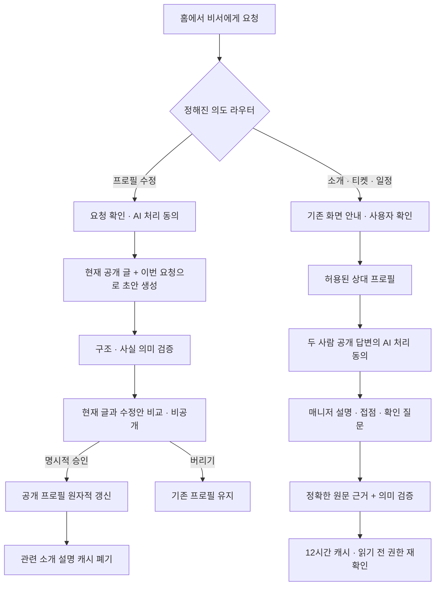

# 매니저 소개 · 비서 프로필 수정 — 로컬 검증

2026-10-25. 인디고·핑크 디자인 승인 후 실제 LLM을 연결한 변경이다. **운영 활성화와 로컬 검증을 분리한다.** 새 기능의 DB 기본값은 OFF이며 운영에서 켜는 변경은 포함하지 않는다.

## 사용자 경험과 구현 경계

- 서비스 안내·화면 이동은 LLM 0회. 호감·결제·일정 확정을 대화만으로 몰래 실행하지 않는다.
- 상대 소개는 회원 본인의 공개 권한으로 읽은 서술형 자료만 사용한다. 관리자 매칭 메모, 비공개 선호·상담·기억, 사진, 신원정보는 모델 입력에 넣지 않는다.
- 매니저 설명은 상대의 일상, 두 사람의 근거 있는 접점, 함께 알아볼 질문으로 구분한다. 원문 근거를 별도로 볼 수 있다. MBTI 기반 성격 추정·궁합·호감 추측·성공 보장은 금지한다.
- 프로필 수정은 현재 공개 V3 글과 이번에 동의한 요청만 사용한다. 초안 생성과 공개 저장은 별개다. 사진·기본 정보·비공개 선호는 그대로 유지한다. V3 자료가 없으면 기존 준비 동선으로 안내한다.
- 승인 화면의 변경 안내는 실제 diff로 만든 짧은 한국어 문장이다. 모델의 내부 필드명은 노출하지 않는다.
- 다른 화면에서 프로필이 바뀌면 이전 초안의 승인과 늦게 도착한 결과 저장을 거절한다. 중복 생성·중복 승인은 영수증으로 구분한다.

## 호출·비용 제어

| 항목 | 계약 |
| --- | --- |
| 상대 소개 | 생성 1회 + 의미 검증 1회, 유효 캐시 조회는 0회 |
| 프로필 수정 | 생성 1회 + 의미 검증 1회, 저장/버리기는 0회 |
| 재시도 | SDK 자동 재시도 0회, 자동 보완 호출 없음 |
| 한도 | 각 기능 사용자당 24시간 내 생성 5회 |
| 기본 모델 | 기존 `DEFAULT_TEXT_MODEL` 재사용, 현재 `claude-sonnet-5-5` |
| 기능별 변수 | `MEMBER_INTRODUCTION_MODEL`, `PROFILE_REVISION_MODEL`, 기존 편집/검증 모델 변수 지원 |
| 계측 | `ai_runs`에 요청 ID·프롬프트 버전·모델·입출력 토큰·지연·상태 기록. 원문은 운영 사용량 지표에 넣지 않음 |

프롬프트는 소개 `member-introduction-v2-natural-voice`, 수정 `profile-revision-v3-member-copy`다. 수정의 실제 공개문 검증은 v2에서 성공했으며 v3는 사용자용 안내 note만 한국어로 제한한 변경이다. 새 유료 호출 없이 변경 안내의 deterministic helper를 검사했다.

## 실제 생성문 확인

합성 회원의 실제 모델 결과이며, 운영 회원 자료가 아니다.

**상대 설명:**

> 처음 만날 때는 조용한 카페에서 커피를 마시며 천천히 알아가는 걸 바란다고 해요. 술은 잘 마시지 않는다고도 알려주셨어요.

**두 사람의 접점:**

> 두 분 모두 처음에는 조용한 카페에서 커피를 마시며 천천히 알아가고 싶다고 하셨어요. 첫 만남의 속도와 분위기를 편하게 맞춰볼 수 있을 것 같아요.

첫 만남의 희망을 이미 늘 해온 습관으로 바꾸지 않고, 음주 부정을 보존했다. 요리·전시 메모·평일 짧은 만남도 실제 합성 원문과 대조했다. 성격이나 호감을 새로 추정하지 않았다.

**프로필 수정 전:**

> 퇴근길에 동네 서점에 들르거나 음악을 들으며 걸어요. 최근에는 수영을 배우고 있어요.

**수정 후:**

> 퇴근길에는 동네 서점에 들르기도 하고, 음악을 들으며 걷기도 해요. 요즘은 수영도 배우고 있어요.

요청한 말투만 다듬고 한 줄 소개와 다른 두 답변은 그대로였다. 서점 방문을 독서 취향으로, 수영 수강을 꾸준한 성격이나 감정으로 부풀리지 않았다.

## 검증 결과

| 검사 | 결과 | 범위 |
| --- | --- | --- |
| `npm run check` | PASS | 타입·전체 린트·대비·AI/인증/일정 helper·production build |
| 새 DB 검사 | 67 assertions PASS | 소개 26 + 수정 26 + 사용량/기능 플래그 15, 트랜잭션 rollback |
| 전체 SQL 회귀 | 70파일 / 1,042 assertions PASS | 별도 fresh DB에서 전체 migration·seed 후 실행, 기존 사용자 DB 초기화 없음 |
| 배포 기본값 | PASS | fresh DB의 상담·기억·일정·소개·수정 다섯 플래그 모두 false |
| QA 재개 중복 비용 방지 | 6/6 PASS | 가짜 provider만 사용. 성공 영수증 재사용, 입력 변경·불명확/실패 상태 재전송 차단, 원자적 저장·동시 잠금 |
| 기존 화면 회귀 | 42/42 PASS | 7개 화면 × 320/390/1440px × 라이트/다크, 등록 안 된 요청·브라우저 오류 0 |
| 실제 LLM 소개 | PASS | 공개 권한/동의, 실제 생성문 대조, 캐시 hit 시 실행 증가 없음 |
| 실제 LLM 수정 | PASS | 초안 때 공개 불변, 화면에서 승인, 원자적 반영, 중복 승인 시 revision 유지 |
| 소개 갱신 | PASS | 승인 전 캐시 1건 → 승인 후 0건, 바뀐 공개 자료로 새 설명과 다른 source hash |
| 기존 매칭 한 사이클 | PASS | 여성 호감 → 운영 큐 승인 → 남성 모의 결제·소개 열람 → 만남 요청 → 여성 비서 승인 → 양쪽 참석 → 후기 2건·완료 상태 |
| 오래된 초안·권한 회수 | PASS | 실제 성공 결과를 복제한 별도 비공개 SQL fixture, 최신 글 변경 후 PT409·추가 모델 호출 0 |
| 기존 기록 보존 | PASS | 검사 전 public 행 해시와 대조. 기존 cron의 `curation_batch_state` 파생 집계 갱신 1행은 별도 명시 |
| 독립 코드 리뷰 | APPROVE | 공개 권한·최소 입력·중복/경합·캐시·UI 무효화·운영 OFF 계약 |
| 독립 시각 마감 리뷰 | ship | 실제 생성 결과 8개 캡처, 모바일/데스크톱·라이트/다크. 새 디자인 결함 없음 |

실제 완료 상태는 양쪽 참석 `true`, 후기 2건, `completed_by=2`, 완료 시각 존재, 취소 없음이다. 실 PG 요청과 브라우저의 예기치 않은 모델 요청은 각각 0건이다. 완료되지 않은 실기기·실결제·운영 활성화를 이 표의 PASS에 포함하지 않는다.

### 실행 근거

- 독립 QA 결과: `/tmp/after-concierge-cycle-qa-concierge-mvngc2y1/report.json`.
- 실제 모델 작업 5건: 성공 3건(소개 2·수정 1), 의미 검증 탈락 1건, 생성 오류 1건. 공급자 요청은 최대 10회이며 자동 재시도하지 않았다. `ai_runs`에 기록된 입력 20,462 / 출력 3,577토큰이다. 실패한 공급자 요청의 미회신 사용량까지 포함한 청구액을 뜻하지 않는다.
- 실제 소개문: 같은 디렉터리의 `manager-introduction-after-edit.json`.
- 수정 전후: `profile-revision.json`. 마지막 stale 검사는 이 실제 결과를 재사용한 안전장치 fixture임을 report에 명시했다.
- 최종 소개 캡처: `real-manager-introduction-after-edit-{light,dark}-{390,1440}.png`.
- 최종 수정 캡처: `profile-revision-final-review-{light,dark}-{390,1440}.png`.
- 이전 실패 시도의 `failure.json`은 보존했다. 최종 상태와 혼동하지 않도록 `report.json`의 `resolvedFailures`에서 구분한다. QA 산출물은 임시 경로이므로 영구 보관을 보장하지 않는다.

시각 마감은 전용 finish-reviewer 대신 독립된 일반 리뷰어가 동일 역할로 수행했다. 승인 comp가 없는 코드 중심 확장이므로 문서의 OWN-WORLD를 기준으로 평가했다. 동의와 최종 승인 행동은 실제 사이클과 소스 검토로 확인했고, 8개 캡처는 소개 설명·수정 비교 섹션을 보여준다. 인디고·핑크·Wanted Sans와 기존 상세 캐릭터를 유지했으며, 기존 `Gowun Batang` 짧은 인용 예외를 디자인 문서에 명시했다. 규칙 무시 항목은 추가하지 않았다.

## 발견·보완한 사항과 남긴 제한

- 소개의 `걸어요라고` 같은 어색한 인용 말투: 간접화법과 정확한 원문 인용을 분리하고 의미 검증 규칙도 보완했다. 실제 v2 결과에서 해소했다.
- 첫 프로필 수정의 의미 검증 실패: 공개하지 않았다. 요청 범위를 좁히고 불필요한 의미 확장을 막은 v2에서 실제 생성·승인을 통과했다.
- 초안 안내의 `summary`/`headline` 노출: diff 기반 한국어 안내로 교체했다. 기존 영수증에도 적용된다.
- 독립 리뷰에서 QA 후단 실패 후 재개 시 성공한 모델을 다시 호출할 가능성을 발견했다. 작업별 입력 해시·고정 요청 ID·원자적 영수증 파일·동시 잠금으로 막고, fake provider 6개 검사로 확인했다. 불명확/실패 전송은 자동 재시도하지 않는다. 실제 모델 실험은 다시 실행하지 않았다.
- Edge의 설정 읽기 권한 부족: 필요한 두 컬럼에만 service-role SELECT를 부여했다. 기능 OFF를 우회하지 않는다.
- 로컬 인증 응답의 미래 `iat` 오류: 로컬 VM/호스트 시계 차이를 확인하고 테스트 프록시 대기만 2초로 조정했다. 앱·운영 인증 검증은 완화하지 않았다.
- 마지막 추가 수정 생성 1건은 `generation_failed`로 종료됐다. 기존 프로필은 보존됐고 오류 영수증을 남겼다. 원인과 재현율은 미확인으로 남기며 비용을 늘려 재시도하지 않았다. 오래된 초안 차단은 실제 성공 결과를 재사용한 명시적 SQL fixture로 분리해 검증했다.
- 로컬 전체 migration up은 이전 `20261017200400`의 이미 존재하는 함수와 registry 불일치로 멈췄다. 초기화하거나 과거 migration을 임의로 완료 처리하지 않고 이번 새 migration 3개만 트랜잭션으로 적용했다.
- 기록이 쌓인 사용자 로컬 DB에서 전체 SQL 검사를 실행했을 때 5개 기존 파일이 전역 AI 호출 수·일정 후보·성숙 코호트·기능 OFF의 초기 상태 전제 때문에 실패했다. 독립 코드 탐색으로 전제를 확인한 뒤 별도 프로젝트 `after-concierge-dbqa-6llnpx`/56582 포트에서 전체 migration·seed·70파일 검사를 통과했다. 사용자 DB를 초기화하거나 실패 검사를 느슨하게 고치지 않았다. 검증 후 이 임시 DB만 제거했다.

실제 LLM 평가는 소수 합성 사례다. 다양한 회원의 표현·방언·희망/부정·빈도·오류율과 사람 만족도에 대한 대규모 검증은 아니다. 모델 검증기가 사실성을 보장하지 않으므로 운영 활성화는 별도 결정으로 남긴다.

## 직접 확인할 순서

기존 환경 <http://127.0.0.1:5191/login>과 [기존 남녀 계정](assistant-manual-cycle.md#접속과-계정)을 그대로 사용한다. 원래 커플의 기록을 초기화하지 않았다.

1. 홈에 `퇴근 후 일상 답변을 더 자연스럽게 다듬어줘` 입력 → **비서와 프로필 다듬기**.
2. 구체적인 요청 확인 → AI 처리 동의 → **비서와 다듬기**. 이 순간에는 공개 프로필이 바뀌지 않아야 한다.
3. 현재/수정안 비교 → **이대로 프로필에 반영** 또는 **반영하지 않고 다시 쓰기**. 사진·기본 정보는 기존 직접 수정에서 확인한다.
4. 여성 호감·운영 큐 승인·모의 결제·남성 소개 열람은 기존 안내 순서대로 진행한다. 승인 없이 프로필을 우회해 열 수 없어야 한다.
5. 열린 상대의 **이분을 소개할게요**에서 동의 → **비서 설명 듣기**. 상대 설명·접점·질문과 공개 원문을 비교한다.
6. 만남 요청·비서 일정 초안·확정·참석·후기는 기존 동선으로 이어간다. 기존 진행을 보존했으므로 현재 상태부터 계속한다.

로컬의 직접 생성도 Anthropic 비용이 발생한다. 상태 안내·저장·모의 결제에는 LLM을 호출하지 않는다. 실결제·외부 문자·카카오 발송은 실행하지 않는다.
