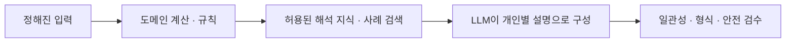

# After 자체 연애 비서 엔진 — 모델·학습 데이터·비용 전략

2026-10-26 · 검토안. 비용 숫자는 명시된 가정에 따른 시뮬레이션이며 사용 승인·가격 결정이 아니다. 제품/결함/구현 순서는 [V2 신뢰 로드맵](concierge-v2-reliability-roadmap.md)에 있다.

## 1. 먼저 결정할 방향

**After만의 엔진은 지금부터 만들어야 한다. 처음부터 범용 언어 모델을 사전학습할 필요는 없다.**

장기 경쟁력은 다음 다섯 가지다.

1. 한국 직장인의 소개·표현·조율 문제를 잘 나눈 업무 설계.
2. 공개 사실·비공개 선호·일시 제약을 구분하는 사용자 이해 구조.
3. 실제 호감·조건·운영 가능성에 근거한 추천과 설명.
4. 사람이 바로잡은 좋은/나쁜 예시와 재현 가능한 평가 세트.
5. 동의·정정·삭제·안전한 실행을 보장하는 제품 데이터 체계.

이 위에서 LLM은 교체 가능한 표현·해석 부품이다. **After Engine은 당장 소유할 제품 자산, After Writer 같은 특화 가중치는 나중에 검증할 자산**으로 구분한다. 오픈 가중치를 가져왔다고 기반 모델의 독점 소유권을 얻는 것은 아니다. 코드·어댑터·데이터의 권리와 기반 모델 라이선스를 각각 관리한다.

### 네 가지 선택지

| 선택                    | 실제 의미                                               | 장점                                         | 현재 판단                                                             |
| ----------------------- | ------------------------------------------------------- | -------------------------------------------- | --------------------------------------------------------------------- |
| 범용 API + After 엔진   | 정책·개인 기억·공개 근거·도구·평가를 우리 시스템이 관리 | 빠른 개선, 낮은 고정비, 강한 기본 언어 능력  | **당장 권고**. 공급자 이름보다 완료 작업 품질/원가로 선택             |
| 오픈 가중치 그대로 실행 | 공개 모델을 로컬/전용 서버에서 추론                     | GPT/Claude 없이 실행 가능, 처리 경로 통제    | 합성 오프라인 기준선부터. 한국어 상담 품질은 별도 검증                |
| 오픈 모델 + SFT/LoRA    | 예시로 특정 문체·판단·형식을 추가 학습                  | 좁은 반복 업무에서 좋은 일관성과 원가 가능성 | 데이터/평가를 확보한 뒤 **한 가지 과업부터**                          |
| 처음부터 사전학습       | 토크나이저·대규모 말뭉치·분산학습·안전 정렬을 직접 구축 | 기반 구조까지 통제                           | 현재 사업 단계에서 비권고. 만남 수요·매출과 연결되는 우선 과제가 아님 |

“파인튜닝하면 더 똑똑하고 싸다”는 자동 성립하지 않는다. 좁은 형식에는 좋아져도 긴 대화·부정 이해·안전성이 나빠질 수 있다. 추론 비용보다 데이터 검수·배포·장애 대응이 더 클 수도 있다.

## 2. 사주 특화 서비스가 꼭 자체 LLM인 것은 아니다

특정 업체의 내부 구조는 확인하지 않았으므로 ‘그 서비스는 프롬프트만 쓴다/자체 학습했다’고 단정할 수 없다. 다음과 같은 구조만으로도 사용자는 강한 전문성을 느낄 수 있다.



사주 서비스라면 달력/명식 계산과 해석 자료를 별도 엔진에 둘 수 있다. 이것은 **가능한 구조의 예시**이지 사주 해석의 과학적 타당성이나 특정 회사 구현에 대한 증거가 아니다.

After에 적용할 것은 ‘특화 도메인 엔진’이지 근거 없는 궁합 단정이 아니다.

| 사주형 서비스에서 보일 수 있는 구조 | After의 적절한 대응                                       |
| ----------------------------------- | --------------------------------------------------------- |
| 고정 입력/계산 결과                 | 공개 프로필, 본인이 승인한 선호, 실제 일정 제약           |
| 해석 규칙/사례                      | 소개 진행 정책, 좋은 질문/자기표현 가이드, 근거 표현 규칙 |
| 개인별 해설                         | 그 사람의 구체적인 모습·공개 접점·확인할 질문             |
| 후속 상담                           | 내가 선택한 목표와 현재 관계 단계에 맞춘 조언             |

MBTI·생년월일·사주를 사실처럼 성격/궁합에 매핑하는 모델을 만들지 않는다. 취향 대화 소재로 사용할지조차 별도 제품 결정이며, 추천 하드 필터·제재·유료 유도 근거로 쓰지 않는다.

## 3. LLM·추천 모델·개인 기억은 서로 다른 문제다

### 3.1 Writer: 표현을 잘 만드는 모델

입력: 허용된 원문, 변경 대상, 말투 지시, 보존해야 할 사실/부정/희망.

출력: 수정된 한 줄/답변, 바뀐 범위, 근거 참조. **새 경험·성격·감정·빈도 추가 금지.**

첫 자체 모델 후보는 이 Writer가 적절하다. 작업 범위가 작고, 수정 전후와 사람이 선택한 문장을 비교할 수 있기 때문이다. 자유로운 심리 상담이나 일정을 직접 실행하는 모델부터 만들지 않는다.

### 3.2 Router/Extractor: 요청을 정확하게 해석하는 모델

명확한 규칙은 0회, 모호한 입력에만 작은 모델을 후보로 둔다. 출력은 `intent/subject/slots/negations/missing_fields`이고 실행 도구 권한은 주지 않는다. 날짜의 유효성·상대 접근·티켓·동의는 코드가 다시 검사한다. 확신이 없으면 ‘모른다/질문 필요’를 허용한다.

모델이 뱉는 0.97 같은 confidence는 보정 전에는 실제 정확도 확률이 아니다. held-out 분류 결과로 임계값·거절 정책을 정하고, 민감한 행동은 confidence와 관계없이 승인한다.

### 3.3 Match Ranker: 누구를 소개할지 고르는 시스템

현재는 여성의 실제 호감, 권역·자격·제외 관계, 선택형 공통 항목·관심사·가능 요일, 대기 시간을 사용하는 규칙 추천이다. LLM 소개 설명이 붙는다고 선정 자체가 학습 기반인 것은 아니다.

권고 순서:

1. **하드 제약 유지:** 실제 호감/노출 계약, 가입·검수 자격, 차단, 권역, 기존 소개 중복, 사용자가 명시한 필수 조건.
2. **노출/선정 로그:** 후보 집합, 노출 순서, 운영자가 바꾼 이유, 당시 조건과 policy version을 기록. private 원문을 복제하지 않는다.
3. **설명 가능한 규칙 조정:** 시간대 중첩·만남 방식·대기 공정성. 중요 조건은 사용자가 고칠 수 있게 한다.
4. 충분한 결과가 쌓이면 로지스틱/트리 기반 또는 pairwise ranker를 비교한다. 추천 순위만 제안하고 초기에는 운영 확인을 유지한다.
5. ‘왜 이분인가’는 실제 선정 feature와 공개 근거를 이용한다. 선정 후 LLM이 그럴듯한 이유를 새로 꾸미지 않는다.

목표는 한쪽의 클릭/좋아요가 아니라 **양쪽 의향과 일정 합의, 실제 만남의 유용성**이다. 한 사람에게 몰리는 노출, 성별/연령대/권역별 데이터 불균형, 운영자 선택 편향을 별도 측정한다. 노출되지 않은 사람을 ‘거절당함’으로, 답하지 않은 후기를 ‘실패’로 학습하지 않는다. 차단·안전 필터는 탐색 실험으로 우회하지 않는다.

### 3.4 Memory: 모델이 아니라 수정 가능한 개인 데이터

개인 사실은 검색/상태 시스템이 담당한다. 가중치에 넣으면 특정 회원의 수정·철회·탈퇴를 정확히 반영하기 어렵다. 모델 변경 시에도 동일한 owner-bound 기억과 권한을 사용한다. 개인별로 하나씩 파인튜닝된 모델을 만들 필요가 없다.

## 4. 모델 후보와 도구

아래는 **평가 후보**이지 운영 교체 결정이나 벤치마크 결과가 아니다. 2026-10-26 열람 기준이며 계정 사용 가능 여부·실제 품질·가격은 실행 직전 다시 확인한다. 모델 카드는 공급자의 주장이지 After 사용자에 대한 품질 검증이 아니다.

| 후보/도구                 | 확인한 사실                                                     | After에서의 역할                                                                                                       |
| ------------------------- | --------------------------------------------------------------- | ---------------------------------------------------------------------------------------------------------------------- |
| 현 Sonnet 기본값          | 코드 `claude-sonnet-5-5`, 소수 합성 실생성 기록 존재            | 비교 기준. 현재 모델을 일괄 교체하지 않음                                                                              |
| Claude Haiku 5.5          | 공식 가격표가 분류/추출/라우팅용 저가 모델로 안내               | 같은 공급자 내 경량 후보. 라우터/한정 편집 평가부터. 이름만 보고 검증기까지 동시에 교체하지 않음                       |
| Qwen3-8B                  | 공식 배포 카드에 Apache-2.0, thinking/non-thinking, 다국어 지원 | GPT/Claude와 독립적인 **재현 가능한 오픈 가중치 기준선**. 최신/최고 모델이라는 주장은 아님. 한국어 뉘앙스는 직접 평가  |
| EXAONE-4.0-1.2B           | 한국어 지원. 해당 배포본의 라이선스는 EXAONE 1.2-NC             | 상용 After 기본 후보에서 제외. 이 배포본은 상업 사용에 별도 계약 필요; 다른 EXAONE 배포본까지 일반화하지 않음          |
| Ollama                    | 로컬 JSON schema structured output 지원                         | 개발 Mac의 추론 실험. 모델 자체나 학습 데이터 생성 보증이 아님. 해당 문서상 cloud structured output 지원은 로컬과 다름 |
| MLX-LM                    | Apple Silicon에서 생성·파인튜닝 지원                            | Mac 자원에 맞는 소규모 LoRA 실험. 운영 24시간 고가용성 서버의 대체로 단정하지 않음                                     |
| Transformers + PEFT + TRL | SFT/LoRA, 선택 쌍 기반 DPO 훈련 도구                            | 독립된 학습 환경. inference/Ollama 버전과 별도 고정                                                                    |
| vLLM                      | OpenAI-compatible serving API 제공                              | 향후 Linux/GPU 서빙 후보. API 호환이 품질·권한 호환을 뜻하지 않음                                                      |

근거: [Claude 가격](https://platform.claude.com/docs/en/about-claude/pricing), [Qwen 모델 카드](https://huggingface.co/Qwen/Qwen3-8B), [EXAONE 해당 LICENSE](https://huggingface.co/LGAI-EXAONE/EXAONE-4.0-1.2B/blob/main/LICENSE), [Ollama 구조화 출력](https://docs.ollama.com/capabilities/structured-outputs), [MLX-LM](https://github.com/ml-explore/mlx-lm), [vLLM 서버](https://docs.vllm.ai/en/latest/serving/openai_compatible_server/).

OpenAI의 현재 모델 최적화 문서는 평가→프롬프트/맥락→필요 시 학습→재평가 흐름을 설명한다. 또한 열람 시점에는 fine-tuning 플랫폼의 신규 사용자 접근 중단 안내가 있어, 과거 API 튜토리얼을 보고 새 학습을 바로 시작할 수 있다고 가정하지 않는다. After 자체 모델 경로는 특정 공급자의 학습 플랫폼에 의존하지 않는다. [공식 최적화 가이드](https://developers.openai.com/api/docs/guides/model-optimization).

## 5. 무엇을 쌓아야 실제 자산이 되는가

**대화가 많이 저장되어 있다는 것과 학습에 쓸 수 있는 데이터가 있다는 것은 다르다.** 현재 회원 수·실제 원문 수·유효 학습 동의 수는 이번에 조회하지 않았으며, 학습 가능 규모는 미확인이다.

| 데이터      | 필요한 필드/정답                                                                 | 쓸 곳                    | 수집 원칙                                                                       |
| ----------- | -------------------------------------------------------------------------------- | ------------------------ | ------------------------------------------------------------------------------- |
| 업무 의도   | 요청, 진행 중 업무 요약, 올바른 intent/slots/부정/질문                           | 규칙·분류 eval           | 합성 한국어 반례부터. 실제 대화는 별도 권리/최소화                              |
| 프로필 교정 | 허용 원문, 요청, 보존 사실, 초안, 사람이 고른 수정안, 이유                       | Writer SFT/eval          | 최종 승인 자체가 사실성 정답은 아님. 근거를 사람이 확인                         |
| 소개 설명   | 허용된 두 공개 근거, 설명, unsupported claim 표시                                | 사실성/개인성 평가       | 상대 자료를 학습에 쓰는 권리는 별도. 열람 가능=학습 허용 아님                   |
| 조언 품질   | 질문 맥락, 좋은/나쁜 답, 선택 이유, 안전 판정                                    | 향후 상담 평가·선호 학습 | private 고민은 기본 학습 제외. 고위험 내용은 별도 안전 처리                     |
| 업무 결과   | operationId, 승인/실행/실패 코드, 반복 입력, 복구                                | 실행 품질                | 원문 없이 기술 계측 가능. 계정 식별자도 최소화                                  |
| 추천 결과   | 후보 집합 ID, policy version, 노출/선정, like/skip, 일정 합의, 참석, 선택적 후기 | ranking 검증             | 관측하지 못한 결과는 missing. 자유서술 원문 전체를 feature로 기본 사용하지 않음 |
| 사진 코칭   | 동의된 이미지와 전달력 문제 라벨, 제안 채택                                      | 후속 시각 품질           | 신원/외모 등급·인종/성격 추정 금지. 당장은 학습 대상에서 제외                   |

### 평가·학습 데이터를 운영 로그와 분리

신규 제안 테이블/레지스트리:

```text
quality_feedback:
  task_kind, run_id, operation_id, rating_reason, created_at
  # 일반 계측에는 상담/프로필 원문 없음

dataset_examples:
  example_id, task_kind, input_ref, target_ref, evidence_ref
  source_kind, permission_record, allowed_uses, retention_until
  reviewer_ids, rubric_version, pii_check, lineage_refs
  subject_group_id, split, dataset_version, tombstoned_at

model_registry:
  base_repo, base_revision, license_digest, adapter_digest
  dataset_version, training_config, eval_report, quantization
  inference_runtime, approved_tasks, deployment_stage
```

`input_ref/target_ref`는 권한 있는 별도 저장소의 참조다. Git·콘솔·일반 관리자 대시보드에 회원 원문을 복사하지 않는다. 내용 해시도 재식별 가능성이 있으므로 익명 정보로 단정하지 않는다.

### 별도 동의와 권리

- 서비스 제공을 위한 AI 처리, 개인 기억 저장, 품질 검토 표본 제공, 모델 학습 제공은 같은 목적이 아니다.
- 베타 가입 동의로 전체 상담을 학습시키지 않는다. 초기는 **직접 작성한 합성 예시와 권리가 확인된 자료**만 사용한다.
- 실제 자료를 추가한다면 선택 동의, 거절해도 핵심 서비스 사용 가능, 철회/삭제 방법, 처리자/보유 기간/국외 처리 등 확인이 필요하다. 법률 적합성 확정은 별도 검토 사항이다.
- 상대 두 명의 데이터가 들어가는 샘플은 한 사람의 동의만으로 통과시키지 않는다.
- 모델 API 출력으로 경쟁/대체 모델을 학습시키는 distillation은 출력 권리만 보고 허용된다고 가정하지 않는다. **그 시점의 공급자 계약과 상업 사용 제한**을 검토한 자료만 사용한다. 무단 웹 스크래핑·커뮤니티 상담 수집도 금지한다.
- 삭제 요청은 원본→평가 후보→train/validation/test manifest→어댑터 lineage까지 추적한다. 가중치에 반영된 실제 개인정보를 즉시 제거할 수 있다고 약속하지 않는다. 이 때문에 첫 학습은 개인 원문이 아닌 비개인 합성 자료로 제한한다.

## 6. 데이터 준비와 학습의 실제 순서

숫자는 실험 계획을 잡기 위한 목표치이며 모델 학습 성공을 보장하는 최소 조건이 아니다.

### 0단계: ‘좋은 답’의 정의부터

연애 심리 권위자가 된 척하지 않는 공통 rubric을 만든다.

- 사실성: 입력의 사실/희망/부정/빈도를 지켰는가?
- 개인성: 누구에게나 할 수 있는 일반론 대신 실제 단서가 있는가?
- 실용성: 사용자가 다음에 할 수 있는 행동 한 가지가 있는가?
- 자연스러움: 따뜻하지만 장황하거나 과장하지 않는가?
- 자율성: 불안을 자극하거나 선택을 강요하지 않는가?
- 권한: 공개 범위/현재 업무/승인을 지키는가?

‘예쁜 말이 많음’이나 ‘회원이 좋아요를 눌렀음’만으로 정답을 정하지 않는다.

### 1단계: 작은 고정 평가 세트

처음에는 합성 **200개 독립 사례군**을 작성한다. 권고 분포: 라우팅/부정/후속 발화 60, 프로필 교정 50, 소개 설명 30, 기억 정정/삭제 20, 일정·권한·안전 40. 같은 사건의 문장 변형과 다중 턴은 하나의 사례군으로 묶는다.

- 120개 개발용, 80개 봉인된 holdout으로 시작한다. 라벨 편중을 확인하고 실제 베타 표현이 들어오면 별도의 미래 시점 검증 세트를 추가한다.
- 비슷한 문장·같은 인물·같은 만남·같은 시나리오 변형이 양쪽에 섞이지 않게 group split을 한다.
- holdout의 답을 보고 프롬프트를 고쳤다면 그 세트는 개발용이 된 것으로 관리하고 새 독립 검증을 준비한다.
- 각 치명 오류 유형 표본은 작기 때문에 0건이라도 안전을 보장하지 않는다. 발견된 오류는 회귀에 누적한다.

### 2단계: 프롬프트/규칙/API 기준선

동일한 입력·context 범위·출력 스키마로 현 Sonnet, 경량 API 후보, 오픈 모델 기본형을 비교한다. 사람에게 모델 이름을 숨기고 짧음/다정함만이 아닌 근거 보존을 먼저 평가한다.

이때 고정 업무는 생성 품질 실험 대상이 아니라 정답이 있는 코드 검사다. 공급자가 장애이면 정해진 오류 응답을 내는 것이 정답일 수도 있다.

### 3단계: Writer 전용 SFT/LoRA

1. 프롬프트 개선만으로 남은 실패 패턴을 분류한다.
2. **추가 500~1,500개 수준의 권리 확인된 고품질 편집 예시**를 계획한다. 수량을 채우기 위한 자동 대량 생성은 하지 않는다. 합성 예시도 사실/문체를 검토한다.
3. Qwen3-8B 같은 후보의 모델/토크나이저/라이선스 revision을 고정한다.
4. SFT로 올바른 입력→출력 동작을 학습한다. LoRA는 전체 가중치가 아니라 작은 추가 행렬을 학습하는 방식이며, QLoRA는 양자화된 기반을 이용해 메모리 요구를 줄이는 선택지다. [PEFT LoRA 설명](https://huggingface.co/docs/peft/main/en/conceptual_guides/lora).
5. training/validation loss만 보지 않고 봉인 holdout·사실 보존·형식·길이·한국어 문체를 비교한다. 초기 실험은 작은 설정 두 개 정도로 제한하고 더 돌릴지는 비용/결과를 보고 결정한다.
6. 추론에 쓸 양자화 버전도 다시 평가한다. 학습 때 좋은 결과가 배포 포맷에서도 같다고 가정하지 않는다.
7. Writer를 통과해도 Router·상담·추천의 사용 승인을 함께 주지 않는다.

개념적 실험 순서일 뿐, 이번 작업에서 모델 다운로드·GPU 임대·학습은 실행하지 않았다.

### 4단계: 필요할 때 선호 학습

SFT가 사실성과 형식은 지키지만 말투 선택이 일관되지 않는 경우에만 사람의 `chosen/rejected + 이유` 쌍을 쌓는다. DPO는 이런 선호 쌍으로 동작을 조정하는 방법이다. 단순한 ‘긴 답 vs 짧은 답’ 편향이나 아첨을 학습하지 않게 rubric으로 검토한다. [TRL DPO](https://huggingface.co/docs/trl/main/en/dpo_trainer).

### 5단계: 운영 승격

오프라인 → 비개인 합성 shadow → 목적/전송 범위가 승인된 제한 beta → 단계적 확대. 기존 API와 같은 입력 스키마·권한·검증·영수증 계약을 유지한다. rollback은 모델/프롬프트 버전 전환으로 가능해야 한다.

shadow도 실제 사용자 내용을 자동 복사해 다른 공급자에게 보내면 안 된다. 새 전송 대상·용도·비용의 승인이 없다면 합성 입력만 사용한다.

## 7. 공급자와 무관한 모델 실행 계약

현재 모델 환경변수는 주로 Anthropic 모델 선택이다. 그것만으로 Ollama/vLLM으로 즉시 바뀌는 provider-neutral 구조는 아니다. 다음 adapter를 먼저 둔다.

```text
generate(taskSpec, permittedEvidence, budgetReservation, requestId)
  -> output | typedError
  -> providerRequestId, modelRevision
  -> input/output/cache usage, usageKnown
  -> finishReason, latencyByStage
```

- provider별 SDK·JSON 출력·토큰 사용량·timeout을 adapter 안에서 정규화한다.
- schema 통과가 사실성 통과는 아니다. 증거/접근/의미 검증은 adapter 바깥에 둔다.
- fallback은 무한 재시도가 아니다. 정보가 다른 공급자로 가도 되는지와 예산을 확인한다. 이미 유료 요청이 수락되었는지 불명확하면 새 호출 전에 영수증/상태를 확인한다.
- 고정된 모델 snapshot을 우선하되 alias만 가능하면 변화 감지와 회귀 점검을 한다. ‘환경변수만 바꾸면 검증 완료’가 아니다.
- 추론 서버에는 Supabase service-role나 무제한 회원 검색 도구를 주지 않는다. 모델이 받는 것은 이미 허용된 최소 근거다.

## 8. 비용 비교: 먼저 API 파이프라인부터 효율화

### 현재 공식 가격을 이용한 가정 예시

열람 시점 Claude 표준 global 요금: Sonnet 5.5 입력 $2/출력 $10, Haiku 5.5 입력 $0.10/출력 $0.50, 각각 100만 토큰당이며 Haiku는 100,000-token 이하 prompt 구간이다. 세금·환율·지역 할증·캐시·배치는 아래 예시에서 제외한다. [가격 원문](https://platform.claude.com/docs/en/about-claude/pricing).

**가정:** 실제 생성이 필요한 작업 하나에 생성 3,500입력/500출력 + 검증 2,500입력/200출력. After 실측 평균이 아니며 프로필 분석·사진·긴 상담은 따로 측정해야 한다.

| 경로                      | 계산                                           | 예시 원가/작업 | 조건                                              |
| ------------------------- | ---------------------------------------------- | -------------- | ------------------------------------------------- |
| Sonnet 생성 + Sonnet 검증 | `(6,000×2 + 700×10)/1e6`                       | $0.0190        | 현재 비교 기준                                    |
| Haiku 생성 + Sonnet 검증  | `(3,500×0.1 + 500×0.5 + 2,500×2 + 200×10)/1e6` | $0.0076        | 해당 작업의 생성 품질 통과가 선행. 전체 적용 아님 |
| 양쪽 모두 Haiku           | `(6,000×0.1 + 700×0.5)/1e6`                    | $0.00095       | 산술 비교만. 독립적인 검증 능력 평가 전 채택 금지 |
| 서버 상태/규칙 안내       | 제공자 호출 없음                               | LLM 비용 $0    | 서버/DB/저장 비용까지 0이라는 뜻 아님             |

경량 생성+기존 검증만으로도 이 가정에서는 **60% 절감**이다. 검증 품질을 유지한다는 조건부 산술 결과이며, 실제 달성한 절감률이 아니다. 전체를 자체 호스팅하기 전에 비교할 가치가 있다.

활성 회원당 월 50개 유료 생성 작업이라는 **별도 사용량 가정**:

| 월 활성 회원 | 월 작업 | Sonnet 두 단계 | 경량 생성+Sonnet 검증 |
| ------------ | ------: | -------------: | --------------------: |
| 100명        |   5,000 |            $95 |                   $38 |
| 1,000명      |  50,000 |           $950 |                  $380 |
| 10,000명     | 500,000 |         $9,500 |                $3,800 |

실제 사용량·실패/재시도·검증 차단·모델별 token·사진·운영 인건비가 없으므로 이 표를 월 예산이나 수익성 확정으로 쓰지 않는다. 기능별 일일 한도가 서비스 전체 월 비용을 보장하지 않는다.

### 자체 호스팅의 손익분기점

```text
API 월비용 = N × C_compare
자체 월비용 = F + N × (C_local + C_external_validation + fallback 비율 × C_fallback)
손익분기 N = F / (C_compare - C_local - C_external_validation - fallback 비율 × C_fallback)

C_compare = 비교 대상 API 경로의 작업당 원가
C_fallback = 자체 경로 실패 시 추가로 호출하는 API 경로의 원가
```

분모가 0 이하라면 이 가정에서 비용상 역전되지 않는다. F에는 GPU 유휴/예비 용량·스토리지·관측·운영 인건비·학습/평가비 상각이 들어간다. GPU 가격만 비교하지 않는다.

**장래 전체 경로 자체화의 설명용 가정:** F=$800/월, C_local=$0.001/작업, 별도 외부 검증 비용=0, API fallback=10%, C_fallback=$0.019/작업. 이 경우 자체 변동 총액은 $0.0029이며, Sonnet 두 단계 대비 약 **49,690작업/월**, 경량 API 경로($0.0076) 대비 약 **170,213작업/월**에서 산술적으로 같아진다. 이는 검증까지 자체 처리할 능력이 평가된 별도 미래 가정이며 **첫 Writer-only 실험의 손익이 아니다.** 특정 GPU 견적이나 After 수요 예측도 아니다.

**Writer만 자체화하고 Sonnet 검증을 유지하는 첫 단계**는 같은 토큰 가정에서 외부 검증에 $0.007/작업이 든다. 자체 변동 $0.001을 더하면 fallback·고정비를 빼고도 $0.008로, 경량 API 생성+Sonnet 검증의 $0.0076보다 비싸다. 이 가정에서는 해당 경량 API 대비 양수 손익분기점이 없다. Writer 실험을 하더라도 비용 절감만이 아니라 표현 품질·독립성의 가치를 검증해야 한다. 동일 품질·처리량·보안·운영 가능성이 가격 비교의 선행 조건이다.

따라서 초기 수백 명 단계에서 자체 호스팅이 무조건 저렴하다고 볼 수 없다. 원가 절감과 별개로 데이터 통제·공급자 독립성에 전략적 가치를 둘 수 있지만 그 목적도 비용과 함께 명시해야 한다.

### 하드웨어 현실

8B 모델의 4bit 가중치만 계산하면 약 4GB이지만 실제 실행에는 양자화 부가정보·KV cache·런타임·동시 요청 메모리가 더 필요하다. 학습에는 활성값·gradient·optimizer 등의 추가 메모리가 든다. ‘4GB 모델이니 8GB Mac에서 운영 가능’ 같은 판단은 하지 않는다.

개발 Mac에서는 실제 RAM/칩/여유 용량과 context 길이를 확인한 뒤 작은 배치·짧은 context로 실험한다. 운영은 동시 사용자·p95·재시작·GPU 장애·비밀 관리·업데이트를 포함한 부하/장애 시험 후 별도로 결정한다.

## 9. 과금 모델에 대한 판단

질문마다 눈에 보이는 크레딧을 차감하면 사용자는 ‘이 질문은 돈 낭비 아닐까’를 계산하게 된다. 개인 비서 컨셉과 충돌할 가능성이 있어, 현재는 다음 **가설**을 먼저 모의 테스트한다.

- 무료/기존 티켓 범위: 상태·기본 안내·프로필 직접 수정·기본 안전·약속 진행·문제 해결.
- 구독 후보: 반복적인 프로필 개선, 깊은 상대 브리핑, 만남 전후 개인 코칭, 승인한 기억을 통한 지속 도움.
- 일상 대화까지 무제한이라고 약속하지 않고 포함 범위·합리적 사용량을 이해하기 쉽게 안내한다. 기능 오류/검증 실패는 사용자가 성공한 코칭을 구매한 것처럼 표시하지 않는다.
- 신고·차단·동의 철회·데이터 삭제·취소/티켓 내역은 프리미엄으로 막지 않는다.
- 소개 공급 부족을 유료 코칭으로 덮지 않는다. 코칭만으로도 납득되는 독립 가치가 있는지 확인한다.
- 기존 만남 티켓과 구독의 중복 과금 인지를 테스트하고 가격/포함 티켓/환불/PG는 별도 승인한다.

핵심 사업 지표는 **활성 회원당 AI+운영 원가, 실제 참석한 만남당 원가, 유용한 코칭 완료율, 갱신 의향**이다. 사용자를 비서에 오래 붙잡아 두는 것이 수익 최적화의 유일한 목표가 되면 제품 방향이 틀어진다.

## 10. 실행 로드맵과 의사결정 문턱

| 순서 | 결과물                                     | 다음 단계로 갈 조건                               | 멈춰야 할 경우                                       |
| ---- | ------------------------------------------ | ------------------------------------------------- | ---------------------------------------------------- |
| 1    | 신뢰 결함 A/B, 공통 context/operation 계약 | 권한·상태·승인·삭제 회귀 통과                     | 상태를 꾸며 말하거나 결과 불명확 재실행 가능         |
| 2    | 합성 eval v1, 단계별 비용/오류 계측        | 표본/분할/정답/가격 가정이 재현 가능              | 사용자 원문 권리/삭제 계약 불명확                    |
| 3    | 현 API vs 경량 API vs 오픈 기본형 비교     | 사람이 평가한 품질·실측 원가 기준선               | 벤치마크 숫자만 있고 After 한국어 평가 없음          |
| 4    | 좁은 Writer 학습 실험                      | 필요한 실패 유형·허용 데이터·학습 예산 승인       | 프롬프트/규칙 수정만으로 충분하거나 데이터 품질 부족 |
| 5    | Writer shadow/한정 beta                    | 치명 오류 0, 품질 비열등 조건, rollback/비용 상한 | 안전·삭제·다른 사용자 정보 노출·불안정 지연          |
| 6    | 서빙/구독 확대 검토                        | 실제 수요에서 총비용과 사용자 가치 확인           | 유휴 GPU/운영 부담이 절감보다 큼                     |

각 단계에서 **통과한 작업만** 승격한다. Writer의 성공으로 ‘연애 심리 전문 모델’을 확보했다고 홍보하지 않는다. 개인정보 처리·학습 권리·새 공급자·월 예산·구독 가격은 이번 설계 문서만으로 승인되지 않는다.

## 11. 다음 개발의 권고안

1. 개인 비서로 실망하게 만드는 라우팅/상태/대화 연결 오류부터 수정한다.
2. 하나의 업무와 한 사람을 끝까지 추적하는 context·초안·영수증 구조를 완성한다.
3. 공개 근거 기반의 따뜻한 표현, 승인 기억, 회고 반영을 품질 데이터로 측정한다.
4. **자체 모델보다 먼저, 작은 API 모델을 같은 평가 세트로 비교**한다.
5. API 대비 품질과 총비용의 이점이 보이는 한 과업에만 오픈 모델+LoRA를 적용한다.

장기적으로 가장 설득력 있는 브랜드 설명은 “자체 LLM을 쓴다”가 아니라 **“내가 반복해서 설명하지 않아도 되고, 맡긴 일이 정확히 처리되며, 왜 이 사람을 소개했는지 납득된다”**다. 자체 모델은 그 약속을 더 싸고 일관되게 지킬 때 도입한다.
