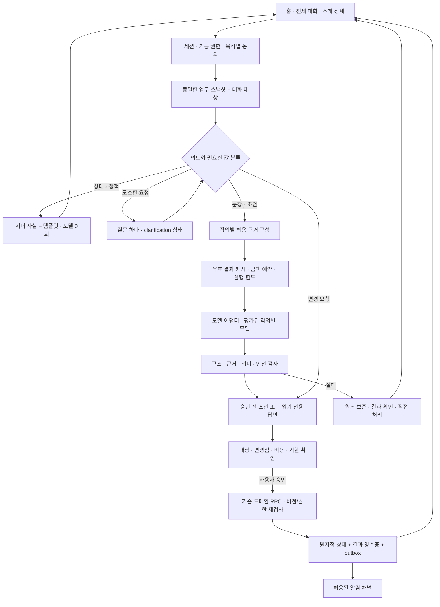

# After 개인 소개 매니저 V2 — 신뢰·연속성·실행 설계

2026-10-26 · 구현 대조 감사 및 다음 개발 설계. **이 문서는 신규 기능 구현 완료나 운영 활성화 승인이 아니다.**

기준: 로컬 `3ecc460`, 해당 변경이 반영된 main `35d0c944a7c2`. 기존 제품 설계는 [개인 소개 매니저](ai-concierge-product-architecture.md), 모델·학습·원가는 [자체 모델 전략](concierge-model-data-strategy.md)을 함께 본다. 이후 구현 상태는 이 문서의 작업 ID별로 갱신하고 과거 QA 결과를 새 기능의 통과 근거로 재사용하지 않는다.

## 1. 결론

**지금 가장 큰 병목은 LLM의 지능이 아니라, 대화와 업무 상태를 연결하는 시스템이다.**

현재 After에는 실제 LLM 생성·검증, 사용자 승인, 소유자 격리, 중복 요청 방지, 삭제 후 지연 응답 차단이 있다. 단순 챗봇 시안은 아니다. 그러나 홈에서 이어 말한 요청의 대상이 전체 대화에서 사라지고, 자연스러운 한국어가 엉뚱한 메뉴로 분류되며, 이전 대화를 오래 기억하는 범위가 좁다. 사용자는 이것을 모두 “비서가 나를 이해하지 못한다”로 경험한다.

제품 약속은 다음으로 고정한다.

> **내 이야기를 이해하고, 좋은 만남까지 필요한 일을 챙겨주는 소개 매니저. 중요한 선택은 내가 확인한다.**

이를 위해 우선순위는 **정확한 상태 → 이어지는 대화 → 승인한 일의 확실한 처리 → 개인화 → 원가 최적화 → 필요할 때 자체 모델**이다. 더 그럴듯한 말투나 자체 모델의 이름이 앞서면 안 된다.

### 이번 감사에서 한 일과 하지 않은 일

- 수행: 설계·UI·Edge·DB migration·검사 코드 대조, 한국어 의도 분류 반례 실행, 기존 결정적 AI/helper 검사 실행, 공식 모델/학습 문서 조사, CI와 운영 페이지 버전 읽기.
- 미수행: 신규 유료 LLM 호출, 운영 회원 원문 조회, DB 경합 시나리오의 새 동시 실행, 전 화면 브라우저 QA, 운영 플래그 변경, 모델 학습·호스팅, 앱 코드 수정.
- 따라서 아래는 **로컬 재현**, **정적 코드 경로 확인**, **설계 공백**, **검증 대기**를 구분한다. 운영 오류 발생률이나 사용자 만족도 점수를 임의로 만들지 않는다.
- 디자인은 현재 승인된 **White & Pink Concierge**와 기존 상세 캐릭터를 유지한다. 새 색상·캐릭터 리디자인은 이번 목표가 아니다.

## 2. 실제 구현 수준

| 영역             | 이미 있는 것                                                                              | 아직 부족한 것                                                                                  |
| ---------------- | ----------------------------------------------------------------------------------------- | ----------------------------------------------------------------------------------------------- |
| 가입·프로필 준비 | 가입과 준비 분리, 선택형 재료·인터뷰, 공개 승인                                           | 비서가 부족한 한 항목만 묻고 중단 지점부터 복귀하는 일관된 업무 상태                            |
| 내 프로필 수정   | 공개 V3 글의 실제 LLM 수정, 전후 비교, 승인 후 원자 저장                                  | 사진/기본 정보/글 의도 구분, 문장별 제안과 후속 수정 대화                                       |
| 상대 소개        | 공개 두 프로필 근거, 소개·접점·확인 질문, 생성+의미 검증, 12시간 캐시                     | 설명의 사용자 평가, 추천 선정 근거와 소개문 생성의 구분, 빈 근거에 대한 섬세한 안내             |
| 소개 선정        | 여성 호감, 동일 권역·자격 조건, 공통 선택/관심사/가능 요일, 대기 시간 기반 운영 큐        | 결과를 학습하는 추천 모델, 추천 당시 후보 집합·정책 버전의 실험 기록                            |
| 상담             | 최근 기록, 승인 기억, 안전 검사, 서비스 FAQ의 모델 0회 처리                               | 역할별 출처 구분, 업무 대상 연속성, 장기 선호의 구조화·정정                                     |
| 일정 비서        | 폼으로 초안 생성, 짧은 승인 유효기간, 승인·멱등 실행                                      | 자연어 시간 해석, 모호한 대상 확인, 공유 가능한 시간 교집합과 반례 복구                         |
| 만남 전후        | 공개 프로필 기반 팁, 참석·후기, 기존 취소/티켓 처리                                       | 회고→선호 제안→별도 승인→다음 소개 반영의 닫힌 고리                                             |
| 사진             | 기기 내 밝기·해상도·비율 검사와 구성 가이드                                               | 동의된 사진 내용 분석. 현재 기능을 AI 사진 판독으로 홍보하면 안 됨                              |
| 운영·원가        | AI 요청 원장, 사용자별 일일 횟수 제한, 채팅·기억·일정·회원 소개·프로필 수정의 개별 플래그 | 전역 금액 상한, 대화 준비 등도 포함하는 전체 AI 중단 계약, 단계별 원가와 결과/계측 복구, 작업함 |

‘4~6턴 대화 연습’은 미완료 백로그가 아니다. 사용자가 원하지 않아 **제외한 기능**이며, 만남 직전 맞춤 조언으로 범위를 유지한다. 직접 상대와 하는 대화도 약속 상세에서 유지한다.

## 3. 발견 사항과 수정 우선순위

여기서 P0는 광범위한 운영 비서 활성화 전 차단 조건, P1은 다음 개발 묶음, P2는 그 이후의 가치 확장이다. 관찰되지 않은 개인정보 사고나 금전 피해가 있었다는 뜻은 아니다.

| ID  | 우선 | 문제·영향                                                                                                         | 증거 수준                           | 수정과 통과 기준                                                                                    |
| --- | ---- | ----------------------------------------------------------------------------------------------------------------- | ----------------------------------- | --------------------------------------------------------------------------------------------------- |
| R01 | P0   | ‘답장을 **얼마나** 기다려야 할까요?’가 결제 안내로 분류됨. 비싼 모델도 호출되지 않음                              | 순수 함수 재현                      | 단독 `얼마` 매칭 제거, 서비스 질문/일반 상담/수정 대상을 구분. 부정·오탈자·복합 의도 회귀 포함      |
| R02 | P0   | 전체 대화에 현재 상대·약속 context가 전달되지 않아 홈과 다른 다음 행동을 안내                                     | 정적 UI 경로 확인                   | 동일 서버 업무 스냅샷 사용. 과거 버튼의 대상 고정, 대상이 사라지면 만료 표시                        |
| R03 | P0   | 남성이 요청만 보낸 상태에도 ‘답을 받았어요’와 ‘상대 답변 대기’가 함께 표시                                        | 조건 분기 확인                      | 요청 전달/응답 수신/양측 확정을 분리한 상태 문구. 미응답 fixture에서 응답 수신 문구 0건             |
| R04 | P0   | 대화 준비 저장 함수가 마지막 읽기 이후의 차단·소개 종료를 원자적으로 재검사하지 않음                              | 정적 경합 경로, 새 동시 실행 미실시 | 열람 관계 revision/잠금 계약을 저장과 권한 회수 양쪽에 적용. 읽기→차단→저장 race에서 결과 공개 금지 |
| R05 | P0   | 결과 저장 후 계측 실패를 생성 실패로 보여주거나, 반대로 계측 오류를 무시함                                        | 네 Edge의 제어 흐름 확인            | 결과 영수증과 원가 확정을 분리. 저장 성공·계측 장애·응답 유실을 각각 주입해 중복 생성 없이 복구     |
| R06 | P0   | 공통 개인정보 안내와 실제 상담/기억 전송 범위가 다름. 동의 버전은 저장하지만 이용 시 현 버전 일치를 검사하지 않음 | 정책/SQL 대조                       | 기능·목적별 고지/동의 버전과 보유/삭제표 정합화. 변경 범위가 필요한 재동의만 요청. 법률 검토는 별도 |
| R07 | P0   | 사용자별 횟수 제한은 있으나 서비스 전체 금액·동시 호출 상한은 없음                                                | 구현 검색·예약 함수 확인            | 운영 한도 결정을 받은 뒤 원가 예약·정산·불명확 사용량 보류·전역 차단 구현. FAQ는 계속 동작          |
| R08 | P1   | 사진 요청을 소개글 편집으로 보내고, ‘마지막 문장 삭제/더 다정하게’는 수정으로 못 알아듣는 경우                    | 순수 함수 재현                      | `edit_photo/edit_facts/edit_story` 구분, 해결 못 한 슬롯 한 개 질문. 잘못된 유료 생성 0회           |
| R09 | P1   | AI 답변을 포함한 history를 ‘사용자 본인의 말’이라고 프롬프트에 설명                                               | 프롬프트/SQL 계약 불일치            | 사용자 공개·AI 제안·승인 기억·서버 사실 출처 분리. 과거 AI 제안은 새 사용자 사실로 승격 금지        |
| R10 | P1   | 상담 기능 ON이면 AI 동의 전에는 0회 FAQ까지 상담 동의 화면 뒤에 가려짐                                            | UI 분기 확인                        | 동의 거절/철회/AI 장애에서도 상태·가격·소개 안내 사용 가능. 원문 기록 없이 처리                     |
| R11 | P1   | 고정 답변의 대화 저장에 별도 요청 속도/보관량 제한이 부족. 연락처 정규식도 기능별 불일치                          | 코드 확인·합성 문자열 검사          | 모델 예산과 API rate limit 분리, 반복 FAQ 합치기, 공통 연락처 검증. 정상 핵심 업무는 별도 경로 보장 |
| R12 | P1   | 새 소개·상담·수정의 평가와 run 연결이 부족, 장기 평가 자료가 주로 임시 QA 경로                                    | 문서/계측 배선 확인                 | 승인된 합성 eval 고정본, 오류 이유·채택 이유·run/단계 연결. 원문은 일반 로그에 넣지 않음            |
| R13 | P1   | 일정·기억·프로필 초안이 서로 다른 화면에 흩어져 미완료 일을 놓치기 쉬움                                           | 설계 공백                           | 홈에 확인할 일 하나, 전체 작업함에서 상태·기한·승인/폐기·재개 제공                                  |
| R14 | P2   | ‘만나지 못했어요’가 곧바로 노쇼 신고로 이어지는 후기 분류                                                         | UI/도메인 경로 확인                 | 상호 변경/본인 사정/상대 미참석/안전 문제의 구분 설계. 제재·티켓 정책은 승인 없이 변경하지 않음     |
| R15 | P0   | CI의 frontend 배포가 구형 `eclps.kr` zone 오류로 실패                                                             | 원격 실행·운영 버전 읽기 확인       | 실제 보유/유지할 도메인 결정 후 trigger 설정 정상화, 새 릴리스 검증. 무작정 재시도하지 않음         |

### 릴리스 상태를 정확하게 읽기

[실행 40201287168](https://github.com/c-yeonwoo/after/actions/runs/40201287168)의 core/quality/Chromium/WebKit은 성공, frontend 배포 단계는 실패다. 로그는 구형 `eclps.kr`의 zone 추론 오류 `10082`와 부분 적용을 명시한다. 이번 조회에서 운영 `/`의 `app-version`은 **35d0c944a7c2**였다. 즉 **최신 프런트 코드가 보이지만 배포 절차 전체는 실패한 상태**다. ‘전혀 배포 안 됨’도 ‘정상 배포 완료’도 아니다. 비서 운영 활성화나 Edge/DB 전체 건강 상태는 이 메타만으로 증명되지 않는다.

### 이번에 실제 확인한 한국어 반례

| 사용자 입력                                       | 현재 분류                 | 기대                                                   |
| ------------------------------------------------- | ------------------------- | ------------------------------------------------------ |
| 상대 답장을 얼마나 기다려야 할까요?               | 결제                      | 일반 조언 또는 대상 있는 대기 상태 확인                |
| 만난 지 얼마 안 됐는데 다시 만나자고 해도 될까요? | 결제                      | 만남 후 조언                                           |
| 사진은 안 바꾸고 약속 시간 변경해줘               | 프로필 수정               | 사진 부정 보존, 일정 변경 대상 확인                    |
| 소개글에서 마지막 문장만 삭제해줘                 | 프로필 안내               | 특정 문장 수정 초안                                    |
| 이번 주 금요일 저녁은 안 돼                       | unknown                   | 진행 중 일정 작업이 있으면 제약 후보, 없으면 대상 질문 |
| 왜 아직 소개가 없어?                              | unknown                   | 서버에서 확인 가능한 상태, 모르는 이유는 모른다고 안내 |
| 그분에게 그 시간으로 보내줘                       | unknown 후 실행 위임 거절 | 대상·시간 확인→승인 초안. 현재 거절은 안전상 정상      |

기존 helper 검사가 통과했다는 사실과 이 반례들은 모순이 아니다. 기존 테스트에 없던 실제 표현과 화면 간 연결을 새로 발견한 것이다.

## 4. 비서를 믿게 만드는 여섯 가지 계약

### 4.1 상태는 정확하게, 설명은 짧게

답변의 기본형은 **알고 있는 사실 한 줄 → 가능한 도움 → 필요한 결정 한 개**다. 상세 근거는 펼쳐 읽는다.

- 대기: “아직 새 소개가 없어요. 지금 등록된 조건은 그대로 유지하고 있어요.” 실제 검색 작업이 없으면 ‘열심히 찾고 있어요’라고 말하지 않는다.
- 요청 전달: “요청을 전달했어요. 상대의 답변을 기다리고 있어요.” 서버에 기한이 있으면 실제 기한만 표시한다.
- 정보 부족: “어느 약속의 시간을 바꿀까요?” 질문 하나와 실제 후보만 제시한다.
- 실패: “수정안을 아직 만들지 못했어요. 기존 프로필은 그대로예요.” 요청 보존·직접 수정·결과 확인 중 실제 가능한 행동을 제공한다.
- 불명확한 전송: “전송 결과를 확인하고 있어요.” 영수증 조회 없이 다시 보내거나 성공/실패로 단정하지 않는다.

### 4.2 기억은 사실·희망·추측을 섞지 않는다

“러닝을 해보고 싶다”는 희망이지 습관이 아니다. “금요일 저녁은 안 된다”는 특정 주의 일정 제약이지 평생 선호가 아니다. “모델이 조용한 카페를 추천했다”는 사용자가 카페를 좋아한다는 증거가 아니다.

현재 30일 대화/90일 승인 기억/최대 10개 계약은 임의로 늘리지 않는다. 먼저 사용자가 **무엇을 기억하고 있고 어디에 쓰는지** 보고 고칠 수 있게 한다. 장기 개인화 확대는 고지·정정·삭제와 함께 진행한다.

### 4.3 행동은 말풍선이 아니라 영수증으로 증명한다

일정·프로필·기억마다 실제 초안 ID, 원본 버전, 대상, 승인 시각, 결과가 있어야 한다. ‘알겠어요’는 이해 확인이고 ‘반영했어요’는 성공 영수증이 있을 때만 가능하다.

### 4.4 친절하되 아첨하거나 인격을 만들어내지 않는다

예쁜 문장보다 **개인의 구체적인 장면**을 살린다. “누구보다 성실하고 따뜻한 분”처럼 입력에 없는 평가를 만들지 않는다. 답변이 짧으면 질문 하나로 재료를 확보한다. 상대의 속마음·호감·미래 관계 성공을 단정하지 않는다.

MBTI는 사용자가 선택한 대화 소재이지 진단도 궁합 점수도 아니다. “INTJ라 차갑다” 대신 “짧게 답하는 편이라고 직접 적으셨네요. 질문을 하나씩 건네보면 어떨까요?”처럼 공개 근거를 사용한다.

### 4.5 AI가 멈춰도 서비스는 계속된다

프로필 직접 수정, 소개 열람, 좋아요/패스, 티켓 내역, 일정 상세, 취소·신고·문의는 모델과 독립적으로 동작한다. 고정 도움은 AI 동의를 강요하지 않는다. 시간 초과 때 폼을 처음부터 다시 작성하게 만들지 않는다.

### 4.6 의지할 수 있지만 의존을 강요하지 않는다

성과는 ‘비서와 더 오래 대화함’이 아니라 **사용자가 덜 반복하고, 더 납득하고, 안전하게 만남을 완료함**이다. AI는 전문가 자격이 있는 상담사나 실제 사람이 아니며, 유료 전환을 위해 불안·외로움·기회를 놓칠 공포를 키우지 않는다. 안전·사생활 문제는 자동 매칭/제재 대신 적절한 사람의 도움과 서비스 지원 경로로 넘긴다.

## 5. 목표 아키텍처

개인별 상시 LLM 프로세스나 ‘비서 두 명의 자유 대화’를 만들지 않는다. 한 서버 워크플로 엔진이 양쪽의 승인·공유 범위 안에서 조율한다. 비서의 말투와 표정은 개인화할 수 있지만 권한은 별개다.



### 한 계정의 대화와 업무를 연결하는 최소 계약

아래 이름은 **제안 계약**이며 새 테이블을 전부 만든다는 뜻이 아니다. 기존 일정·수정·기억 테이블과 알림 전달 체계를 우선 재사용하고, view/RPC와 참조 필드로 충족되지 않는 저장 요구만 추가한다. 별도 에이전트 프레임워크나 두 번째 작업 큐는 기본 도입하지 않는다.

| 구성                       | 필수 값                                                                                                                               | 원칙                                                                                                     |
| -------------------------- | ------------------------------------------------------------------------------------------------------------------------------------- | -------------------------------------------------------------------------------------------------------- |
| `assistant_context_v2` RPC | owner, contextRevision, active subject, 실제 state, permitted actions, checkedAt                                                      | 클라이언트와 서버가 동일한 상태 의미 사용. 상대 개인정보를 무조건 상담 모델에 전달하지 않음              |
| `assistant_operations`     | id, owner, kind, subjectType/Id, state, sourceRevision, draftRevision, contentHash, approvalRef, consentVersion, expiresAt, receiptId | 기존 도메인 초안의 참조 색인. 실제 실행/잔액의 원장은 기존 도메인 테이블                                 |
| `assistant_clarifications` | operationId, missingSlots, allowedChoices, proposed values, expiry                                                                    | 원문 전체 대신 필요한 최소 값. 일정 제안과 ‘안 됨’ 제약을 별도 저장                                      |
| `assistant_message_refs`   | turnId, operationId, subjectId, resultKind                                                                                            | 오래된 말풍선의 버튼을 다른 상대에게 재활용 금지                                                         |
| `ai_run_steps`             | runId, step, provider/model, providerRequestId, usage, priceVersion, status                                                           | 생성·검증의 모델과 토큰을 별도 정산. secret/원문 제외                                                    |
| `ai_budget_reservations`   | scope, period, reservedUpperBound, settledAmount, unknownAmount                                                                       | 사용자 기능 횟수 + 전역 금액 + 동시성 제한을 각각 유지                                                   |
| 기존 알림 outbox 연결      | eventId, operationId, eventType, 기존 dispatch/lease/retry/delivery 상태                                                              | `notifications`·`notification_deliveries` 재사용. 도메인 결과와 사건 연결을 원자 기록하고 중복 알림 방지 |

업무 상태는 `collecting → awaiting_approval → executing → succeeded`를 기본으로 하고 `failed/expired/cancelled/reconciliation_required`를 별도로 둔다. 모델 생성 상태와 실제 만남 요청 상태는 같은 enum에 섞지 않는다. 결제 결과 불명확은 `failed`로 단정하지 않고 기존 결제 확인 경로를 따른다.

승인은 **대상·원본 버전·초안 버전·최종 diff hash**에 묶는다. 승인 화면을 연 뒤 초안이 수정되면 이전 approvalRef를 무효화한다. 확인한 내용과 다른 수정안이 뒤늦게 반영되지 않아야 한다. 기존 알림 계약의 근거는 [notification delivery migration](../supabase/migrations/20261016180000_s63_notification_delivery.sql)이며, 알림 재전송과 업무 자체의 재실행을 분리한다.

### 금액 예약의 구현 수락조건

- 평균 토큰이 아니라 **허용된 입력 token 상한 + 출력 상한 + 생성/검증/허용된 보완·fallback 횟수**와 확정 가격 버전으로 보수적인 최대 비용을 예약한다. 캐시 할인을 선반영하지 않는다. 가격을 알 수 없거나 입력이 상한을 넘으면 새 모델 요청 전에 중단/축소한다.
- 예약과 동시성 검사는 DB에서 원자 수행한다. 서비스가 관리하는 같은 기간·범위에서 `정산액 + 미확정 보류액 + 기존 활성 예약액 + 새 예약액 ≤ 승인 예산`을 유지한다. 각 금액은 서로 중복되지 않는 상태로 관리한다.
- timeout은 미청구의 증거가 아니다. 제공자 수락/사용량이 불명확하면 예약을 보류로 전환하고, 시간 만료만으로 풀어 새 호출을 허용하지 않는다. provider request ID·사용량/청구 대조 또는 권한 있는 운영 확인으로 정산한다.
- 결과 저장 성공과 사용량 확정 실패는 별도 상태다. 결과는 기존 영수증으로 복구하고, 계측 재처리는 같은 단계 ID로 멱등 수행한다. 모델 재생성을 계측 재시도로 쓰지 않는다.
- 동시 N개 요청, timeout 뒤 지연 성공, 중복 완료 이벤트, 다른 모델 fallback, 가격 누락을 장애 주입 테스트에 포함한다. 전체 AI 중단은 기존 다섯 플래그뿐 아니라 대화 준비·프로필 생성 등 유료 호출의 공통 진입점까지 적용하되, 고정 안내와 사용자 직접 작업은 유지한다.
- 이는 **이 서비스가 예약한 모델 추론 비용의 제어**다. 계정의 다른 앱 사용, 세금·추가 도구 요금, 공급자의 청구 변경까지 자동으로 막는 계정 전체 청구 보증이 아니다. 공급자 한도/알림·가격 재확인도 병행한다.

## 6. 각 사용자 여정의 변경안

### A. 처음 나를 알아가는 과정

1. 가입·인증은 기존 절차 유지. 민감한 인증 업무를 LLM이 대신하지 않는다.
2. 비서가 필요한 재료의 범위와 예상 단계를 짧게 설명한다.
3. 선택형 질문은 생활 조건, 주관식은 그 사람만의 장면/이야기를 수집해 중복을 줄인다.
4. 근거가 부족한 항목만 추가 질문 하나. 건너뛰어도 사실을 꾸며 채우지 않는다.
5. “제가 이해한 내용”에서 사실/희망/공개 여부를 확인한다.
6. 한 줄 소개·사진·기본 정보·이야기 구성으로 미리 보고 승인한다.

‘7시에 퇴근해서 회사 옆 헬스장에 가요’를 그 자체로 대표 문구로 고정하지 않는다. 운동 이야기를 살리되, 대표 문구로 쓸 만한 만남 태도가 부족하면 물어본다. 예: “처음 만나는 날은 어떤 분위기가 편하세요?” 사용자에게서 얻은 답만 합쳐 재작성한다.

### B. “내 소개글 좀 더 다정하게 해줘”

- 현재 글을 다시 묻지 않고, 권한 있는 공개 원문을 읽는다.
- 바꿀 대상이 명확하면 바로 초안, 애매하면 ‘한 줄 소개 / 인터뷰 답변’ 한 번만 확인한다.
- 불필요한 새로운 성격·빈도·감정을 만들지 않는다. 변경된 문장만 강조한다.
- “두 번째 문장은 원래대로”를 동일 초안의 수정으로 처리한다. 새로운 프로필 전체 생성으로 중복 과금하지 않는다.
- 최종 승인 때 sourceRevision과 현재 공개 원문, 승인한 draftRevision/contentHash를 함께 대조한다. 다른 기기에서 변경했다면 기존 초안은 비교 후 다시 작성한다. 초안 내용이 바뀌면 이전 승인은 재사용하지 않는다.
- 완료 영수증: “인터뷰 답변 한 곳을 바꿨어요. 사진과 한 줄 소개는 그대로예요.” 실제 diff에서 계산한다.

### C. “왜 이분을 소개해줬어?”

**후보를 고른 이유와 후보를 설명하는 글을 분리한다.** 현재 선정은 규칙·실제 호감·운영 큐레이션이고, LLM이 전체 회원을 비교해 운명적 상대를 찾는 시스템이 아니다.

매니저 브리핑은 다음 순서로 구성한다.

1. 그 사람의 구체적인 모습 두 문장.
2. 나와의 공개된 접점 한 가지.
3. 실제 차이가 있을 때만 확인할 점 한 가지. 차이를 억지로 생성하지 않는다.
4. 대화 시작 질문 하나.
5. 필요하면 공개 원문 근거 확인.

예시 — 합성 공개 자료: 본인은 첫 만남에 짧은 카페 만남, 상대는 첫 만남에 전시 관람을 희망.

> “이분은 처음 만날 때 전시를 함께 보고 싶다고 적어주셨어요. 짧은 카페 만남을 바라는 회원님과 첫 만남 방식은 조금 달라요. 먼저 카페에서 가볍게 이야기하고 전시는 다음에 함께 가도 괜찮을지 물어보면 어떨까요?”

이는 공개 근거와 **제안**의 구분 예시이며 실제 생성 결과나 추천 성과가 아니다. 비공개 좋아요·운영 메모·타인 상담을 설명에 섞지 않는다. 설명이 없더라도 원래 프로필과 선택권은 유지한다.

### D. “다음 금요일 저녁으로 잡아줘”

1. 실제 진행 중인 약속이 하나인지 확인한다. 두 개면 상대 선택.
2. 한국 시간 기준 날짜를 절대 날짜로 표시해 확인한다. ‘저녁’을 임의로 19시로 확정하지 않는다.
3. 사용자가 공개를 허용한 가능 시간만 사용한다. 상대의 전체 캘린더는 전송하지 않는다.
4. 겹치는 후보가 있으면 최대 두 개, 없으면 일정 추가를 요청한다. 제안은 예약이나 확정이 아니다.
5. 시간·장소·수신자·기존 정책상 티켓 영향을 보여주고 명시 승인.
6. 실행 시점에 버전·권한·마감·충돌 재검사. 양쪽 합의 없이 확정 금지.
7. 네트워크 단절 시 기존 operationId로 영수증을 조회한다. 새 승인/새 차감으로 재실행하지 않는다.

### E. 만남 전후

- 만남 전: 현재 공개 프로필과 사용자가 요청한 범위로 팁 2~3개. 상대 심리를 진단하지 않고 실제 단서를 연결한다. 무리한 대화 연습 기능은 만들지 않는다.
- 이후: 참석 여부→선택적 회고→“이 내용을 다음 소개에도 참고할까요?” 순서. 상대의 비공개 후기 대신 본인의 선호만 후보화한다.
- 거절·응답 없음·취소 이유를 비서가 추측하지 않는다. 무응답은 기존 경고 기록/반복 시 운영 검토 기준을 유지하고 임의 벌금·정지 금지.
- 회고에서 선호를 저장해도 하드 필터나 소개 중지를 자동 변경하지 않는다. 변경 효과를 별도 확인한다.

## 7. 메모리와 데이터의 신뢰 설계

개인 기억을 모델 가중치에 학습하지 않는다. 현재 owner-bound 저장소를 확장하는 방식이 정정·삭제·권한에 맞다.

권고 기억 필드:

```text
owner_id, memory_id, category, value
modality = fact | preference | intention | temporary_constraint
source_type = user_explicit | user_approved_summary
source_ref, approved_at, valid_from, expires_at, supersedes_id
scope = private_coaching | matching_preference
consent_version, owner_revision
```

- 공개 프로필 반영은 이 schema의 scope 추가만으로 허용하지 않는다. 별도 공개 수정 승인 필요.
- 대화 요약을 도입하더라도 새로운 사실이 아니다. 원문 출처와 동일하거나 더 짧은 TTL을 가진 파생 캐시로 취급한다. 원문 삭제 시 무효화한다.
- 기억 사용 시 “전에 알려주신 ‘조용한 첫 만남’ 기준을 참고했어요” 정도로 확인 가능하게 한다. 모든 답변마다 긴 고지를 붙이지 않는다.
- 상충한 기억은 최신값으로 조용히 덮어쓰지 않는다. “지금은 어느 쪽에 가까우세요?”로 정정한다.
- 현재는 메모 최대 10개이므로 벡터 DB가 우선이 아니다. 구조화 필터·최근성·업무 관련성으로 충분한지 먼저 측정한다.
- 향후 임베딩 검색을 넣어도 owner/목적/삭제/상대 열람 범위를 **검색 전** 제한한다. 전역 검색 후 프롬프트로 숨기는 방식은 금지한다.

### 삭제와 보유 기간 정합성

현재 ‘프로필 수정안 확인 24시간’은 물리 보관 24시간과 같지 않다. 실제 purge는 만료 후 7일이다. 상담·기억 삭제가 계정의 모든 AI 이력을 지우는 명령도 아니다. 화면에는 무엇을 지우는지 구분하고, 새 저장소를 만들 때 원본→파생본→평가/학습 후보까지 삭제 전파표를 함께 작성한다.

계측 원장의 제한된 보유 목적과 기간도 정의한다. 횟수 우회 방지에 필요한 최소 필드는 유지할 수 있지만 무기한 보관을 기본값으로 정하지 않는다. 정확한 법적 근거·국외 처리 고지는 개인정보 검토 후 확정한다.

## 8. 비용·지연을 줄이는 방법

1. **잘못된 호출부터 없앤다.** 상태·가격·다음 행동은 DB+템플릿. 모호한 업무 요청을 곧바로 비싼 일반 상담에 넣지 않는다.
2. **생성과 검증을 별도 계측한다.** 모델명 하나와 합산 토큰으로는 검증 모델을 바꾼 효과를 알 수 없다.
3. **공개 콘텐츠 revision과 운영 row revision을 분리한다.** 소재가 같을 때는 캐시를 유지하되, 차단/탈퇴/공개 철회는 별도 권한 revision으로 즉시 막는다. 권한 확인을 캐시로 생략하지 않는다.
4. **공통 자산 캐시는 이미 구현됐다.** 해시 이미지·고정 문구·60초 설정 조회 최적화를 다시 개발하지 않는다. 개인 대화는 공유 CDN 캐시로 보내지 않는다.
5. **낮은 위험의 작은 작업부터 경량 모델을 비교한다.** 분류·추출·한 문장 편집 후보. 복합 조언·소개문 전체를 일괄 낮추지 않는다.
6. **검증 두 번째 호출을 무조건 없애지 않는다.** 결정적 규칙을 먼저 적용하고, 과업별 사람 평가에서 같은 수준을 입증한 범위만 단순화한다. 낮은 위험을 모델 자신의 자신감 점수로만 판단하지 않는다.
7. **긴 생성은 재개 가능한 비동기 작업으로 만든다.** 초안 생성 중 앱을 나갔다 돌아와도 동일 ID로 결과를 확인한다. 검증 전 텍스트를 먼저 공개하는 스트리밍은 피한다.
8. **prompt cache는 실제 적중률로 판단한다.** 안정된 공통 prefix만 후보로 삼고 짧은 prompt를 최소 길이에 맞추려 불필요하게 늘리지 않는다. private 결과의 공유 캐시와 공급자 prefix cache를 구분한다.
9. **배치는 오프라인 평가에 우선 적용한다.** 회원이 기다리는 질문을 할인 때문에 장시간 batch로 보내지 않는다. 자동 회원별 소개문 선생성도 허가/수요가 없으면 비용 낭비다.

현재 네 기능은 생성+검증 직렬 경로다. 설정상 모델 대기만 약 40~50초까지 갈 수 있지만 이것은 관측 p95가 아니다. 앞으로 과업별 `queue / context / generation / validation / persistence` 시간을 측정한다.

## 9. 운영자가 혼자 관리할 화면

새 대시보드를 별도 제품처럼 만들지 말고 기존 관리자 작업함에 **‘비서 운영’** 뷰를 추가한다.

| 보기         | 무엇을 보여줄지                                              | 조치                                                              |
| ------------ | ------------------------------------------------------------ | ----------------------------------------------------------------- |
| 지금 막힌 일 | reconciliation, 동시성 충돌, 사용자 반복 실패, 처리 기한     | 영수증 확인·대상 작업으로 이동·사용자 지원. 몰래 재생성/승인 금지 |
| 모델 상태    | 기능별 성공/차단/제공자 오류, p50/p95, 실제/미정산 원가      | 기능별 중단·한도 조정은 권한/감사 기록 필요                       |
| 품질         | ‘내 얘기 아님/틀린 정보/너무 일반적/너무 길다’ 비율, 표본 수 | 동의된 평가 샘플만 제한된 리뷰 뷰에서 확인                        |
| 만남 진행    | 소개 대기/상대 응답 대기/가능 시간 필요/확정/회고            | 기존 운영 큐 연결. 모델이 새 정책으로 제재하지 않음               |
| 개인정보     | 삭제 전파 대기, 만료 정리 실패, 정책 버전 불일치             | 코드·기간·건수 중심. 비공개 상담 내용 자동 공개 금지              |

사람에게 이관할 때 사용자가 공유할 내용을 선택하게 한다. 운영자가 모든 상담을 볼 수 있어야 좋은 지원이라는 가정은 하지 않는다. 외부 카카오·SMS 발송은 승인/연동 완료 전 in-app 상태 안내와 구분한다.

## 10. 구현 순서와 수락 기준

아래 노력치는 일정 약속이 아닌 **코드 조사 후 재산정할 1인 개발 계획치**다. 외부 승인·참가자 평가·운영 관찰 대기 시간은 별도이며, 마지막까지 모든 작업을 동시에 벌이지 않는다.

| 묶음                | 작업                                          | 주 소유 영역                          | 의존성                          | 수락 조건                                                                         | 계획치                   |
| ------------------- | --------------------------------------------- | ------------------------------------- | ------------------------------- | --------------------------------------------------------------------------------- | ------------------------ |
| A. 신뢰 결함 마감   | R01/02 일부/03/08/09/10                       | shared workflow, assistant UI, intro  | 없음                            | 최신 context 공유·대상 없는 행동 숨김·한국어 반례·0회 FAQ·상태 문구 통과          | 2~4 개발일               |
| B. 서버·출시 안전   | R04/05/06/07/11/15                            | Edge, SQL, 정책, 배포 설정            | A와 독립 진행 가능, 공개는 B 후 | 경합·장애 주입·금액/동시성·고지/버전·정상 릴리스. 예산/정책 결정 전 운영 OFF      | 3~6 개발일 + 확인 대기   |
| C. 진짜 업무 연속성 | R02 나머지/R13, clarification, 대상/초안 인계 | context RPC, operation index, 홈/대화 | A/B                             | 과거 메시지의 대상·업무 ID 영속화, 재시작/만료/응답 유실 복구, 승인한 diff만 실행 | 4~7 개발일               |
| D. 개인 매니저 품질 | 구조화 기억, 문장 수정, 회고 제안, R12/14     | profile, memory, feedback, eval       | C, 목적별 동의                  | 사실/희망/기간 보존, 부정 회귀, 사람 블라인드 평가와 삭제 전파 통과               | 4~7 개발일 + 평가 대기   |
| E. 비용 절감        | adapter, 단계 계측, 경량 분류/편집 비교       | model gateway, eval harness           | B/D 기준선                      | 품질 비열등 조건·실패 복구·실측 완료 작업 원가 절감 확인                          | 2~4 개발일 + 실험 예산   |
| F. 자체 모델 실험   | 좁은 Writer SFT/LoRA                          | 독립 실험 디렉터리·dataset registry   | 합법 데이터/holdout/총비용 gate | 오프라인 통과→shadow→승인된 작은 cohort. 자동 운영 전환 금지                      | 데이터 준비 후 별도 산정 |

**바로 시작할 첫 묶음은 A다.** 새로운 모델 구매나 재디자인 없이 사용자가 즉시 느낄 신뢰 결함을 없앨 수 있다. B의 운영 정책·비용 상한은 대표 판단이 필요하지만 코드 계약과 합성 검증은 먼저 준비할 수 있다.

### 단계별 QA와 마지막 통합 QA

- 매 묶음: 순수 함수→SQL 권한/경합→Edge 가짜 공급자 장애 주입→모바일 핵심 여정. 실제 모델이 필요한 품질 평가는 고정 예산·합성/승인 자료로 따로 수행한다.
- 마지막: 새 합성 여성/남성 계정으로 가입→프로필→여성 호감→운영 승인→남성 순차 소개→모의 결제→시간 조율→참석/미참석→후기→승인 기억까지 검증. 기존 테스트 기록은 보존한다.
- 공통 축: 320/390px와 데스크톱, 라이트/다크, 뒤로가기·새로고침·재로그인, 상대 변경, 기능 OFF, 동의 거절/철회, 느린 응답·중복 전송·삭제 중 응답, 기한 직전/직후.
- API 성공만으로 완료 처리하지 않는다. DB 상태·영수증·화면 문구·모델 호출 수·사용량 기록을 함께 대조한다.
- 외부 본인인증·실결제·카카오·실기기·MFA 복구·운영 관찰은 실제 확인 전 미확인으로 남긴다. 현재 코드에서 자동 통과 처리하지 않는다.

### 모델/제품 평가 기준 — 제안, 아직 달성했다고 주장하지 않음

| 지표                                                        | gate/관찰 기준                                                                                            |
| ----------------------------------------------------------- | --------------------------------------------------------------------------------------------------------- |
| 권한 위반·승인 없는 쓰기·다른 상대 실행·중복 차감           | 전용 회귀에서 0건. 발견 즉시 중단, 평균 점수로 상쇄 금지                                                  |
| 사실 날조·희망을 습관으로 바꾸기·AI 제안을 본인 사실로 저장 | 안전/사실 평가 세트에서 0건. 유한 표본 통과는 실세계 무오류 보장이 아님                                   |
| 확정적인 업무 라우팅                                        | 초기 고정 holdout에서 98% 이상을 목표, 나머지는 정직한 clarification 허용. 애매한 질문까지 억지 분류 금지 |
| 모델 응답 품질                                              | 정확성·개인성·실용성·자연스러움을 별도 채점. 사람 블라인드 비교에서 현 기준보다 열등하면 비용이 싸도 보류 |
| 사용 경험                                                   | 완료까지 반복 입력 수, 잘못된 화면 이동 수, 수정/폐기 이유, 실제 완료율·중단 이유                         |
| 성과                                                        | 소개 열람→양측 의향→일정 합의→실제 참석. 채팅량이나 무조건적인 호감 증가를 목표로 삼지 않음               |
| 비용                                                        | 승인된 작업 1건 원가, 활성 회원 월원가, 실패/재시도/검증 포함 원가, 수동 운영 분                          |
| 지연                                                        | 과업별 p50/p95와 표본 수. 목표치 확정은 초기 기준선 측정 후                                               |

## 11. 근거 지도

파일 줄 번호는 감사 기준 커밋의 위치다. 후속 변경으로 이동할 수 있다.

- R01/08: [공유 의도 분류](../supabase/functions/_shared/assistant-workflow.ts) 16~46행, [기존 검사](../scripts/check-assistant.ts) 41행 이후.
- R02: [홈](../src/routes/home.tsx) 450행, [전체 대화](../src/routes/assistant.tsx) 22행, [대화 행동 재계산](../src/components/assistant/AssistantConversation.tsx) 510행.
- R03: [소개](../src/routes/intro.tsx) 348/468/505행.
- R04: [대화 준비 Edge](../supabase/functions/prepare-conversation/index.ts) 183/191행, [guarded store](../supabase/migrations/20261024120100_conversation_prep_guarded_store.sql) 11행, [기존 pair exclusion](../supabase/migrations/20260905120100_s28b_exclusion_and_grants.sql) 65행. 비교 대상 [member introduction access](../supabase/migrations/20261025160000_member_introduction.sql) 78행.
- R05/09/11: [상담](../supabase/functions/assistant-chat/index.ts) 21/56/88/119/147행, [수정](../supabase/functions/revise-profile/index.ts) 89/117/248행, [소개](../supabase/functions/introduce-member/index.ts) 179/220/233행, [대화 준비](../supabase/functions/prepare-conversation/index.ts) 150/191/204행, [상담 검증](../supabase/functions/_shared/assistant-private.ts) 24행.
- R06: [공통 정책](../src/lib/policy.ts) 98/132/154행, [private memory](../supabase/migrations/20261025090000_assistant_private_memory.sql) 79행, [현재 이용 게이트](../supabase/migrations/20261025180000_assistant_conversation_continuity.sql) 95행.
- R07: [사용량 예약](../supabase/migrations/20261025162000_concierge_capabilities_and_usage.sql) 35행, [QA 비용 계산](../scripts/lib/ai-cost.mjs).
- R10: [Dock 전환](../src/components/assistant/AssistantDock.tsx) 35행, [동의/입력 UI](../src/components/assistant/AssistantConversation.tsx) 296/370/419행.
- R12: [기존 AI 선택 계측](../supabase/migrations/20261016210000_s66_ai_reservations.sql) 84행, [실제 소수 합성 평가와 한계](concierge-llm-local-qa.md), [V3 평가 잔여](ai-profile-v3-live-eval.md).
- R14: [후기](../src/routes/feedback.tsx) 35/221행. 추천은 [grounded curation](../supabase/migrations/20261017230000_grounded_curation.sql) 107/152행, 여성 노출은 [candidate readiness](../supabase/migrations/20261016150100_s60b_candidate_readiness.sql).
- 실제 기억 context: [continuity SQL](../supabase/migrations/20261025180000_assistant_conversation_continuity.sql) 75행. 현재 승인 기억 최대 10개·90일, 대화 30일은 [private memory SQL](../supabase/migrations/20261025090000_assistant_private_memory.sql).
- R15: [release workflow](../.github/workflows/release.yml), [도메인 설정](../wrangler.jsonc), 위 CI 링크. 이 설계 작성 중 런타임 설정을 수정하지 않았다.

## 12. 이번 조사에서 확인한 검사 결과

기존 `check-ai-quality` 166개, assistant/member-introduction/profile-revision 결정적 검사, QA용 generation receipts 6개 검사가 통과했다. 의도 반례도 DB·외부 모델 없이 직접 실행했다. receipts 6개는 **QA 스크립트의 재실행 방지 모듈** 검사이지 운영 Edge 장애 복구 전체 검사가 아니다.

기존 실제 LLM QA는 5개 작업 중 성공 3개·의미 검증 차단 1개·생성 오류 1개를 기록한다. 이는 소수 합성 실행 기록이지 ‘품질 60%’ 또는 실사용 오류율의 추정치가 아니다. 새 live 평가나 사용자 블라인드 평가는 이번에 수행하지 않았다.

설계 원칙의 외부 근거: 명시적 워크플로와 필요한 경우의 모델 호출을 구분하는 [Anthropic의 에이전트 설계](https://www.anthropic.com/research/building-effective-agents)를 참고했다. After의 도메인 계약·발견 사항·수락 기준은 해당 글의 성능 보장이 아니라 이번 코드 감사에 따른 제안이다.
