# After · 기능 연결과 케미 데이터 점검

## 설계 결정

프로필은 소개할 이유를 설명할 자료이지, 처음 보는 두 사람의 실제 호감을 확정하는 검사가 아니다. 사전 특성·선호를 많이 받아도 특정 두 사람의 끌림 예측에는 한계가 있었다([Joel·Eastwick·Finkel, 2017](https://www.kellogg.northwestern.edu/academics-research/research/detail/2017/is-romantic-desire-predictable-machine-learning-applied-to-initial/)). 기존 커플 43개 종단 자료 연구도 현재 관계 경험과 이후 변화의 예측을 구별한다([Joel 등, 2020](https://pmc.ncbi.nlm.nih.gov/articles/PMC7431040/)). 이 결과를 애프터 개별 회원의 점수로 환산하지 않는다.

이번 데이터 선정은 제품 가설이다. 효과는 베타에서 확인한다. MBTI·사주·외모 등급을 추가 점수 근거로 삼지 않는다.

| 데이터               | 확보 방식                          | 사용자 수고    | 실제 쓰임                                    |
| -------------------- | ---------------------------------- | -------------- | -------------------------------------------- |
| 퇴근 후·첫 만남 방식 | 기존 선택 답 재사용                | 추가 없음      | 가까운 곳에서 편하게 만날 장면 제안          |
| 원하는 관계          | 중복 선택 문항 교체, 한 번 탭      | 장문 작성 없음 | 관계 기대를 대화 전에 확인                   |
| 편한 배려            | 중복 선택 문항 교체, 최대 두 번 탭 | 장문 작성 없음 | 자기 표현·초기 소통 팁의 구체적 근거         |
| 연락·약속 방식       | 기존 비공개 선택 유지              | 추가 없음      | 본인 일정 조율; 공개 설명·공통 지표에서 제외 |
| 실제 가용 시간·지역  | 기존 일정/권역 데이터              | 재입력 없음    | 만날 수 없는 조합 차단, 운영 일정 검토       |
| 기존 인터뷰 3개      | 기존 흐름 유지                     | 질문 추가 없음 | 선택만으로는 담기지 않는 장면과 말투         |

## 입력 흐름

```mermaid
flowchart LR
 A[가입·인증] --> B[사진·기본/생활 정보]
 B --> C[선택 3화면·6문항
모두 선택 사항]
 C --> D[기존 주관식 3개
필요 시 보충 최대 2개]
 D --> E[공개할 답 직접 선택]
 E --> F[AI 프로필 확인·저장]
 F --> G[공개 만남 스타일·이야기]
 G --> H[여성 호감]
 H --> I[같은 권역·가입 자격 확인]
 I --> J[운영자 추천 검토·승인]
 J --> K[남성 한 사람씩 소개·티켓 확인]
 K --> L[만남 요청·수락·일정]
 L --> M[약속·상대 대화·개인 매니저]
 M --> N[리마인드·응답·만남·후기]
```

선택 질문의 세 번째 화면만 관계 기대·편한 배려로 교체한다. 질문 수와 화면 수는 유지한다. 예전 가까워지는 방식·대화 소재의 ID와 옵션 순서는 유지해 기존 답변을 지우거나 새 의미로 재해석하지 않는다. 다시 인터뷰할 때 기존 선택·직접 입력을 채워 재입력을 줄이되, 과거 비공개 답을 자동 공개하지 않는다. 옵션 ID·순서·문구 변경에는 데이터 매핑 마이그레이션이 필요하다. 프로필 수정에서도 선택형으로 추가·변경·해제한다.

## 공개와 분석 파이프라인

1. `profile_preferences`는 기존 비공개 답변을 보존한다.
2. 저장 시 `publicIds`와 서버 옵션 목록을 대조해 `profile_public_signals`를 만든다. 공개 해제·빈 값·모르는 값은 제외한다. 연락·약속 선호는 위조된 공개 ID가 있어도 포함하지 않는다.
3. 기존 회원의 비공개 선택을 자동 공개하지 않는다. 본인이 불러오고 저장할 수 있다.
4. 공개 프로필·권한 있는 소개 API만 이 값을 반환한다. 직접 대입으로 승인 절차를 우회할 수 없다.
5. 매니저 LLM에는 원래 공개 이야기와 공개 선택만 함께 보낸다. 요청 횟수는 늘리지 않는다. 질문 답을 새 경험·성격으로 부풀리지 않는다.
6. 홈의 공통 수치는 실제 동일 선택 수다. 상세에서는 공통 선택과 함께 맞춰볼 점을 구분한다. 답이 없으면 모르는 상태를 유지한다.
7. 운영 추천은 공개 선택의 공통 영역·최근 가용 시간·기존 대기 우선순위를 참고한다. 가격·성별 순서·권역·호감·안전 필터는 유지한다. 점수는 내부 검토 순서이며 궁합 확률이 아니다.
8. 프로필 승인 버전은 단조 증가한다. 문장이 같은 선택 수정도 새 승인으로 처리해 공개 정보·캐시·추천 근거가 갱신된다.

## 발견하고 고친 결함

- 동일한 소개글을 다시 저장하면 초안 버전이 1부터 재시작해, 기존과 같은 공개 문서가 되어 선택 답 갱신 트리거가 건너뛰어질 수 있었다. 공개 버전은 이전 값보다 반드시 증가시킨다.
- V3 인터뷰 이후 남아 있는 구형 관심사 태그를 홈 공통 지표로 표시할 수 있었다. V3는 승인된 새 선택만 지표로 쓴다.
- 다시 인터뷰할 때 이미 받은 선택 답을 빈 값부터 다시 받을 수 있었다. 기존 답은 채우고 공개 범위는 별도로 유지한다.
- 저장 전 프로필 미리보기에 공개 선택이 빠져 최종 게시 모습과 달라질 수 있었다. 미리보기도 서버와 같은 공개 옵션 범위로 구성한다.
- 선택 답이 프로필/매니저에 충분히 연결되지 않았다. 공개 승인 투영을 추가해 입력부터 소개·운영 검토까지 같은 사실을 쓴다.

## QA 범위와 근거

실제 회원·공유 로컬 설정을 바꾸지 않도록 별도 QA Supabase 프로젝트(5632x 포트)를 사용한다. 이메일·SMS·PG·유료 모델 응답은 각 테스트가 명시한 모의 범위다. 실제 외부 계약 개통 증거로 해석하지 않는다.

- 변경 전 전체 사이클: 47개 통과. 가입·사진·여성 호감·남성 모의 결제·운영 큐·요청 수락/거절·일정 변경·양방향 대화·무응답 복구·두 차례 넛지·후기·관리자 MFA를 포함한다.
  | 검증                              | 결과                                  | 범위/한계                                               |
  | --------------------------------- | ------------------------------------- | ------------------------------------------------------- |
  | DB 회귀                           | 76개 파일·1,190개 assertion 통과      | 승인 범위·접근권한·동일 문장 재저장·공개 해제·탈퇴 포함 |
  | 변경 후 만남 전체 사이클          | 47/47 통과                            | 가입→호감→운영 검토→모의 결제→약속→후기·무응답 복구     |
  | 가입/소개/관리자/필수 인증 UI E2E | 통과                                  | 별도 QA DB, 실제 PG·외부 인증은 모의                    |
  | 일정 비서                         | 통과                                  | 남녀 화면·변경 요청·동시 재시도·모바일/다크·시간대      |
  | 화면 회귀                         | Chromium 36개 + WebKit 12개 통과      | 320/390/1440px·밝음/어두움; API/AI 응답은 합성 fixture  |
  | 저장 전 프로필 미리보기           | 모바일 320/390px·밝음/어두움 4개 통과 | 체크한 선택만 표시; 비공개·공개 해제 답은 제외          |

| 프로필 수정 실제 DB 저장 | 통과 | 취소/계속/버리기·공개 답 추가/해제·동일 문장 재저장·기존 기록 보존·LLM 0회 |
| 코드/품질/빌드 | `npm run check` 통과 | 타입·린트·AI 근거/개인정보·인증·대비·빌드 |
| 실제 LLM 새 문구 품질 | 이번 변경에서 신규 호출 안 함 | 공개 자료 전달/검증 경계는 자동 검사; 사용자 체감은 베타 관찰 필요 |

전체 사이클 근거는 `/tmp/after-full-cycle-4d1f81ed/report.json`, DB 로그는 `/private/tmp/after-flow-qa-db-final.log`, 화면 검증은 `/private/tmp/after-flow-signals-final/summary.json`과 `/private/tmp/after-flow-signals-webkit/summary.json`이다. 이 경로는 로컬 임시 근거이며 영구 보관을 보장하지 않는다.

기존 브라우저 회귀 스크립트가 예전 CTA·홈 빠른 질문·상대 대화 하단 내비게이션을 기대하던 부분도 현재 확정된 흐름과 맞췄다. 이들은 신규 제품 결함과 구별한다.

기존 로컬 DB는 과거 마이그레이션 기록 22개가 누락되어 있었지만, 이번에 교체하는 기존 함수 5개의 본문은 저장소 기준과 일치했다. 과거 마이그레이션을 일괄 재실행하지 않고 이번 한 건만 트랜잭션으로 적용했다. 기존 프로필 필드와 설정의 해시 보존을 확인했고, 과거 이력은 임의로 보정하지 않았다. 로컬 이력 정합성은 별도 유지보수 항목이다.

사용자가 승인한 애프터 로컬 Edge 1회 갱신 후 `member-introduction-v4.3-public-preferences` 응답을 확인했다. 공유 DB 재시작·초기화·기존 사용자 재설정은 하지 않았다.

- 운영 비서 플래그 활성화, 실제 결제·통신사 인증·카카오 발송, 실기기 키보드 확인은 이번 자동 검증의 완료 항목이 아니다.

## 베타에서 확인할 ROI

선택 화면 완료/건너뛰기와 이탈, 프로필 완성 소요 시간, 소개 설명 유용성, 만남 요청·수락, 실제 만남과 후기의 연결을 관찰한다. 처음에는 결혼 기대나 특정 배려 선택에 가중치를 더 주지 않는다. 정보량과 호감·수락의 인과 효과는 별도 비교가 필요하며, 누락 답변을 부정적인 성격이나 낮은 궁합으로 처리하지 않는다. 별도 동의 없는 학습 데이터 전용은 하지 않는다.
