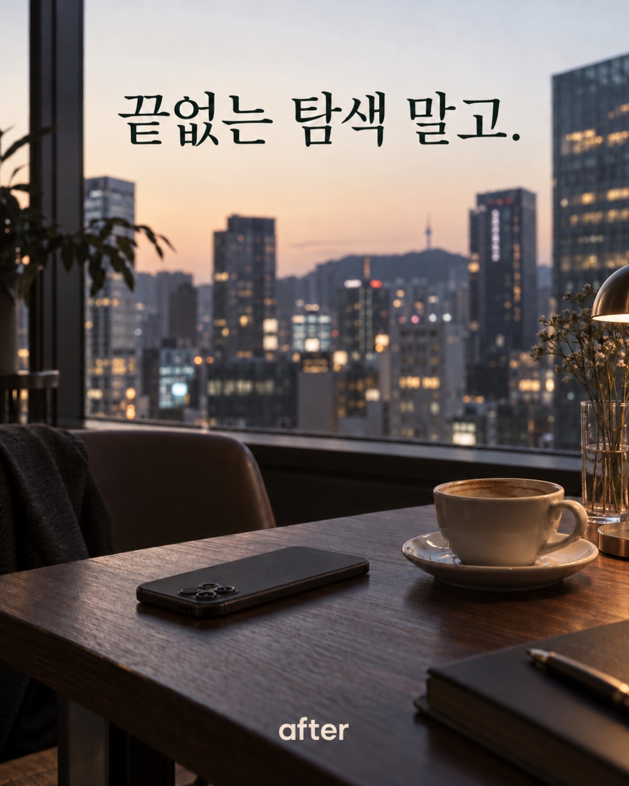
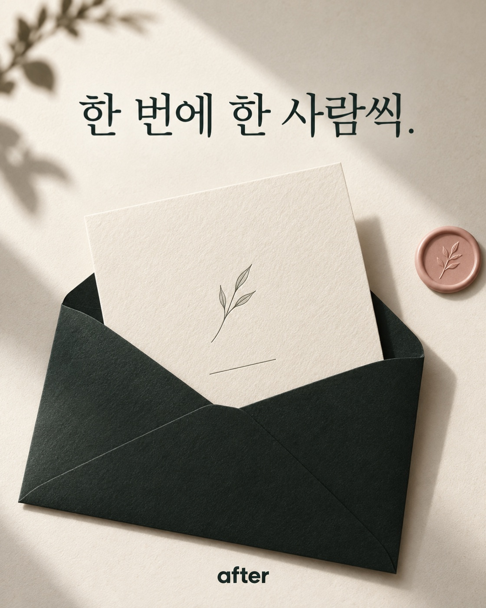
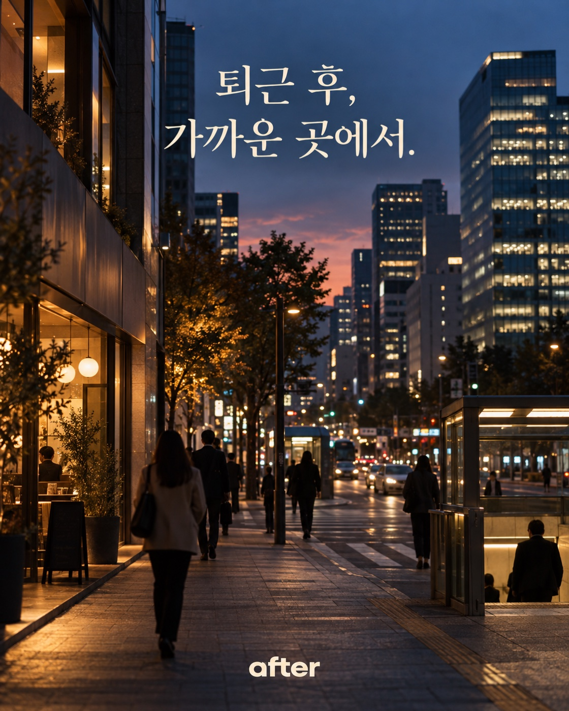
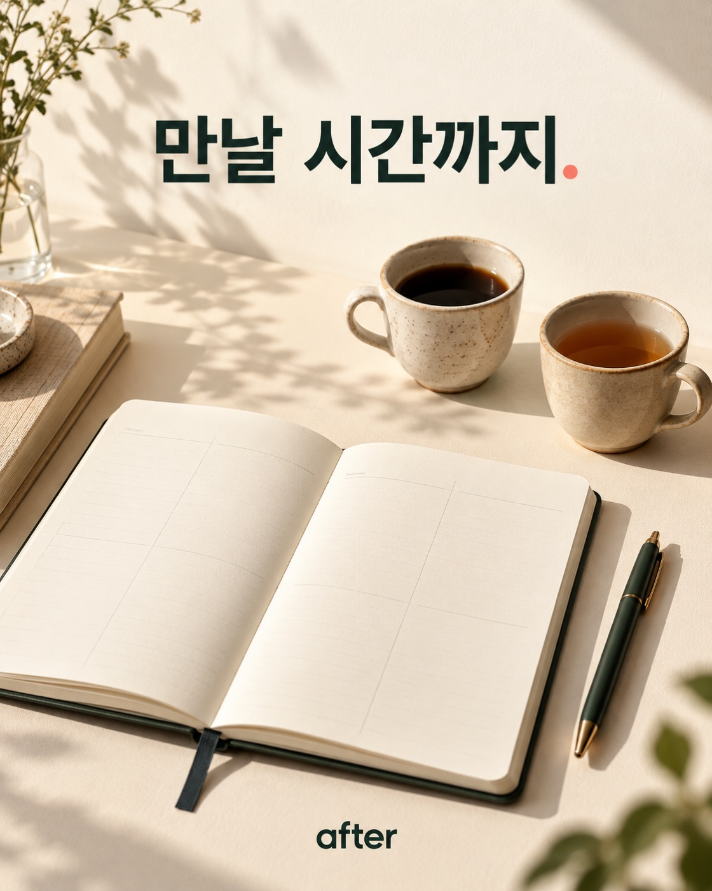
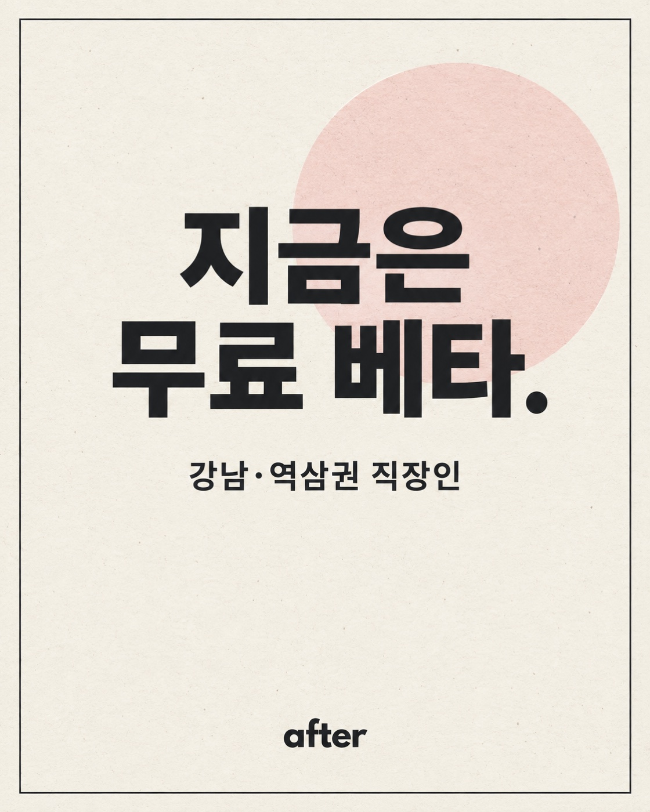

# 애프터 인스타그램 피드 초안 5개

첫 게시물 `feed-a-afterwork` 다음에 올린 자연 게시용 시안이다. 각 이미지는 1120×1400 JPG(4:5)이다. 2026-10-11 `@after_wuu`에 5개 모두 게시했으며, 아래 캡션은 실제 게시 문구다. 유료 광고 전환은 별도 심사·승인 후 결정한다.

| 순서 | 주제 | 이미지 속 문구 | 파일 | 게시물 |
| --- | --- | --- | --- | --- |
| C | 탐색 피로 | 끝없는 탐색 말고. | [feed-c-search-fatigue-v2.jpg](feed-c-search-fatigue-v2.jpg) | [보기](https://www.instagram.com/after_wuu/p/DeWzBQ3CbJt/) |
| D | 한 사람씩 소개 | 한 번에 한 사람씩. | [feed-d-one-at-a-time.jpg](feed-d-one-at-a-time.jpg) | [보기](https://www.instagram.com/after_wuu/p/DeWzFRlCecd/) |
| E | 가까운 생활권 | 퇴근 후, 가까운 곳에서. | [feed-e-nearby-afterwork.jpg](feed-e-nearby-afterwork.jpg) | [보기](https://www.instagram.com/after_wuu/p/DeWzKT2CSje/) |
| F | 일정 조율 | 만날 시간까지. | [feed-f-meeting-time.jpg](feed-f-meeting-time.jpg) | [보기](https://www.instagram.com/after_wuu/p/DeWzL9HCWBb/) |
| G | 무료 베타 | 지금은 무료 베타. | [feed-g-free-beta.jpg](feed-g-free-beta.jpg) | [보기](https://www.instagram.com/after_wuu/p/DeWzN0liaBS/) |

## C · 탐색 피로

프로필을 끝없이 넘기기보다, 한 사람을 알아가는 시간.

애프터는 강남·역삼권 직장인을 한 번에 한 사람씩 소개합니다. 지금은 무료 베타를 운영 중입니다. 가입은 aftersunset.kr에서.

#애프터 #강남소개팅

대체 텍스트: 퇴근 후 카페 테이블에 뒤집어 놓인 휴대폰과 커피. 창밖으로 저녁 서울 풍경이 보이고, 위쪽에 “끝없는 탐색 말고.”라고 적혀 있다.

## D · 한 사람씩 소개

소개를 많이 쌓아두기보다, 한 사람에게 집중할 수 있게.

애프터는 서로의 선택을 거쳐 소개를 이어갑니다. 프로필을 완성하면 현재 참여 상황에 맞춰 순차적으로 소개가 열려요. 자세한 내용은 aftersunset.kr에서.

#애프터 #직장인소개팅

대체 텍스트: 크림색 종이와 짙은 색 봉투가 놓인 미니멀한 화면. 위쪽에 “한 번에 한 사람씩.”이라고 적혀 있다.

## E · 가까운 생활권

퇴근 후 만날 사람이라면, 거리도 중요하니까.

애프터는 강남·역삼권에서 만날 수 있는 직장인을 위한 소개 서비스입니다. 이 근처가 생활권이라면 aftersunset.kr에서 시작해 보세요.

#애프터 #강남소개팅

대체 텍스트: 저녁 조명이 켜진 서울 업무지구 거리. 위쪽에 “퇴근 후, 가까운 곳에서.”라고 적혀 있다.

## F · 일정 조율

서로 마음이 맞았다면, 다음은 언제 만날지.

애프터는 소개 이후 만날 시간을 정하는 과정까지 돕습니다. 지금은 강남·역삼권 무료 베타를 운영 중이에요. 가입은 aftersunset.kr에서.

#애프터 #퇴근후소개

대체 텍스트: 열린 일정 노트 옆에 두 잔의 음료와 펜이 놓여 있다. 위쪽에 “만날 시간까지.”라고 적혀 있다.

## G · 무료 베타

애프터 무료 베타를 시작했어요.

강남·역삼권 직장인이라면 회사 이메일 확인과 프로필 작성 후 참여할 수 있습니다. 베타 기간에는 결제하지 않으며, 소개는 참여 상황에 따라 순차적으로 진행돼요. 가입은 aftersunset.kr에서.

#애프터 #무료베타

대체 텍스트: 크림색 종이 배경과 연한 블러시 원 위에 “지금은 무료 베타.”, 그 아래 “강남·역삼권 직장인”이라고 적힌 타이포그래피 포스터.

## 제작 기준

내장 ImageGen으로 각 주제를 별도 생성했다. 공통 프롬프트는 `ads-marketing`, 인스타그램 4:5 피드, 애프터의 잉크·크림·소량의 블러시 팔레트, 짧고 정확한 한국어 헤드라인, 불필요한 문구·하트·가짜 후기·가짜 앱 화면·만남 보장 표현 제외였다. 장면별 최종 지시는 다음과 같다.

- C: 퇴근 후 카페, 뒤집어 놓은 휴대폰, 저녁 도시 풍경. 헤드라인 `끝없는 탐색 말고.`
- D: 크림색 초대 카드와 짙은 봉투의 에디토리얼 정물. 헤드라인 `한 번에 한 사람씩.`
- E: 강남 업무지구를 연상시키는 저녁 거리. 헤드라인 `퇴근 후, 가까운 곳에서.`
- F: 빈 일정 노트, 펜, 두 잔의 음료. 헤드라인 `만날 시간까지.`
- G: 크림색 인쇄물과 절제된 블러시 원. 헤드라인 `지금은 무료 베타.`, 보조 문구 `강남·역삼권 직장인`.

이미지의 거리는 실제 특정 장소를 기록한 사진이나 실제 회원을 보여주는 사진이 아니다. 5개 게시물 모두 4:5 크롭, AI 제작 표시, 대체 텍스트를 적용했다. 게시 당시 프로필에 웹사이트 링크가 보이지 않아 캡션에는 직접 도메인을 넣었다. 프로필 웹사이트 링크는 별도로 등록해야 한다.
